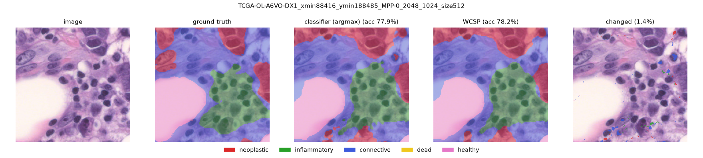
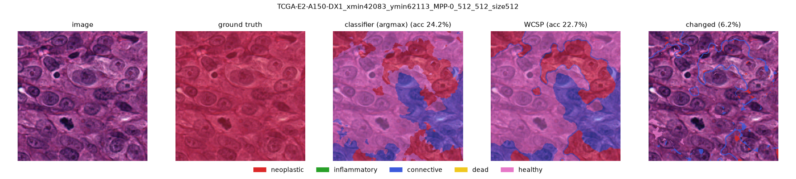

# Deliverable 5 — PanNuke Full-Patch WCSP

This deliverable runs the WCSP end to end on one complete, real HoVer-Net prediction region: **PanNuke Fold 2, `image_00748`**.

```text
PanNuke image
    ↓
HoVer-Net prediction
    ↓
164×164 predicted pixel-label map          (pannuke_aakanksha/)
    ↓
WCSP refinement                            (pannuke_abhishek/run_wcsp.py)
    ↓
refined labels
    ↓
comparison with aligned PanNuke ground truth   (pannuke_abhishek/evaluate.py)
```

Ground truth is used only for evaluation. It is never read by the WCSP solver.

Run from the repository root, in this order:

```bash
conda activate pannuke
python benchmarks/deliverable_5/pannuke_aakanksha/prepare_full_patch.py   # needs the Fold 2 data, see below
python benchmarks/deliverable_5/pannuke_abhishek/run_wcsp.py
python benchmarks/deliverable_5/pannuke_abhishek/evaluate.py
```

The prepared inputs are committed, so the last two steps run without the PanNuke data.

---

## 1. Full-Patch Input Preparation (Aakanksha)

### Source prediction

The input comes from the existing `hovernet_fast-pannuke` inference performed on PanNuke Fold 2.

For `image_00748`, HoVer-Net produced:

- **47 predicted nuclei**
- a **164×164 instance segmentation map**
- predicted nucleus classes stored in the Fold 2 prediction CSV
- centroids used to associate each predicted nucleus with its corresponding instance ID

All 47 predicted nuclei were successfully mapped from the prediction metadata to their instance-map regions.

### Conversion to pixel labels

HoVer-Net's instance map stores a unique integer ID for each detected nucleus. The corresponding nucleus class from the prediction CSV was assigned to every pixel belonging to that instance.

The WCSP label mapping is:

|  ID | Biological class          |
| --: | ------------------------- |
|   0 | Background / inactive     |
|   1 | Neoplastic                |
|   2 | Inflammatory              |
|   3 | Connective                |
|   4 | Dead                      |
|   5 | Non-neoplastic epithelial |

A pixel with label `0` is **not interpreted as healthy tissue**. It means that the pixel is not part of a usable HoVer-Net nucleus prediction and is therefore excluded from the active WCSP variables.

### Alignment with PanNuke ground truth

The original PanNuke patch is **256×256**, while the saved fast HoVer-Net prediction corresponds to the central **164×164** region:

```text
x = 46 ... 209
y = 46 ... 209
```

The corresponding PanNuke ground-truth mask was cropped to exactly this same 164×164 region before evaluation.

### Diagnostics

| Quantity                                          |  Value |
| ------------------------------------------------- | -----: |
| Predicted nuclei                                  |     47 |
| Active HoVer-Net pixels                           | 10,726 |
| Inactive/background pixels                        | 16,170 |
| Ground-truth nucleus pixels                       |  9,250 |
| Prediction/GT overlapping nucleus pixels          |  8,229 |
| Predicted nucleus pixels where GT is background   |  2,497 |
| GT nucleus pixels missed by predicted active mask |  1,021 |
| Class agreement on overlapping nucleus pixels     | 0.7737 |

The **0.7737 class agreement is not overall pixel accuracy**. It is the fraction of overlapping nucleus pixels where both HoVer-Net and PanNuke assign a nucleus and their biological class labels agree.

The 1,021 ground-truth nucleus pixels that fall outside the HoVer-Net active mask represent an important upstream limitation: these pixels do not become WCSP variables and therefore cannot be recovered through label refinement alone.

### Files in `pannuke_aakanksha/`

| File | Contents |
| --- | --- |
| `hovernet_labels_164.npy` | (164, 164) main WCSP input. Active pixels carry labels 1–5, inactive pixels are 0. |
| `active_mask_164.npy` | (164, 164) bool. `active_mask[y, x] == True` means the pixel is a WCSP variable (10,726 pixels). |
| `hovernet_instance_map_164.npy` | Original HoVer-Net instance map; each positive integer is one nucleus. Kept for nucleus-level analysis. |
| `pannuke_gt_labels_164.npy` | Aligned PanNuke ground-truth class labels. **Evaluation only.** |
| `pannuke_d5_patch_package.npz` | Bundle of `predicted_labels`, `active_mask`, `ground_truth_labels`, `instance_map`. |
| `metadata.json` | Dataset/image ID, coordinates, label dictionary, active/background policy, counts, overlap statistics, source paths. |
| `prepare_full_patch.py` | Reproduces the files above from the saved HoVer-Net instance map + prediction CSV and the Fold 2 `masks.npy`. |

```python
import numpy as np

data = np.load("benchmarks/deliverable_5/pannuke_aakanksha/pannuke_d5_patch_package.npz")

initial_labels = data["predicted_labels"]
active_mask = data["active_mask"]
ground_truth = data["ground_truth_labels"]   # ignore during optimization
instance_map = data["instance_map"]
```

---

## 2. WCSP Run (Abhishek, Kashvi's original task)

`run_wcsp.py` only reads `hovernet_labels_164.npy` and `active_mask_164.npy`.

Same setup as D4 so the results are comparable:

- Variables: the 10,726 active pixels, each with domain {1, ..., 5}. Inactive pixels stay 0.
- Unary: λ if a pixel changes from its HoVer-Net label, 0 if it keeps it.
- Pairwise: the handout cost table divided by distance, over all five neighbor types (up to 2√2 away). Pairs touching an inactive pixel are left out. That gives 111,755 unique edges.
- Solver: the shared `wcsp/` block scheme with ICM inside each block. The default 100x100 blocks don't fit a 164x164 image, so it uses 60x60 corners and a 44 px cross. No assignments are enumerated.

| Run | λ | Initial objective | Returned objective | Changed pixels | Rounds | Runtime |
| --- | ---: | ---: | ---: | ---: | ---: | ---: |
| Unary-only | 1 | 0.00 | 0.00 | 0 | 1 | 1.8 s |
| Strong fidelity | 139 | 772.81 | 772.81 | 0 | 1 | 1.8 s |
| Weaker fidelity | 1 | 772.81 | 723.15 | 13 | 2 | 3.4 s |

Why λ = 139 is strong enough: a pixel has at most 24 neighbors, and the sum of 1/d over them is 13.82. The biggest table cost is 10, so changing one pixel can save at most 138.2 in pairwise cost. Changing any k pixels saves at most 138.2k but costs λk, so with λ > 138.2 no change can lower the objective. This bound is actually reached on this mask, since some pixels have all 24 neighbors active. The run also confirms it empirically: 0 changes.

ICM is greedy, so the results are local optima, not proven global ones. For every run, no single pixel can lower the objective by changing its label, and solving the whole image as one block gives the same weak result (723.1453).

---

## 3. Ground-Truth Evaluation (Abhishek)

`evaluate.py` is the only script that opens `pannuke_gt_labels_164.npy`, and it runs after the WCSP labels are saved.

The ground truth for this patch only has one class: all 9,250 nucleus pixels are Inflammatory. I checked this against the raw `masks.npy` channels, so it is not an alignment bug.

Strong fidelity output is identical to HoVer-Net on every pixel.

The 13 pixels changed in the weaker fidelity run:

| Change | Pixels | What changed |
| --- | ---: | --- |
| Wrong → correct | 0 | |
| Correct → wrong | 6 | Inflammatory → Connective |
| Wrong → different wrong | 0 | |
| Ground truth is background | 7 | 5 Connective → Inflammatory, 2 Inflammatory → Connective |

Before and after:

| Metric | HoVer-Net | WCSP (λ = 1) | Difference |
| --- | ---: | ---: | ---: |
| Class agreement on overlap (8,229 px) | 0.7737 | 0.7730 | −0.0007 |
| Accuracy on HoVer-Net active region | 0.5936 | 0.5930 | −0.0006 |
| Accuracy on ground-truth nucleus region | 0.6883 | 0.6877 | −0.0006 |
| Pixel accuracy, full patch | 0.8000 | 0.7997 | −0.0002 |
| Inflammatory IoU | 0.6399 | 0.6391 | −0.0008 |

Error breakdown:

| Error | Pixels | Can the WCSP fix it? |
| --- | ---: | --- |
| Detection: ground-truth nucleus missed by HoVer-Net | 1,021 | No, never a variable |
| Detection: HoVer-Net nucleus where ground truth is background | 2,497 | No, the WCSP can't relabel to background |
| Classification: wrong class on overlap, HoVer-Net | 1,862 | Yes |
| Classification: wrong class on overlap, after WCSP | 1,868 | |

What we see:

- The pipeline works end to end on a real full prediction: HoVer-Net → WCSP → ground-truth comparison.
- Strong fidelity reproduces HoVer-Net exactly, as expected.
- At λ = 1 the WCSP lowers the objective but makes accuracy slightly worse. It made 0 corrections and 6 new errors. A lower objective only means the labels fit the cost table better, not that they are more correct.
- Almost all of HoVer-Net's class errors are whole nuclei labeled Connective (3,231 px) when they are Inflammatory. The WCSP can't fix a whole wrong nucleus because every pixel inside it agrees with its neighbors, so it only moves pixels on the edges where two nuclei touch.
- Same thing we saw on BCSS: the pairwise terms only reach 2 pixels, so they only change boundaries.
- This is one patch with one ground-truth class, so it doesn't say much about PanNuke in general. The next step is running more patches. Making the decision per nucleus (using the instance map) instead of per pixel would also probably fit PanNuke better.

How it was evaluated:

- Overlap = pixels that are nucleus in both HoVer-Net and the ground truth. This is the same 0.7737 class agreement from Section 1, so the evaluation matches the preparation.
- Active region accuracy counts ground-truth background as wrong. Ground-truth nucleus accuracy counts missed pixels as wrong.
- IoU is only reported for Inflammatory since it is the only class in the ground truth. The other predicted classes have IoU 0 both before and after, and Dead is never predicted.
- λ = 1 was taken from D4 and not tuned on this patch, since tuning it here would use the ground truth.

### Files in `pannuke_abhishek/`

| File | Contents |
| --- | --- |
| `run_wcsp.py`, `results.json` | WCSP runs, settings, objectives, energy trace per round |
| `wcsp_strong_labels.npy`, `wcsp_weak_labels.npy` | Returned 164x164 label maps (0 = inactive) |
| `evaluate.py`, `evaluation.json` | All metrics above plus confusion matrices |

---

## Next Steps

The goal of this stage was to show a working end-to-end pipeline on one real full prediction region, not yet to show the WCSP improves HoVer-Net across PanNuke. Next is scaling the same experiment to multiple patches and checking whether the biological constraints consistently improve held-out performance rather than just smoothing individual examples.

---

# BCSS: Pixel-Level WCSP on a U-Net (Urvi)

Separate from the PanNuke work above. Code: [`wcsp/`](../../wcsp/) (BCSS only), configs in `configs/`, SLURM scripts in `slurm/`.

## Setup

- **Data:** BCSS breast-cancer tiles, 512 × 512 px. 5 classes: tumor, stroma, inflammatory, necrosis, other.
- **Classifier:** the pretrained TIAToolbox U-Net (`fcn_resnet50_unet-bcss`), used as is: no training, no calibration.
  - It sees the full 512 px tile and predicts at half resolution. We upsample ×2 and keep the **central 256 × 256**.
  - The outer ring is context only. Everything below (U-Net, WCSP, scoring) uses the central 256 × 256.
- **Splits:**
  - **dev:** every 8th training region. Used only to choose λ, the b table and β.
  - **val:** held-out hospitals. Used only for the final numbers.
  - Tiles with no labeled pixels in the crop are skipped.
- **Metrics:**
  - **Pixel accuracy:** share of labeled pixels with the right class.
  - **mIoU:** per-class overlap (IoU), averaged over the 5 classes, so small classes count as much as big ones.
  - **95% CI** on the WCSP − U-Net difference, from resampling whole tissue regions (bootstrap).

## How the WCSP works

The WCSP takes the U-Net's per-pixel probabilities and looks for a labeling of the whole tile that agrees with the U-Net *and* follows tissue-adjacency rules.

- **Variables:** every pixel of the 256 × 256 crop (65,536). **Domain:** the 5 classes.
- **Total cost** = Σ unary + λ · Σ pairwise. The solver looks for the labeling with the lowest total.
- **Unary (trust the U-Net):** −log p(label).
  - p = 0.9 → 0.1; p = 0.5 → 0.7; p = 0.01 → 4.6.
  - Labels the U-Net likes are cheap.
- **Pairwise (the biology rules):** for every pixel pair up to 2√2 px apart (24 neighbors), the cost is b[label₁, label₂] / distance.
  - Same label costs 0.
  - Weights are normalized so a pixel's 24 neighbors sum to 1.
- **λ:** how much the rules count relative to the U-Net. λ = 0 gives back the U-Net exactly.
- **Optional image term f** (my addition, not in the original notes): extra cost for a label change between similar-looking pixels, so boundaries snap to color edges. Strength β; off unless stated.
- **Solver:** the notes' block scheme with greedy ICM inside each block. toulbar2 solves the same problem as a comparison.
  - Block scheme: fix the 56 px cross and solve the four 100 × 100 corners, then fix the corners and solve the cross; repeat.
  - ICM: switch each pixel to its cheapest label given its neighbors until nothing changes.

**Intuition: when do the rules win?**
- A pixel's label changes only if the rule savings beat the U-Net's cost difference.
- At λ = 4, an edge pixel with half its neighbors disagreeing gets about 2–4 of rule pressure.
- That only beats the U-Net where it is unsure (top label p ≲ 0.5). So the WCSP mostly cleans up **edges and specks**, and only ~1% of pixels change.
- It cannot fix a whole region the U-Net is confidently wrong about.

## The b table: handwritten vs. data-derived

Each cell is **handwritten / data-derived** (symmetric, so only the upper triangle is shown; diagonal = 0).

| | Tumor | Inflam. | Stroma | Necrosis | Other |
|---|---|---|---|---|---|
| **Tumor** | 0 | 2 / 5.2 | 1 / 3.0 | 1 / 4.1 | 9 / 4.5 |
| **Inflam.** | | 0 | 2 / 2.2 | 1 / 6.9 | 8 / 3.2 |
| **Stroma** | | | 0 | 5 / 3.6 | 1 / 2.3 |
| **Necrosis** | | | | 0 | 10 / 4.9 |
| **Other** | | | | | 0 |

- **Handwritten:** from the project notes; the "Other" row is the notes' *healthy* class.
- **Data-derived:** from how often each pair of classes touches in the training ground truth, using pointwise mutual information:
  - cost = −log( P(a next to b) / (P(a) · P(b)) )
  - Dividing by P(a)·P(b) means a rare class like necrosis is not penalized just for being rare. A pair is only expensive if it touches *less than its frequency predicts*.
  - +1 smoothing; negative values are set to 0; rescaled to the handwritten table's mean (4.0) so λ means the same for both.
- **How they differ:**
  - The notes punish anything next to healthy (8–10). In BCSS, "other" is fat, vessels and similar tissue, which touches everything, so the data gives only 2.3–4.9.
  - Inflammatory next to necrosis is the rarest pair in the data (6.9) but costs 1 in the notes.
  - The handwritten table breaks the triangle inequality: tumor → stroma → other costs 1 + 1 = 2 < 9. So the cheapest fix is often a **fake 1-px stroma strip** between tumor and other (see the "hurts" figure below). The data-derived table is flatter and almost removes this incentive (3.0 + 2.3 vs. 4.5).

## Results

### 1. Choosing settings on dev (185 labeled tiles, ICM)

U-Net alone: pixel acc **0.8555**, mIoU **0.7067**.

| b table | λ | Pixel acc | mIoU | Δ mIoU [95% CI] | Pixels changed |
|---|---:|---:|---:|---|---:|
| Handwritten | 0.5 | 0.8560 | 0.7082 | +0.0015 [+0.0007, +0.0020] | 0.45% |
| Handwritten | 1 | 0.8561 | 0.7086 | +0.0019 [+0.0009, +0.0026] | 0.60% |
| Handwritten | 2 | 0.8563 | 0.7094 | +0.0027 [+0.0014, +0.0035] | 0.75% |
| Handwritten | 4 | 0.8562 | 0.7096 | +0.0029 [+0.0013, +0.0038] | 0.87% |
| Handwritten | 8 | 0.8562 | **0.7097** | **+0.0030** [+0.0013, +0.0040] | 0.94% |
| Data-derived | 0.5 | 0.8562 | 0.7082 | +0.0015 [+0.0008, +0.0021] | 0.52% |
| Data-derived | 1 | 0.8563 | 0.7085 | +0.0018 [+0.0008, +0.0027] | 0.65% |
| Data-derived | 2 | 0.8564 | 0.7089 | +0.0022 [+0.0011, +0.0032] | 0.73% |
| Data-derived | 4 | **0.8565** | 0.7090 | +0.0023 [+0.0012, +0.0033] | 0.76% |
| Data-derived | 8 | 0.8564 | 0.7090 | +0.0023 [+0.0012, +0.0033] | 0.76% |

- **Every setting helps a little**, and every interval stays above 0.
- **Gains level off from λ ≈ 2.** λ = 16 and 32 are running to confirm.
- **Handwritten is slightly ahead on mIoU, data-derived slightly ahead on pixel accuracy.** The difference is far smaller than the intervals, so the two tables are effectively tied.

### 2. Adding the image term f (dev, handwritten b)

| λ | β | Pixel acc | mIoU | Δ mIoU [95% CI] |
|---:|---:|---:|---:|---|
| 4 | 0 (no f) | 0.8562 | 0.7096 | +0.0029 [+0.0013, +0.0038] |
| 4 | 1 | 0.8562 | 0.7095 | +0.0027 [+0.0012, +0.0036] |
| 4 | 2 | 0.8560 | 0.7089 | +0.0022 [+0.0007, +0.0031] |
| 4 | 4 | 0.8560 | 0.7085 | +0.0018 [+0.0006, +0.0026] |
| 8 | 1, 2, 4 | *running* | | |

- **f does not help; it hurts slightly as β grows.**
- Likely reason: H&E color edges are mostly nucleus vs. background *inside* one tissue type, not tissue boundaries. So f protects the wrong edges.

### 3. Full val: λ sweep, both tables (ICM)

All 2,124 labeled val tiles from held-out hospitals. The U-Net-alone mIoU matches the repo's earlier U-Net benchmark (0.649).

| b table | λ | Pixel acc | mIoU | Δ mIoU [95% CI] | Pixels changed | s/tile |
|---|---:|---:|---:|---|---:|---:|
| U-Net alone | — | 0.8414 | 0.6489 | — | — | — |
| Handwritten | 0.5 | 0.8418 | 0.6499 | +0.0011 [+0.0006, +0.0014] | 0.52% | 9 |
| Handwritten | 1 | 0.8418 | 0.6503 | +0.0014 [+0.0008, +0.0019] | 0.67% | 7 |
| Handwritten | 2 | 0.8419 | 0.6505 | +0.0017 [+0.0010, +0.0023] | 0.82% | 14 |
| Handwritten | 4 | 0.8419 | 0.6507 | +0.0018 [+0.0010, +0.0026] | 0.93% | 12 |
| Handwritten | 8 | 0.8419 | **0.6507** | **+0.0019** [+0.0010, +0.0027] | 0.98% | 11 |
| Data-derived | 0.5–8 | *running* | | | | |

- **Same pattern as dev:** every λ helps, gains level off from λ ≈ 2, and every interval is above zero.
- **Smaller gain on val** (+0.0019 vs. +0.0030 on dev), but the U-Net is also weaker on these unseen hospitals.
- **Pixel accuracy barely moves** (+0.05 pp). The gain is mostly in mIoU, i.e. in the smaller classes' edges.

### 4. ICM vs. toulbar2 (full val, same problem)

*Running.* Same costs, different search: ICM is greedy and fast; toulbar2 searches each block properly, up to 20 s per block.

### Example tiles (val, handwritten b, λ = 4)

Panels: image | ground truth | U-Net | WCSP | changed pixels, with colors overlaid on the tissue.

- **Mixed tile (4 classes):** U-Net 77.9% → WCSP 78.2%. Ragged edges are smoothed and stray specks removed.
  
- **Helps:** U-Net 65.2% → WCSP 66.4%.
  
- **Hurts:** U-Net 24.2% → WCSP 22.7%.
  - The U-Net calls most of this tumor "healthy", and the WCSP can't fix that.
  - The WCSP also draws 1-px stroma strips along tumor/other edges (the triangle-inequality issue above).
  

## Takeaways so far

- **The WCSP helps, but only slightly:** +0.002–0.003 mIoU (≈ +0.4% relative) and +0.05–0.1 pp pixel accuracy. The gains are consistent, with every interval above zero.
- **Why it's small:**
  - The rules reach at most 2√2 px, so the WCSP only edits boundaries.
  - The U-Net's mistakes are mostly whole regions it is confident about.
- **The handwritten and data-derived tables perform about the same.**
  - The data table is better grounded: it fits BCSS's "other" class and avoids the fake-strip artifact.
  - The handwritten table encodes the notes' biology.
- **The image term f doesn't help.**
- **Next:**
  - learn b directly on dev, for accuracy rather than co-occurrence;
  - add longer-range or region-level variables (superpixels, whole regions) so the rules can fix whole regions, not just edges.
