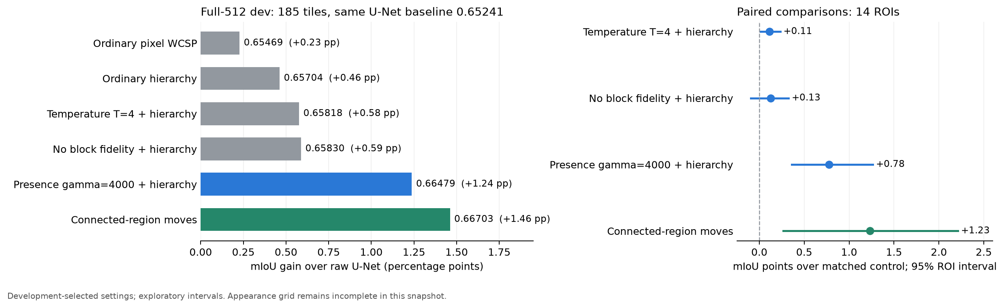
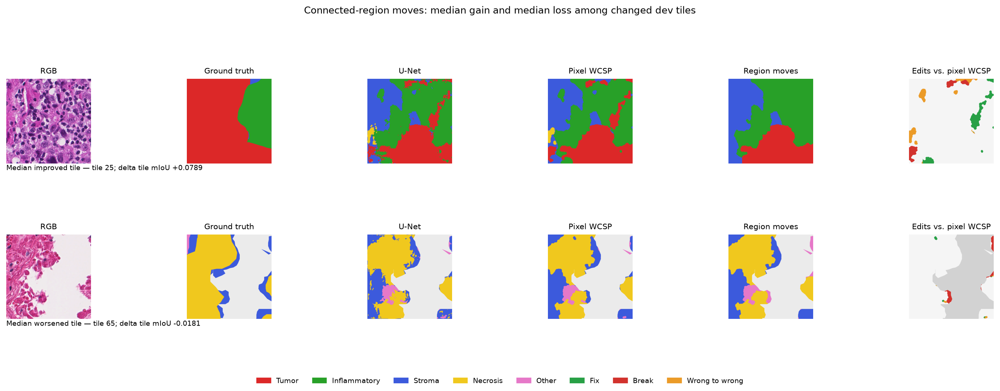
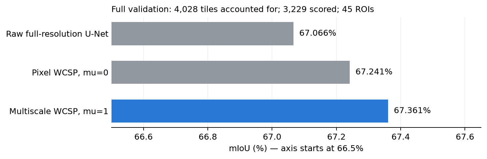

# BCSS full-resolution corrections · details

[← Back to Deliverable 7](deliverable_7.md)

**Current finding:** connected-region moves and tile-level class context give
the strongest completed development results. These new choices have **not**
yet been evaluated on the full validation set.

### Data and comparison protocol

- Official upstream BCSS preparation v2: **151 ROIs**, 0.25 MPP, nonoverlapping
  **512×512** tiles; **7,768 fit / 1,012 dev / 4,028 validation** tiles.
- The full-resolution head and backbone were already trained. Every correction
  arm reuses the **same frozen checkpoint and probability maps** and scores the
  entire 512×512 field. No central crop or new U-Net training is used here.
- Correction selection uses **185 frozen dev tiles from 14 ROIs**, a fixed
  subset of the 1,012 dev tiles. The U-Net baseline on this subset is
  **0.652414 mIoU**. Do not compare it directly with the recap's 0.7067.
- Priors and the independent appearance model use the **fit split only**.
  Aggregate accuracy is reported only after all 185 tiles of an arm finish.
  Paired intervals resample whole ROIs (2,000 replicates, seed 0).
- Snapshot: **34/40 correction configurations complete**, 6,323/7,400 tile
  solves, November 23 at 15:16 PST. The remaining appearance configurations
  are still running. The earlier expanded sweep finished all 3,145 solves.

The earlier 0.6610 presence pilot used the existing prior and an
area-scaled fixed gamma. The following sweep refits a full-field fit prior,
varies gamma on dev, and uses audited convergence with matched controls.

### What the new methods change

| Family | Change | Configurations |
|---|---|---:|
| Temperature | Soften U-Net probabilities before constructing costs; makes class changes cheaper | T={1,1.5,2,3,4}, mu={0,1}: **10** |
| Block fidelity | Reduce the coarse blocks' own pooled U-Net costs; retain their neighbor and parent–child links | block_alpha={0,0.25,0.5}, mu=1: **3**; alpha=1 control shared |
| Class presence | Choose an allowed class set using fit-split co-occurrence costs plus pixel evidence, then spatially optimize | gamma={40,120,400,1200,4000,12000}, mu={0,1}: **12** |
| Region moves | Propose changing a connected same-label region or an image-derived SLIC segment together | Two region types, mu={0,1}: **4** |
| Image-aware boundaries | Add disagreement costs between pixels with similar HED stain features | beta={1,4}, mu={0,1}: **4** |
| Independent regional evidence | Blend U-Net costs with a fit-only HED/texture classifier pooled within SLIC segments | weights={0.1,0.3,1}, mu={0,1}: **6**, plus **1** appearance-only control |

All 40 arms use lambda=8; mu=0 disables parent–child coupling and mu=1
enables it. Temperature and appearance also change the evidence reconstructed
for coarse blocks. Block-alpha isolates their direct fidelity weight.

**Region moves:** first reach an ordinary single-variable local minimum.
Then test up to two passes over the 32 largest eligible regions (at least
64 pixels). Try each tissue label for the entire region, alone or together
with coarse blocks at least half covered by it. Accept a proposal only when
the **exact full objective decreases**, then resume pixel/coarse descent.
The final assignment is audited for single-variable stationarity; the bounded
proposal search does not establish a global or region-wise optimum. This is
different from the recap's SLIC cluster solver: the strongest new result uses
**connected components of the current labels**, not SLIC.

**Presence:** the full-field prior uses 6,888 fit tiles with at least 1,000
labeled pixels; a class is present when it occupies at least 1% of labeled
area. All 31 nonempty class sets are considered with add-one smoothing.
Selection is a two-stage approximation: choose an allowed set from unary
evidence and the prior, then impose a finite 1,000 exclusion cost on other
labels. Every result checks that excluded labels do not survive. This does
not jointly optimize class-set selection with the spatial energy.

**Appearance:** a diagonal Gaussian classifier uses HED channels, local
means and local standard deviations. Of 288 fit tiles, 256 fit its parameters
and 32 calibrate its temperature. Development RGB and annotations must align
exactly with the frozen inputs; dev annotations score results but do not
construct regions or appearance evidence. This is an independent shallow
appearance model, not another U-Net training arm.

### Completed development results

| Method | mIoU | Change vs. U-Net |
|---|---:|---:|
| Raw full-resolution U-Net | 0.652414 | — |
| Ordinary pixel WCSP, mu=0 | 0.654691 | +0.002276 |
| Ordinary hierarchy, mu=1 | 0.657038 | +0.004624 |
| Best expanded lambda/mu grid: lambda=16, mu=2 | 0.657713 | +0.005299 |
| Temperature T=4 + hierarchy | 0.658183 | +0.005768 |
| No block fidelity + hierarchy | 0.658301 | +0.005886 |
| **Presence gamma=4000 + hierarchy** | **0.664791** | **+0.012376** |
| **Connected-region moves, mu=0** | **0.667026** | **+0.014611** |
| HED boundary beta=1 + hierarchy | 0.656998 | +0.004584 |
| Appearance weight=0.1, mu=0; family incomplete | 0.655015 | +0.002600 |

| Comparison | Change in mIoU | 95% paired ROI interval |
|---|---:|---:|
| Region moves minus ordinary pixel WCSP | +0.012335 | [+0.002673, +0.022119] |
| Presence + hierarchy minus ordinary hierarchy | +0.007752 | [+0.003623, +0.012651] |
| T=4 minus T=1, both with hierarchy | +0.001144 | [+0.000158, +0.002339] |
| No block fidelity minus ordinary block fidelity | +0.001262 | [−0.000969, +0.003266] |

These are **development-selected, exploratory intervals**, without correction
for selecting settings across the sweep. Removing block fidelity improves
the point estimate but its interval includes zero. HED boundary terms did
not consistently improve the hierarchy. The appearance grid is incomplete.

The convergence experiment adds a small gain: mu=1 reaches **0.657038** at
convergence versus **0.656822** after four outer rounds. More iterations
alone do not explain the larger region-move or presence gains.

### Corrections, failures and region interiors

- Region moves fix **601,023** previously wrong pixels and break **404,681**
  previously correct pixels, relative to the raw U-Net. The matched pixel
  control fixes 154,373 and breaks 112,729. A separate energy audit found
  lower pixel energy on 154 tiles, ties on 31, and no increases; 780 region
  proposals were accepted across the cohort. See the
  [per-tile energy audit](../experiments/bcss_wcsp/results/full512_20261123/region_energy_audit.json).
- Presence + hierarchy fixes **425,280** and breaks **231,814** pixels versus
  the raw U-Net. More than 10 pixels from a raw prediction boundary, it fixes
  **34,715** and breaks **3,170** pixels. The ordinary hierarchy fixes 15 and
  breaks 11 in those interiors.
- Region moves also change interiors, but their interior fixes and breaks
  are close (76,898 versus 76,175). Their benefit cannot be summarized as
  uniformly fixing large regions. Report per-class IoU and both fixes and
  breaks alongside pooled mIoU; energy reduction alone is not correctness.

Examples are the median positive and median negative **per-tile mIoU change
against the matched pixel control**, selected after inspecting dev outcomes.
They illustrate behavior, not independent evidence. The edit map is relative
to that pixel control: green=fix, red=break, orange=wrong-to-wrong. Ignored
annotation pixels are gray. Exact IDs and selection counts are in
[region_examples.json](../experiments/bcss_wcsp/results/full512_20261123/region_examples.json).

### Established full-validation result

The earlier frozen validation protocol accounts for **all 4,028 tiles from
45 held-out ROIs**, scoring 3,229 with labeled pixels and excluding 799 wholly
ignored tiles. It uses the trained full-512 checkpoint, lambda=8, T=1 and the
dev-selected mu=1 setting with the historical four-round limits.

| Full-validation method | mIoU |
|---|---:|
| Raw full-resolution U-Net | 0.670665 |
| Pixel WCSP, mu=0 | 0.672414 |
| **Multiscale WCSP, mu=1** | **0.673607** |
| New presence / region-move candidates | Not evaluated on full validation yet |

The established improvement over the U-Net is **+0.002942 mIoU**, with
95% ROI interval **[+0.002218, +0.003615]**. The 0.667026 new dev score and
0.673607 validation score describe different populations and must not be
ranked against one another.

**Next:** finish the appearance grid, freeze the final development choices,
and evaluate the region-move and presence candidates with their matched
controls on the full validation set. Do not select settings using those
validation outcomes.

Portable evidence: [correction snapshot](../experiments/bcss_wcsp/results/full512_20261123/corrections_dev.json),
[completed expanded sweep](../experiments/bcss_wcsp/results/full512_20261123/expanded_dev.json),
[validation summary](../experiments/bcss_wcsp/results/full512_20261123/validation.json),
and [frozen provenance](../experiments/bcss_wcsp/results/full512_20261123/provenance.json).
Raw images, probability caches and per-tile predictions remain local.
Rebuild the charts with `python deliverables/figures_20261123/make_full512_figures.py`;
the qualitative figure additionally needs `--cache-root` pointing to the
original experiment checkout. The frozen experiment source hashes predate
the upstream solver updates; existing output roots must retain those sources.
Sync this section and its figures into the GitHub Pages version with
`python deliverables/figures_20261123/sync_full512_pages.py` (requires mistune).

The training-loss arms in the preceding BCSS section use the original
central-256 architecture/field, separately from this full-512 post-processing
protocol (`experiments/bcss_wcsp/slurm/train_loss_arms.sbatch`).
<!-- END FULL512 BCSS -->
