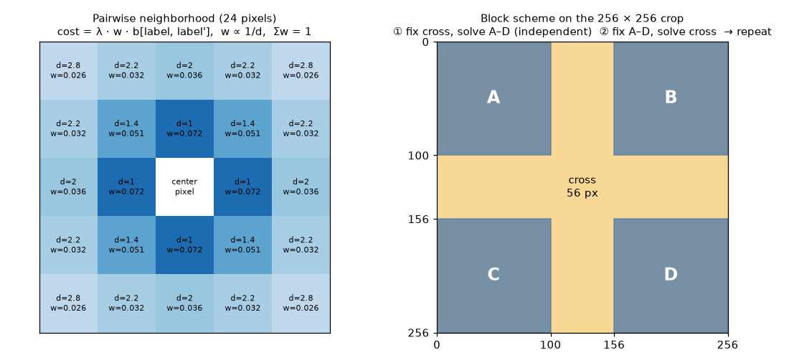
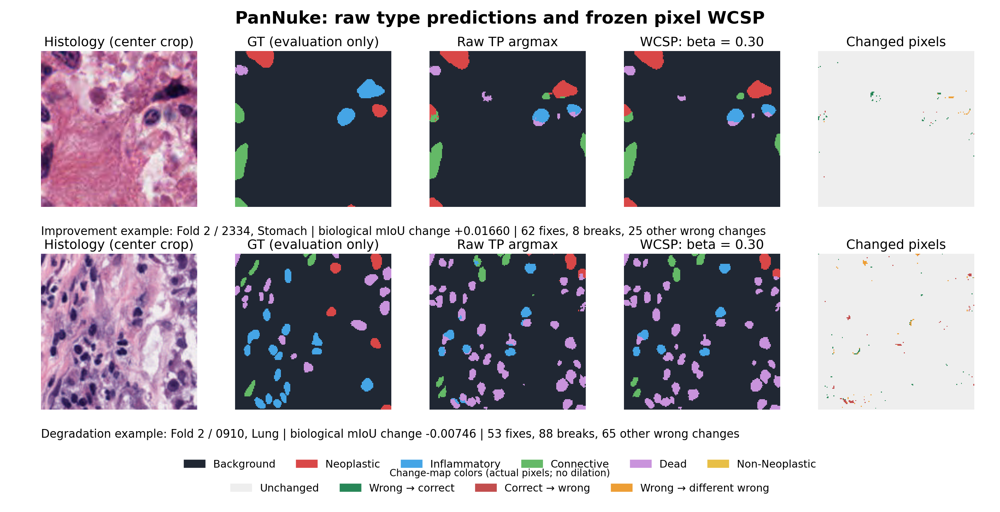
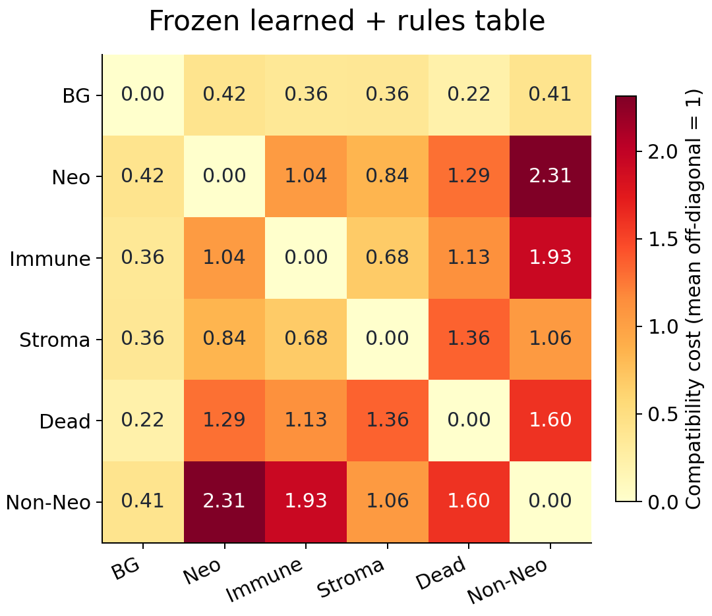
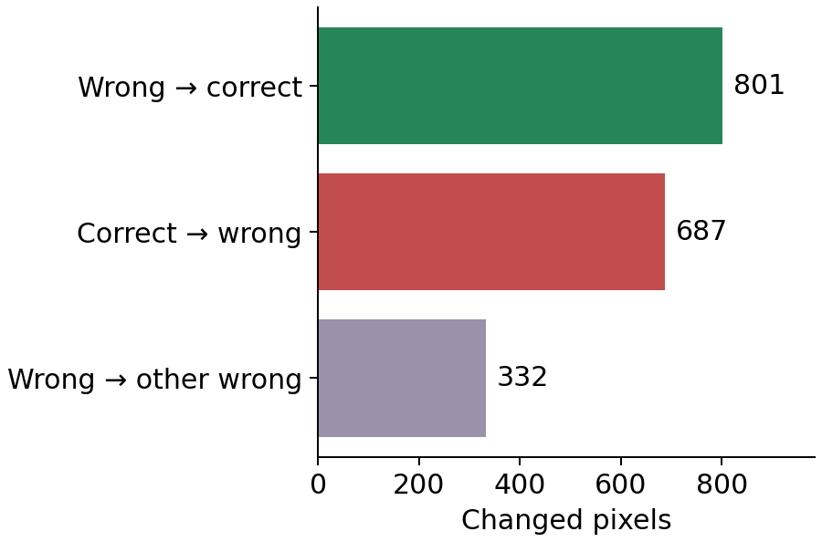
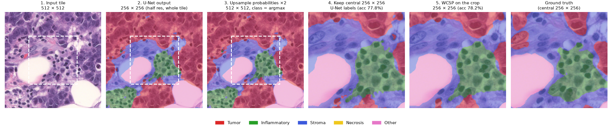
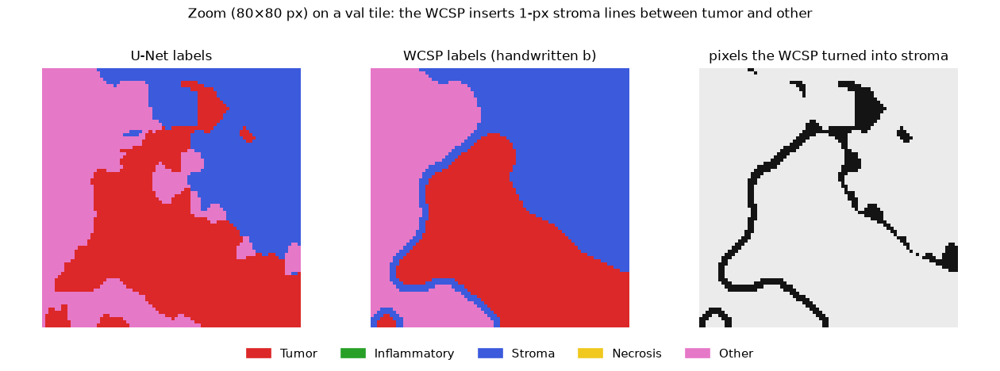
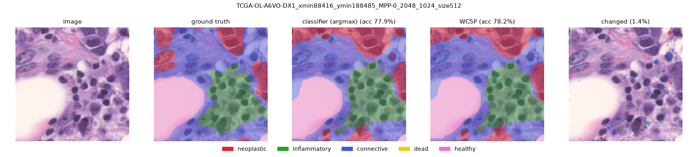
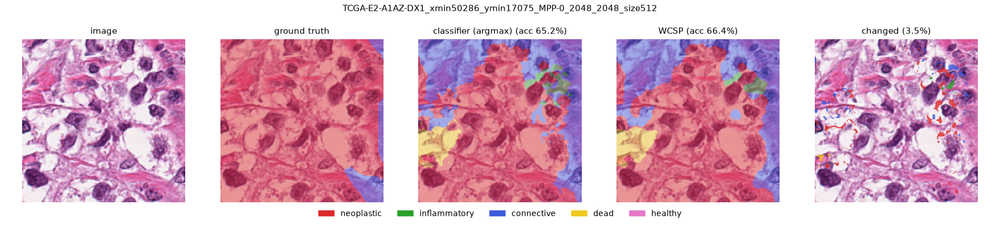
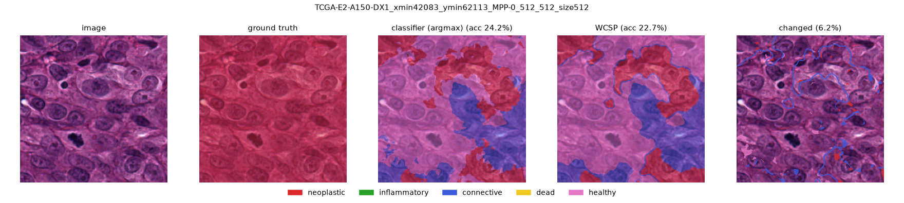

# Deliverable 5 — WCSP Refinement of Classifier Predictions (PanNuke + BCSS)

- **Goal:** refine pretrained segmentation predictions with a weighted constraint satisfaction problem (WCSP).
- **Costs:** retain classifier probabilities while expressing preferences about neighboring labels.

| | **PanNuke: current experiment** | **BCSS** |
|---|---|---|
| Classifier | Pretrained HoVer-Net fast PanNuke; raw TP/type probabilities | TIAToolbox U-Net; tissue probabilities |
| WCSP variables | All 26,896 pixels on the 164 × 164 output grid | All pixels in the central 256 × 256 output grid |
| Labels | Background + five biological classes | Tumor, inflammatory, stroma, necrosis, other |
| Compatibility table | Learned from 200 training GT patches, blended with a fixed biological prior | Handwritten or learned from training labels |
| Code | [`pannuke_pixel_learned_costs/`](../experiments/pannuke_wcsp/pannuke_d5/) | [`bcss_wcsp/`](../experiments/bcss_wcsp/) |

**Main findings:**

- **PanNuke:** no reliable improvement at fixed β = 0.30. Pooled biological mIoU decreases **0.37687 → 0.37521**; the paired 95% interval includes zero.
- **BCSS:** a small gain, mIoU **0.6489 → 0.6507** (+0.0019, 95% CI [+0.0010, +0.0027]) on 2,124 validation tiles.

---

## 1. The WCSP (shared idea)

- **Objective:** unary costs for unlikely labels + pairwise costs for discouraged neighboring labels.
- **Unaries:** −log classifier probability in both current pipelines.
- **Graph:** 24 neighbors at squared distances 1, 2, 4, 5 and 8; pairwise costs decrease as 1/distance; each undirected edge is counted once.

| Setting | PanNuke: current experiment | BCSS |
|---|---|---|
| Pairwise weight | β = 0.30, fixed before testing | λ chosen on development data; 8 reported |
| Solver | Deterministic raster-order ICM over the full grid | Alternating corner/cross blocks with ICM; time-limited toulbar2 also compared |
| Stopping | No changes in a complete round; maximum 100 rounds | Up to four block rounds; toulbar2 limited to 20 s/block |

- **ICM:** accepts energy-decreasing changes and finds a local solution; lower energy does not guarantee better accuracy or global optimality.
- **Notation:** the BCSS image-term β in §3 is separate from the PanNuke pairwise weight β.

<b>BCSS compatibility costs and block diagram</b>

- **Diagram:** BCSS block updates; PanNuke uses six labels and full-grid raster updates.

- **BCSS table:** handwritten / data-derived costs; symmetric, with zero diagonal.

| | Tumor | Inflammatory | Stroma | Necrosis | Other |
|---|---|---|---|---|---|
| **Tumor** | 0 | 2 / 5.2 | 1 / 3.0 | 1 / 4.1 | 9 / 4.5 |
| **Inflammatory** | | 0 | 2 / 2.2 | 1 / 6.9 | 8 / 3.2 |
| **Stroma** | | | 0 | 5 / 3.6 | 1 / 2.3 |
| **Necrosis** | | | | 0 | 10 / 4.9 |
| **Other** | | | | | 0 |

---

## 2. PanNuke — learned pixel costs at fixed β = 0.30

### Pipeline and method

- **Panels:** histology → GT → raw TP argmax → WCSP → changed pixels, all on the same 164 × 164 grid. GT is used only for scoring.
- **Change colors:** green = fixes; red = new errors; orange = changes between wrong labels.
- **Examples:** largest improvement, patch 2334 (Stomach), and largest degradation, patch 0910 (Lung). These illustrate extremes, not representative averages.
- **Question:** can learned neighbor costs and four biological preferences improve raw HoVer-Net type predictions?
- **Baseline:** pretrained `hovernet_fast-pannuke` raw TP logits → six-channel softmax → pixelwise argmax.
- **Variables:** all 26,896 output pixels, each with six metadata-verified labels: Background, Neoplastic, Inflammatory, Connective, Dead and Non-Neoplastic Epithelial. No NP confidence, HV, instances or nucleus voting.
- **Unary:** −log(max(probability, 10⁻¹²)), minus the minimum at each pixel.
- **Pairwise:** 0.30 × C[label, neighbor label] / distance, using all 24 neighbors.
- **Learned table:** training-GT adjacency relative to class prevalence; smoothing = 1; **80% learned costs + 20% fixed prior**; zero diagonal; final mean off-diagonal cost = 1.
- **Four soft biological preferences:**
  - Prefer same-type neighbors.
  - Discourage Dead–Non-Neoplastic contact more than Dead–Tumor/Immune contact.
  - Discourage Immune–Non-Neoplastic contact.
  - Favor Connective contact with Tumor/Non-Neoplastic over direct Tumor–Non-Neoplastic contact.

<b>Learned compatibility table</b>

### Evaluation design

- **Split:** 200 training patches / 18 tissues; 20 disjoint test patches / all 19 Fold 2 tissues.
- **Selection:** tissue/GT metadata only; 266 identifiable prior-use IDs excluded; no test replacements based on predictions.
- **Alignment:** central `[46:210, 46:210]` GT crop matches the 164 × 164 predictions; highest biological class ID wins overlapping annotations.
- **Metrics:** pool confusion counts before IoU; biological mIoU always averages classes 1–5; six-class mIoU always averages classes 0–5; zero-union IoU = 0; no method-specific class dropping.
- **Uncertainty:** paired patch-bootstrap 95% interval, 5,000 replicates, fixed seed.
- **Comparison:** raw TP argmax versus frozen β = 0.30 WCSP only; **no sweep or test-based tuning**.

### Results

| Pooled metric | Raw TP argmax | Learned + rules WCSP |
|---|---:|---:|
| **Biological five-class mIoU** | **0.376874** | **0.375209** |
| Six-class mIoU | 0.473138 | 0.471753 |
| Pixel accuracy | 0.933362 | 0.933574 |

- **Biological mIoU change:** −0.001666; paired 95% CI **[−0.004971, +0.007969]**.
- **Conclusion:** no reliable improvement; the observed mIoU decreases and the interval includes zero.

| Class | Test GT pixels | Patches containing GT | Raw TP IoU | WCSP IoU |
|---|---:|---:|---:|---:|
| Background | 456,622 | 20/20 | 0.954456 | 0.954476 |
| Neoplastic | 45,575 | 10/20 | 0.631903 | 0.633773 |
| Inflammatory | 4,212 | 8/20 | 0.160374 | 0.153589 |
| Connective | 18,105 | 15/20 | 0.412998 | 0.411050 |
| Dead | 1,301 | 3/20 | 0.155398 | 0.152301 |
| Non-Neoplastic Epithelial | 12,105 | 5/20 | 0.523697 | 0.525330 |

- **Changed pixels:** 1,820 / 537,920.
- **Fixes / new errors / different wrong labels:** 801 / 687 / 332.

### Why the current PanNuke experiment does not show improvement

- **Gains and losses fall on different classes:** 114 net fixes slightly raise accuracy, but Inflammatory, Connective and Dead IoUs fall. Those losses outweigh the other gains under equally weighted biological mIoU.
- **Background dominates:** 84.89% of GT pixels are background; high overall accuracy can hide biological-class errors.
- **Possible scale mismatch:** in training GT, 96.875% of neighbor edges have the same label, 3.118% join background to a biological class, and only **0.007%** join different biological classes ([counts](../experiments/pannuke_wcsp/pannuke_d5/deliverable_diagnostics.json)). The 2.83-pixel neighborhood mostly sees interiors and nucleus boundaries rather than relationships between distinct cells. This is a plausible limitation, not a proven cause.
- **Rare-class evidence is limited:** Dead appears in only two training patches (2,842 pixels) and three test patches (1,301 pixels).
- **Earlier limitations have been addressed:** this version already uses probability unaries and background variables; missing confidence or an inactive background mask cannot explain the current result.

### Validation and limits

- **β = 0:** exactly reproduces raw TP argmax on all 20 test patches.
- **Solver:** non-increasing energy; all 20 solutions independently verified as single-pixel local minima; 2–20 rounds; no 100-round limits reached. No global optimum claimed.
- **Tests:** 13 passed.
- **CPU runtime:** inference 17.04 s; solver plus audits 1.07 s; excludes model setup and explicit warmup/β = 0 checks.
- **Coverage:** no biological class is absent from pooled test GT; the coverage-enriched sample is not prevalence-representative.
- **Leakage uncertainty:** patient/slide IDs unavailable; “held out” means WCSP fitting only; pretrained HoVer-Net exposure to Fold 2 is unknown.
- **Biological limits:** preferences are soft; pairwise costs cannot enforce literal stromal barriers or detect dense immune clusters.

### Experiment records

- **Current:** [setup, frozen settings and manifests](../experiments/pannuke_wcsp/pannuke_d5/README.md); [full evaluation and solver audits](../experiments/pannuke_wcsp/pannuke_d5/RESULTS.md).
- **Earlier work:** [multi-patch refinement](deliverable_5_pannuke_multipatch.md), [one-stage experiments](../experiments/pannuke_d5/README_FULLGRID.md), and [two-stage experiments](../experiments/pannuke_d5/README_TWO_STAGE.md). Different historical baselines and patch-mean metrics are not directly comparable with this pooled raw-TP test.

---

## 3. BCSS

### Pipeline and experiments

1. **Input:** a 512 × 512 tile. **U-Net:** outputs 5 class probabilities per pixel at half resolution (256 × 256), covering the whole tile.
2. **Upsample ×2 to 512 × 512:** each class probability map is upsampled bilinearly, and a pixel's class is the **argmax** of its 5 probabilities. We upsample probabilities, not labels, so the WCSP knows how confident the U-Net is at every pixel.
3. **Keep the central 256 × 256:** the outer ring is context only, since predictions near the edge see less tissue.
4. **WCSP** on all 65,536 crop pixels, giving 256 × 256 refined labels, scored against the ground truth for the same crop.
5. **Splits:** settings are chosen on **dev** (every 8th training region, 185 tiles). Results are reported on **val** (held-out hospitals, 2,124 labeled tiles).
6. **Sweeps, each step answering one question:**
   1. Rule strength λ ∈ {0.5 … 32} × b table (handwritten vs. data-derived), on dev.
   2. Image-edge term f (β = 1, 2, 4), on dev.
   3. Chosen settings on val.
   4. ICM vs. toulbar2 on val.

**Metrics:** pixel accuracy and mIoU (per-class IoU averaged over the 5 classes), with a 95% CI from resampling whole tissue regions.

#### Sweeps and details (click to expand)

<b>How the data-derived b table is computed, and how it differs</b>

#### The b table: handwritten vs. data-derived

Each cell is **handwritten / data-derived**. The table is symmetric, so only the upper triangle is shown; the diagonal is 0.

| | Tumor | Inflam. | Stroma | Necrosis | Other |
|---|---|---|---|---|---|
| **Tumor** | 0 | 2 / 5.2 | 1 / 3.0 | 1 / 4.1 | 9 / 4.5 |
| **Inflam.** | | 0 | 2 / 2.2 | 1 / 6.9 | 8 / 3.2 |
| **Stroma** | | | 0 | 5 / 3.6 | 1 / 2.3 |
| **Necrosis** | | | | 0 | 10 / 4.9 |
| **Other** | | | | | 0 |

- **Handwritten:** the project notes. "Other" is the notes' *healthy*.
- **Data-derived:** how much less often two classes touch in the training ground truth than chance predicts (pointwise mutual information):
  - cost = −log( P(a next to b) / (P(a)·P(b)) ).
  - **Why divide by P(a)·P(b):** so a rare class like necrosis isn't penalized just for being rare.
  - +1 smoothing; negative values are set to 0; rescaled to the handwritten mean (4.0) so λ means the same for both.
- **Key differences:**
  - **Other:** the notes punish anything next to healthy (8–10). BCSS "other" is fat, vessels and similar tissue, which touches everything (data: 2.3–4.9).
  - **Inflammatory–necrosis:** the rarest pair in the data (6.9), but it costs only 1 in the notes.
  - **Triangle inequality:** the handwritten table breaks it. Tumor → stroma → other costs 1 + 1 < 9, so the cheapest "fix" is often a **fake 1 px stroma strip** between tumor and other (see the "hurts" example). The data-derived table almost removes this incentive (3.0 + 2.3 vs. 4.5).

    

    *Zoom on a val tile (handwritten b, λ = 4). Where the U-Net puts tumor next to other, the WCSP draws a 1 px stroma line between them, because two cheap borders (1 + 1) cost less than one expensive border (9). Right panel: the pixels it changed to stroma.*

<b>λ sweep (dev, 185 tiles)</b>

Dev is used only to choose settings, and the U-Net scores higher there (mIoU 0.7067) than on val.

| λ | Handwritten b: mIoU (Δ) | Data-derived b: mIoU (Δ) |
|---:|---:|---:|
| 0.5 | 0.7082 (+0.0015) | 0.7082 (+0.0015) |
| 1 | 0.7086 (+0.0019) | 0.7085 (+0.0018) |
| 2 | 0.7094 (+0.0027) | 0.7089 (+0.0022) |
| 4 | 0.7096 (+0.0029) | 0.7090 (+0.0023) |
| 8 | 0.7097 (+0.0030) | 0.7090 (+0.0023) |
| 16 | **0.7100 (+0.0032)** | 0.7090 (+0.0023) |
| 32 | 0.7098 (+0.0031) | 0.7090 (+0.0023) |

- Every setting helps, and every 95% CI is above zero.
- Pixel accuracy stays between 0.8560 and 0.8565.
- **The gain levels off by λ ≈ 4.** After that, every pixel the U-Net is unsure about has already flipped, and confident pixels never do.
- **The two tables are effectively tied:** the gap is far smaller than the CIs (about ±0.0013).
- **Chosen:** λ = 8 for both tables. λ = 16 is best for handwritten by +0.0003, and its val run is in progress.

<b>Image term f (dev, handwritten b)</b>

| λ | no f | β = 1 | β = 2 | β = 4 |
|---:|---:|---:|---:|---:|
| 4 | 0.7096 | 0.7095 | 0.7089 | 0.7085 |
| 8 | 0.7097 | 0.7092 | 0.7091 | 0.7087 |

- Entries are mIoU.
- **f hurts slightly, and more as β grows.**
- **Why:** in H&E images the strongest color edges are nucleus vs. background *inside* one tissue type, not boundaries between tissues. So f protects the wrong edges.
- **Chosen:** no f.

### Final results

| Method | Evaluated on | Pixel acc | mIoU | Δ mIoU vs. U-Net [95% CI] |
|---|---|---:|---:|---|
| U-Net | val, 2,124 tiles | 0.8414 | 0.6489 | — |
| U-Net + WCSP, handwritten b (λ = 8) | val, 2,124 tiles | 0.8419 | **0.6507** | +0.0019 [+0.0010, +0.0027] |
| U-Net + WCSP, data-derived b (λ = 8) | val, 2,124 tiles | **0.8422** | 0.6506 | +0.0018 [+0.0011, +0.0024] |
| U-Net + WCSP, toulbar2 instead of ICM (λ = 4) | val, 2,124 tiles | 0.8416 | 0.6492 | +0.0003 [−0.0000, +0.0006] (ICM at λ = 4: +0.0018) |
| U-Net + WCSP + image term f (β = 1, λ = 8) | dev, 185 tiles (val running) | 0.8560 | 0.7092 | +0.0025 (no f on dev: +0.0030) |

- **val:** 2,124 labeled tiles from hospitals the U-Net never saw.
- **dev:** 185 tiles from every 8th training region, used only to choose settings. U-Net mIoU on dev is 0.7067.
- toulbar2 times out at 20 s per block, so it finds worse solutions than ICM.

- **Sensitivity check on val:** the gain rises the same way with λ (+0.0011 at λ = 0.5 to +0.0019 at λ = 8) and is flat from λ ≈ 4 on, so the exact choice of λ barely matters.

**Per class (val, IoU, λ = 8)**

| Method | Tumor | Stroma | Inflammatory | Necrosis | Other |
|---|---:|---:|---:|---:|---:|
| U-Net | 0.813 | 0.721 | 0.617 | 0.669 | 0.424 |
| + WCSP, handwritten b | 0.813 | 0.722 | 0.618 | 0.670 | **0.431** |
| + WCSP, data-derived b | 0.814 | 0.722 | 0.618 | 0.671 | 0.427 |

- Almost all of the gain is the "other" class.
- It comes from precision (0.604 → 0.622), not recall (0.586 → 0.584).
- The handwritten table makes "other" very expensive next to tumor, inflammatory and necrosis, so stray "other" specks inside those regions get relabeled.

**Solver (val, handwritten b, λ = 4): same problem, different search inside each block**

| Solver | Total cost (U-Net = 100%) | mIoU | s/tile |
|---|---:|---:|---:|
| ICM (greedy) | **52.6%** | **0.6507** | 12 |
| toulbar2 (exact search, 20 s per block) | 98.5% | 0.6492 | 87 |

- toulbar2 barely moves from its start on 10k–25k-variable blocks in 20 s, so it ends with a higher cost than ICM on 78% of tiles.
- Lower cost went with higher mIoU, so a better solver could still help a little.

**Why it helps a little on BCSS:**
- Every pixel is a variable, and the unary carries the U-Net's certainty.
- So the rules relabel the *unsure* boundary pixels and stray specks, which is where the U-Net makes edge mistakes.
- Most of the gain is in the "other" class (precision 0.604 → 0.622).

<b>Example tiles (val)</b>

Handwritten b, λ = 4. Panels: image | ground truth | U-Net | WCSP | changed pixels.

- **Mixed tile:** U-Net 77.9% → WCSP 78.2%. Ragged edges are smoothed and specks removed.
  
- **Helps:** U-Net 65.2% → WCSP 66.4%.
  
- **Hurts:** U-Net 24.2% → WCSP 22.7%.
  - The U-Net calls this tumor "other", and confident regions can't be fixed.
  - The WCSP also adds 1 px stroma strips (see the b table).
  

---

## 4. Takeaways

- **PanNuke:** probability unaries, all six pixel labels, and a learned-plus-rules compatibility table still do not establish an improvement at fixed β = 0.30. Accuracy rises slightly, while biological mIoU falls and its uncertainty interval includes zero.
- **BCSS:** spatial refinement gives a small gain in the reported validation experiment, mainly in the “other” class.
- **Optimization and accuracy are different:** lower energy and a verified local minimum show that the specified objective was optimized locally; they do not prove biological correctness or global optimality.
- **Questions for further development:** is pixel adjacency the appropriate biological scale, how should rare classes be protected, and would region- or nucleus-level context justify a separately frozen follow-up experiment?
