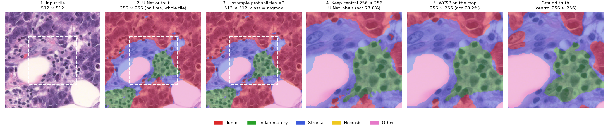
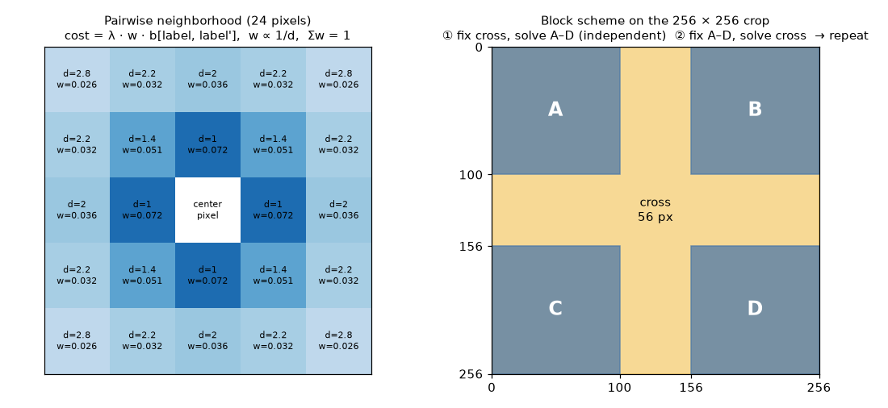
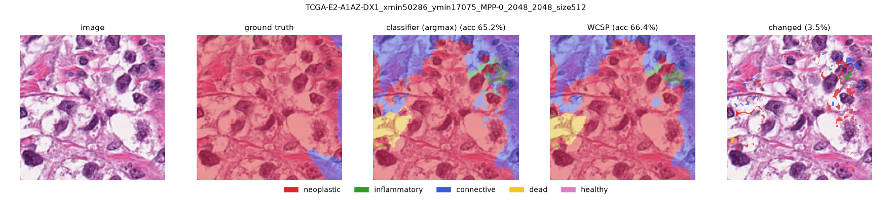

# Deliverable 5 — Full-Patch WCSP (PanNuke) and Pixel WCSP (BCSS)

- **PanNuke:** single full patch (below) and the multi-patch / λ study in [deliverable_5_pannuke_multipatch.md](deliverable_5_pannuke_multipatch.md). Code in [`experiments/pannuke_d5/`](../experiments/pannuke_d5/).
- **BCSS:** [pixel-level WCSP on a U-Net](#bcss-pixel-level-wcsp-on-a-u-net-urvi). Code in [`wcsp/`](../wcsp/) and [`experiments/bcss_wcsp/`](../experiments/bcss_wcsp/).
(In Progress)

1.Running the WCSP end to end on one complete, real HoVer-Net prediction region: **PanNuke Fold 2, `image_00748`**.

```text
PanNuke image
    ↓
HoVer-Net prediction
    ↓
164×164 predicted pixel-label map          (experiments/pannuke_d5/pannuke_preparation/)
    ↓
WCSP refinement                            (experiments/pannuke_d5/pannuke_refinement/run_wcsp.py)
    ↓
refined labels
    ↓
comparison with aligned PanNuke ground truth   (experiments/pannuke_d5/pannuke_refinement/evaluate.py)
```

Ground truth is used only for evaluation. It is never read by the WCSP solver.

Run from the repository root, in this order:

```bash
conda activate pannuke
python experiments/pannuke_d5/pannuke_preparation/prepare_full_patch.py   # needs the Fold 2 data, see below
python experiments/pannuke_d5/pannuke_refinement/run_wcsp.py
python experiments/pannuke_d5/pannuke_refinement/evaluate.py
```

The prepared inputs are committed, so the last two steps run without the PanNuke data.

---

## 1. Full-Patch Input Preparation 

### Source prediction

The input comes from the existing `hovernet_fast-pannuke` inference performed on PanNuke Fold 2.

For `image_00748`, HoVer-Net produced:

- **47 predicted nuclei**
- a **164×164 instance segmentation map**
- predicted nucleus classes stored in the Fold 2 prediction CSV
- centroids used to associate each predicted nucleus with its corresponding instance ID

All 47 predicted nuclei were successfully mapped from the prediction metadata to their instance-map regions.

### Conversion to pixel labels

HoVer-Net's instance map stores a unique integer ID for each detected nucleus. The corresponding nucleus class from the prediction CSV was assigned to every pixel belonging to that instance.

The WCSP label mapping is:

|  ID | Biological class          |
| --: | ------------------------- |
|   0 | Background / inactive     |
|   1 | Neoplastic                |
|   2 | Inflammatory              |
|   3 | Connective                |
|   4 | Dead                      |
|   5 | Non-neoplastic epithelial |

A pixel with label `0` is **not interpreted as healthy tissue**. It means that the pixel is not part of a usable HoVer-Net nucleus prediction and is therefore excluded from the active WCSP variables.

### Alignment with PanNuke ground truth

The original PanNuke patch is **256×256**, while the saved fast HoVer-Net prediction corresponds to the central **164×164** region:

```text
x = 46 ... 209
y = 46 ... 209
```

The corresponding PanNuke ground-truth mask was cropped to exactly this same 164×164 region before evaluation.

### Diagnostics

| Quantity                                          |  Value |
| ------------------------------------------------- | -----: |
| Predicted nuclei                                  |     47 |
| Active HoVer-Net pixels                           | 10,726 |
| Inactive/background pixels                        | 16,170 |
| Ground-truth nucleus pixels                       |  9,250 |
| Prediction/GT overlapping nucleus pixels          |  8,229 |
| Predicted nucleus pixels where GT is background   |  2,497 |
| GT nucleus pixels missed by predicted active mask |  1,021 |
| Class agreement on overlapping nucleus pixels     | 0.7737 |

The **0.7737 class agreement is not overall pixel accuracy**. It is the fraction of overlapping nucleus pixels where both HoVer-Net and PanNuke assign a nucleus and their biological class labels agree.

The 1,021 ground-truth nucleus pixels that fall outside the HoVer-Net active mask represent an important upstream limitation: these pixels do not become WCSP variables and therefore cannot be recovered through label refinement alone.

### Files in [`experiments/pannuke_d5/pannuke_preparation/`](../experiments/pannuke_d5/pannuke_preparation/)

| File | Contents |
| --- | --- |
| `hovernet_labels_164.npy` | (164, 164) main WCSP input. Active pixels carry labels 1–5, inactive pixels are 0. |
| `active_mask_164.npy` | (164, 164) bool. `active_mask[y, x] == True` means the pixel is a WCSP variable (10,726 pixels). |
| `hovernet_instance_map_164.npy` | Original HoVer-Net instance map; each positive integer is one nucleus. Kept for nucleus-level analysis. |
| `pannuke_gt_labels_164.npy` | Aligned PanNuke ground-truth class labels. **Evaluation only.** |
| `pannuke_d5_patch_package.npz` | Bundle of `predicted_labels`, `active_mask`, `ground_truth_labels`, `instance_map`. |
| `metadata.json` | Dataset/image ID, coordinates, label dictionary, active/background policy, counts, overlap statistics, source paths. |
| `prepare_full_patch.py` | Reproduces the files above from the saved HoVer-Net instance map + prediction CSV and the Fold 2 `masks.npy`. |

HoVer-Net instance map
        +
HoVer-Net nucleus class predictions
        ->
hovernet_labels_164.npy
        ->
active_mask_164.npy = hovernet_labels > 0
        ->
WCSP gets:
  1. label map
  2. active mask

```python
import numpy as np

data = np.load("experiments/pannuke_d5/pannuke_preparation/pannuke_d5_patch_package.npz")

initial_labels = data["predicted_labels"]
active_mask = data["active_mask"]
ground_truth = data["ground_truth_labels"]   # ignore during optimization
instance_map = data["instance_map"]
```

---

## 2. WCSP Run 

`run_wcsp.py` only reads `hovernet_labels_164.npy` and `active_mask_164.npy`.

Same setup as D4 so the results are comparable:

- Variables: the 10,726 active pixels, each with domain {1, ..., 5}. Inactive pixels stay 0.
- Unary: λ if a pixel changes from its HoVer-Net label, 0 if it keeps it.
- Pairwise: the handout cost table divided by distance, over all five neighbor types (up to 2√2 away). Pairs touching an inactive pixel are left out. That gives 111,755 unique edges.
- Solver: the shared `wcsp/` block scheme with ICM inside each block. The default 100x100 blocks don't fit a 164x164 image, so it uses 60x60 corners and a 44 px cross. No assignments are enumerated.

| Run | λ | Initial objective | Returned objective | Changed pixels | Rounds | Runtime |
| --- | ---: | ---: | ---: | ---: | ---: | ---: |
| Unary-only | 1 | 0.00 | 0.00 | 0 | 1 | 1.8 s |
| Strong fidelity | 139 | 772.81 | 772.81 | 0 | 1 | 1.8 s |
| Weaker fidelity | 1 | 772.81 | 723.15 | 13 | 2 | 3.4 s |

Why λ = 139 is strong enough: a pixel has at most 24 neighbors, and the sum of 1/d over them is 13.82. The biggest table cost is 10, so changing one pixel can save at most 138.2 in pairwise cost. Changing any k pixels saves at most 138.2k but costs λk, so with λ > 138.2 no change can lower the objective. This bound is actually reached on this mask, since some pixels have all 24 neighbors active. The run also confirms it empirically: 0 changes.

ICM is greedy, so the results are local optima, not proven global ones. For every run, no single pixel can lower the objective by changing its label, and solving the whole image as one block gives the same weak result (723.1453).

---

## 3. Ground-Truth Evaluation 

`evaluate.py` is the only script that opens `pannuke_gt_labels_164.npy`, and it runs after the WCSP labels are saved.

The ground truth for this patch only has one class: all 9,250 nucleus pixels are Inflammatory. I checked this against the raw `masks.npy` channels, so it is not an alignment bug.

Strong fidelity output is identical to HoVer-Net on every pixel.

The 13 pixels changed in the weaker fidelity run:

| Change | Pixels | What changed |
| --- | ---: | --- |
| Wrong → correct | 0 | |
| Correct → wrong | 6 | Inflammatory → Connective |
| Wrong → different wrong | 0 | |
| Ground truth is background | 7 | 5 Connective → Inflammatory, 2 Inflammatory → Connective |

Before and after:

| Metric | HoVer-Net | WCSP (λ = 1) | Difference |
| --- | ---: | ---: | ---: |
| Class agreement on overlap (8,229 px) | 0.7737 | 0.7730 | −0.0007 |
| Accuracy on HoVer-Net active region | 0.5936 | 0.5930 | −0.0006 |
| Accuracy on ground-truth nucleus region | 0.6883 | 0.6877 | −0.0006 |
| Pixel accuracy, full patch | 0.8000 | 0.7997 | −0.0002 |
| Inflammatory IoU | 0.6399 | 0.6391 | −0.0008 |

Error breakdown:

| Error | Pixels | Can the WCSP fix it? |
| --- | ---: | --- |
| Detection: ground-truth nucleus missed by HoVer-Net | 1,021 | No, never a variable |
| Detection: HoVer-Net nucleus where ground truth is background | 2,497 | No, the WCSP can't relabel to background |
| Classification: wrong class on overlap, HoVer-Net | 1,862 | Yes |
| Classification: wrong class on overlap, after WCSP | 1,868 | |

What we see:

- The pipeline works end to end on a real full prediction: HoVer-Net → WCSP → ground-truth comparison.
- Strong fidelity reproduces HoVer-Net exactly, as expected.
- At λ = 1 the WCSP lowers the objective but makes accuracy slightly worse. It made 0 corrections and 6 new errors. A lower objective only means the labels fit the cost table better, not that they are more correct.
- Almost all of HoVer-Net's class errors are whole nuclei labeled Connective (3,231 px) when they are Inflammatory. The WCSP can't fix a whole wrong nucleus because every pixel inside it agrees with its neighbors, so it only moves pixels on the edges where two nuclei touch.
- Same thing we saw on BCSS: the pairwise terms only reach 2 pixels, so they only change boundaries.
- This is one patch with one ground-truth class, so it doesn't say much about PanNuke in general. The next step is running more patches. Making the decision per nucleus (using the instance map) instead of per pixel would also probably fit PanNuke better.

How it was evaluated:

- Overlap = pixels that are nucleus in both HoVer-Net and the ground truth. This is the same 0.7737 class agreement from Section 1, so the evaluation matches the preparation.
- Active region accuracy counts ground-truth background as wrong. Ground-truth nucleus accuracy counts missed pixels as wrong.
- IoU is only reported for Inflammatory since it is the only class in the ground truth. The other predicted classes have IoU 0 both before and after, and Dead is never predicted.
- λ = 1 was taken from D4 and not tuned on this patch, since tuning it here would use the ground truth.

### Files in [`experiments/pannuke_d5/pannuke_refinement/`](../experiments/pannuke_d5/pannuke_refinement/)

| File | Contents |
| --- | --- |
| `run_wcsp.py`, `results.json` | WCSP runs, settings, objectives, energy trace per round |
| `wcsp_strong_labels.npy`, `wcsp_weak_labels.npy` | Returned 164x164 label maps (0 = inactive) |
| `evaluate.py`, `evaluation.json` | All metrics above plus confusion matrices |

---

## Next Steps

The goal of this stage was to show a working end-to-end pipeline on one real full prediction region, not yet to show the WCSP improves HoVer-Net across PanNuke. Next is scaling the same experiment to multiple patches and checking whether the biological constraints consistently improve held-out performance rather than just smoothing individual examples.

---

# BCSS: Pixel-Level WCSP on a U-Net (Urvi)

Separate from the PanNuke work above.
- **WCSP package:** [`wcsp/`](../wcsp/)
- **Experiment configs, SLURM scripts, figures:** [`experiments/bcss_wcsp/`](../experiments/bcss_wcsp/)
- **Metrics:** pixel accuracy and mIoU (per-class overlap averaged over the 5 classes, so small classes count as much as big ones). Δ is WCSP − U-Net, with a 95% CI from resampling whole tissue regions.

## 1. Pipeline



1. **Input:** a 512 × 512 BCSS tile.
2. **U-Net:** the pretrained TIAToolbox `fcn_resnet50_unet-bcss`, used as is: no training, no calibration. It sees the whole tile and outputs **5 class probabilities per pixel at half resolution (256 × 256)**.
3. **Upsample ×2 to 512 × 512:** each class's probability map is upsampled with bilinear interpolation. A pixel's class is the **argmax** of its 5 upsampled probabilities. We upsample probabilities, not labels, so the WCSP gets the U-Net's confidence at every pixel.
4. **Keep the central 256 × 256:** the outer ring is context only, because predictions near the tile edge see less tissue and are worse.
5. **WCSP:** refines the 256 × 256 crop and returns 256 × 256 labels. Scored against the ground truth for the same crop.

**Splits:**
- **dev:** every 8th training region. Used only to choose settings.
- **val:** held-out hospitals; 2,124 tiles with labels in the crop. Used only for reported results.

## 2. How the WCSP works



- **Variables:** the 65,536 pixels of the crop. **Domain:** {tumor, inflammatory, stroma, necrosis, other}.
- **Cost of a labeling** = Σ unary + λ · Σ pairwise. The solver searches for the cheapest labeling.
  - **Unary = −log p(label)** from the U-Net. Trust the U-Net: labels it likes are cheap (p = 0.9 → 0.1, p = 0.01 → 4.6).
  - **Pairwise = w · b[label, label′]** for each pixel pair up to 2√2 px apart (24 neighbors). w ∝ 1/distance, and the weights sum to 1. b is the class-compatibility table (§3).
  - **λ** sets how much the rules count. λ = 0 gives back the U-Net exactly.
  - **Optional image term f** (our addition, not in the notes): makes changing labels between similar-colored pixels cost extra, so boundaries follow color edges.
- **Solver:**
  - The notes' block scheme (right panel): solve the four 100 × 100 corners with the 56 px cross fixed, then the cross with the corners fixed, and repeat.
  - Inside each block we use **ICM**: switch each pixel to its cheapest label until nothing changes. It's greedy and fast (~10 s per tile).
  - **toulbar2**, a real WCSP solver, is run on the same problem for comparison (§4.4).
- **Intuition:** a pixel flips only if the rule savings beat the U-Net's cost difference. Rule pressure on a boundary pixel is a few units, so flips happen only where the U-Net is unsure (top p ≲ 0.5). The WCSP mostly cleans **edges and specks**, about 1% of pixels.

## 3. The b table: handwritten vs. data-derived

Each cell is **handwritten / data-derived**. The table is symmetric, so only the upper triangle is shown; the diagonal is 0.

| | Tumor | Inflam. | Stroma | Necrosis | Other |
|---|---|---|---|---|---|
| **Tumor** | 0 | 2 / 5.2 | 1 / 3.0 | 1 / 4.1 | 9 / 4.5 |
| **Inflam.** | | 0 | 2 / 2.2 | 1 / 6.9 | 8 / 3.2 |
| **Stroma** | | | 0 | 5 / 3.6 | 1 / 2.3 |
| **Necrosis** | | | | 0 | 10 / 4.9 |
| **Other** | | | | | 0 |

- **Handwritten:** the project notes. "Other" is the notes' *healthy*.
- **Data-derived:** how much less often two classes touch in the training ground truth than chance predicts (pointwise mutual information):
  - cost = −log( P(a next to b) / (P(a)·P(b)) ).
  - **Why divide by P(a)·P(b):** so a rare class like necrosis isn't penalized just for being rare.
  - +1 smoothing; negative values are set to 0; rescaled to the handwritten mean (4.0) so λ means the same for both.
- **Key differences:**
  - **Other:** the notes punish anything next to healthy (8–10). BCSS "other" is fat, vessels and similar tissue, which touches everything (data: 2.3–4.9).
  - **Inflammatory–necrosis:** the rarest pair in the data (6.9), but it costs only 1 in the notes.
  - **Triangle inequality:** the handwritten table breaks it. Tumor → stroma → other costs 1 + 1 < 9, so the cheapest "fix" is often a **fake 1 px stroma strip** between tumor and other (§5). The data-derived table almost removes this incentive (3.0 + 2.3 vs. 4.5).

## 4. Experiments

Each step answers one question on **dev**, fixes a choice, then checks it on **val**.

### 4.1 How strong should the rules be, and which b table? (dev, 185 tiles)

U-Net alone: pixel acc 0.8555, mIoU 0.7067.

| λ | Handwritten: acc | mIoU | Δ mIoU [95% CI] | Data-derived: acc | mIoU | Δ mIoU [95% CI] |
|---:|---:|---:|---|---:|---:|---|
| 0.5 | 0.8560 | 0.7082 | +0.0015 [+0.0007, +0.0020] | 0.8562 | 0.7082 | +0.0015 [+0.0008, +0.0021] |
| 1 | 0.8561 | 0.7086 | +0.0019 [+0.0009, +0.0026] | 0.8563 | 0.7085 | +0.0018 [+0.0008, +0.0027] |
| 2 | 0.8563 | 0.7094 | +0.0027 [+0.0014, +0.0035] | 0.8564 | 0.7089 | +0.0022 [+0.0011, +0.0032] |
| 4 | 0.8562 | 0.7096 | +0.0029 [+0.0013, +0.0038] | **0.8565** | 0.7090 | +0.0023 [+0.0012, +0.0033] |
| 8 | 0.8562 | 0.7097 | +0.0030 [+0.0013, +0.0040] | 0.8564 | 0.7090 | +0.0023 [+0.0012, +0.0033] |
| 16 | 0.8562 | **0.7100** | **+0.0032** [+0.0015, +0.0041] | 0.8565 | 0.7090 | +0.0023 [+0.0012, +0.0034] |
| 32 | 0.8561 | 0.7098 | +0.0031 [+0.0013, +0.0042] | 0.8565 | 0.7090 | +0.0023 [+0.0012, +0.0034] |

- **Every setting helps, and every CI is above 0.**
- **The gain levels off by λ ≈ 4–8.** Beyond that, the rules have already fixed every pixel the U-Net is unsure about. Confident pixels never flip, so a larger λ does nothing more.
- **Handwritten wins on mIoU and data-derived on pixel accuracy, by tiny margins inside the CIs.** Effectively a tie.
- **Decision:** use λ = 8 for both tables on val.

### 4.2 Does the image term f help? (dev, handwritten b)

| λ | β = 0 (no f) | β = 1 | β = 2 | β = 4 |
|---:|---:|---:|---:|---:|
| 4: mIoU (Δ) | 0.7096 (+0.0029) | 0.7095 (+0.0027) | 0.7089 (+0.0022) | 0.7085 (+0.0018) |
| 8: mIoU (Δ) | 0.7097 (+0.0030) | 0.7092 (+0.0025) | 0.7091 (+0.0024) | 0.7087 (+0.0020) |

- **No. It hurts slightly, and more as β grows.**
- **Why:** in H&E images the strongest color edges are nucleus vs. background *inside* one tissue type, not boundaries between tissues. So f protects the wrong edges.
- **Decision:** drop f.

### 4.3 Does it hold on unseen hospitals? (val, 2,124 tiles, ICM)

U-Net alone: pixel acc **0.8414**, mIoU **0.6489**. This matches the repo's earlier U-Net benchmark (0.649).

| λ | Handwritten: acc | mIoU | Δ mIoU [95% CI] | Data-derived: acc | mIoU | Δ mIoU [95% CI] |
|---:|---:|---:|---|---:|---:|---|
| 0.5 | 0.8418 | 0.6499 | +0.0011 [+0.0006, +0.0014] | 0.8419 | 0.6499 | +0.0010 [+0.0007, +0.0014] |
| 1 | 0.8418 | 0.6503 | +0.0014 [+0.0008, +0.0019] | 0.8421 | 0.6502 | +0.0014 [+0.0009, +0.0018] |
| 2 | 0.8419 | 0.6505 | +0.0017 [+0.0010, +0.0023] | 0.8422 | 0.6506 | +0.0017 [+0.0011, +0.0023] |
| 4 | 0.8419 | 0.6507 | +0.0018 [+0.0010, +0.0026] | 0.8422 | 0.6506 | +0.0018 [+0.0011, +0.0024] |
| **8** | 0.8419 | **0.6507** | **+0.0019** [+0.0010, +0.0027] | **0.8422** | 0.6506 | +0.0018 [+0.0011, +0.0024] |

- **Same picture as dev.** A small, reliable gain that levels off by λ ≈ 4, and the two tables are tied.
- **The gain is smaller than on dev** (+0.0019 vs. +0.0030). New hospitals look different, so the U-Net's mistakes there are more often whole regions, which the WCSP can't fix.
- **About 0.9% of pixels change.** That's +0.05–0.08 pp of pixel accuracy, so the mIoU gain comes from the edges of the smaller classes.

### 4.4 Does a real WCSP solver do better than greedy ICM? (val, handwritten b, λ = 4)

Same problem and same blocks; only the search inside each block differs. Compared on the 2,066 val tiles both finished (some toulbar2 jobs hit CARC filesystem errors).

| Solver (inside each block) | Total cost vs. U-Net start | Pixel acc | mIoU | Pixels changed | s/tile |
|---|---:|---:|---:|---:|---:|
| none (U-Net alone) | 100% | 0.8423 | 0.6461 | — | — |
| ICM (greedy) | **52.6%** | **0.8428** | **0.6479** | 0.92% | 12 |
| toulbar2 (20 s per block) | 98.6% | 0.8425 | 0.6464 | 0.11% | 86 |

- **Within the time limit, toulbar2 finds much worse solutions than ICM.** It cuts the cost by only 1.4%, against 47% for ICM, and has a higher cost than ICM on 78% of tiles.
- **Why:** a block has 10,000–25,000 variables. toulbar2's exact search (depth-first branch and bound) can't get far in 20 s, so it returns little more than its starting point. ICM's greedy local moves are a better fit at this scale.
- **Lower cost also gave higher mIoU here**, so a better solver could help a bit.
- **To make toulbar2 competitive:**
  - start it from the ICM solution;
  - use its local-search mode (VNS);
  - give it smaller blocks or more time.

### 4.5 Summary (val)

| Method | Pixel acc | mIoU | Δ mIoU [95% CI] |
|---|---:|---:|---|
| U-Net alone | 0.8414 | 0.6489 | — |
| + WCSP, handwritten b, λ = 8 (ICM) | 0.8419 | **0.6507** | +0.0019 [+0.0010, +0.0027] |
| + WCSP, data-derived b, λ = 8 (ICM) | **0.8422** | 0.6506 | +0.0018 [+0.0011, +0.0024] |
| + image term f | not run on val: hurt on dev (§4.2) | | |
| toulbar2 instead of ICM (λ = 4, 2,066 tiles) | 0.8425 | 0.6464 | below ICM; it times out (§4.4) |

## 5. Examples (val, handwritten b, λ = 4)

Panels: image | ground truth | U-Net | WCSP | changed pixels.

- **Mixed tile:** U-Net 77.9% → WCSP 78.2%. Ragged edges are smoothed and stray specks removed.
  
- **Helps:** U-Net 65.2% → WCSP 66.4%.
  
- **Hurts:** U-Net 24.2% → WCSP 22.7%.
  - The U-Net calls this tumor "other", and confident regions can't be fixed.
  - The handwritten table also draws 1 px stroma strips along tumor/other edges (§3).
  

## 6. Takeaways

- **The WCSP gives a small but reliable gain:** about +0.002 mIoU on unseen hospitals, with every CI above zero. Pixel accuracy barely moves.
- **Why it's small:** the rules reach only 2√2 px and act only where the U-Net is unsure. So they fix edges and specks but never whole regions the U-Net is confidently wrong about, which are its main errors.
- **The handwritten and data-derived tables tie on accuracy.** The data-derived table is better grounded for BCSS: it fits the "other" class and avoids the fake-strip artifact.
- **Color edges (f) don't mark tissue boundaries in H&E,** so f doesn't help.
- **Next:**
  - learn b on dev to maximize accuracy directly (instead of co-occurrence);
  - use region-level variables (superpixels or whole regions) or longer-range neighbors, so the rules can fix whole regions, not just edges.

**Reproduce:**

```bash
python -m wcsp predict --config experiments/bcss_wcsp/configs/bcss_unet.yaml --split val          # U-Net once, cached
python -m wcsp solve   --config experiments/bcss_wcsp/configs/bcss_unet.yaml --split val --run NAME --set problem.lam=8
python -m wcsp summarize --config experiments/bcss_wcsp/configs/bcss_unet.yaml --split val --run NAME
python experiments/bcss_wcsp/make_figures.py --id <val tile id>
```

On SLURM, `experiments/bcss_wcsp/slurm/wcsp_multi.sbatch` splits a run into array tasks × 16 CPUs.
