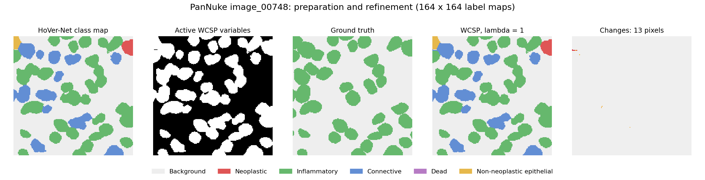
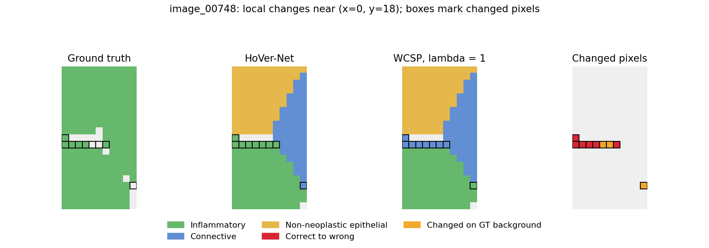
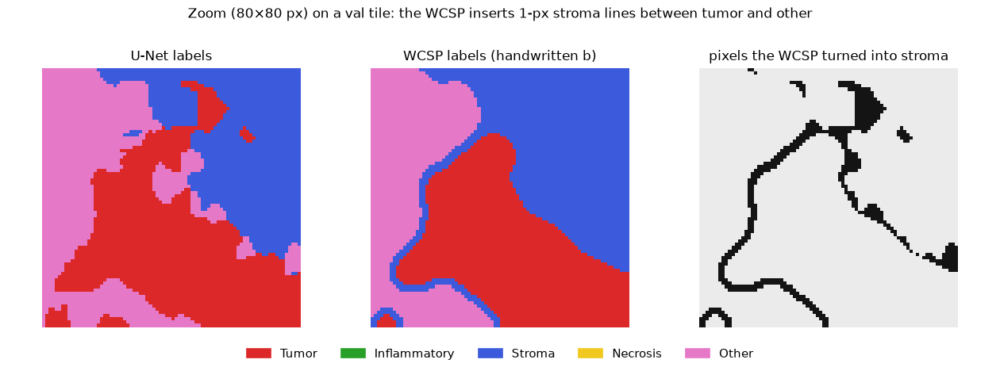

# Deliverable 5 — WCSP Refinement of Classifier Predictions (PanNuke + BCSS)

We take a trained classifier's per-pixel predictions and refine them with a **weighted constraint satisfaction problem (WCSP)** that encodes which tissue/cell types should and shouldn't sit next to each other. We test this on two datasets:

| | **PanNuke** (nuclei) | **BCSS** (tissue regions) |
|---|---|---|
| Classifier | HoVer-Net (nucleus instances + class) | TIAToolbox U-Net (per-pixel tissue class) |
| WCSP grid | 164 × 164 HoVer-Net region; only nucleus pixels are variables | central 256 × 256 of each 512 tile; every pixel is a variable |
| Labels | neoplastic, inflammatory, connective, dead, non-neoplastic epithelial | tumor, inflammatory, stroma, necrosis, other |
| Code | shared [`wcsp/`](../wcsp/) solver + [`experiments/pannuke_d5/`](../experiments/pannuke_d5/) | shared [`wcsp/`](../wcsp/) package + [`experiments/bcss_wcsp/`](../experiments/bcss_wcsp/) |

**Headline.** The WCSP only reliably fixes **boundaries**, never whole wrong regions.
- **BCSS:** a small but real gain, mIoU 0.6489 → 0.6507 (+0.0019, 95% CI [+0.0010, +0.0027]) on 2,124 held-out-hospital tiles.
- **PanNuke:** almost no changes, and the few changes it makes are mostly wrong.

---

## 1. The WCSP (shared)

- **Variables:** pixels. **Domain:** the 5 class labels.
- **Objective:** find the labeling with the lowest total cost = Σ unary + Σ pairwise.
- **Pairwise cost (the biology rules):**
  - Applies to every pixel pair up to 2√2 px apart: 24 neighbors, 5 distance types (left panel).
  - Cost = b[label, label′] / distance. Closer neighbors count more; same label is free.
  - **b** is the class-compatibility table. PanNuke uses the handwritten table from the project notes. BCSS tests both the handwritten table and one **derived from the BCSS training labels** (each cell: handwritten / data-derived; details in §3):

**PanNuke (handwritten)**

| | Neoplastic | Inflammatory | Connective | Dead | Non-neoplastic epithelial |
|---|---|---|---|---|---|
| **Neoplastic** | 0 | 2 | 1 | 1 | 9 |
| **Inflammatory** | | 0 | 2 | 1 | 8 |
| **Connective** | | | 0 | 5 | 1 |
| **Dead** | | | | 0 | 10 |
| **Non-neoplastic epithelial** | | | | | 0 |

**BCSS (handwritten / data-derived)**

| | Tumor | Inflammatory | Stroma | Necrosis | Other |
|---|---|---|---|---|---|
| **Tumor** | 0 | 2 / 5.2 | 1 / 3.0 | 1 / 4.1 | 9 / 4.5 |
| **Inflammatory** | | 0 | 2 / 2.2 | 1 / 6.9 | 8 / 3.2 |
| **Stroma** | | | 0 | 5 / 3.6 | 1 / 2.3 |
| **Necrosis** | | | | 0 | 10 / 4.9 |
| **Other** | | | | | 0 |

  Symmetric, so only the upper triangle is shown; same label (diagonal) is free.

- **Unary cost (trust the classifier).** This is where the two datasets differ:

  | | PanNuke | BCSS |
  |---|---|---|
  | Unary | **λ if the pixel changes from HoVer-Net's label, else 0** | **−log p(label)** from the U-Net (p = 0.9 → 0.1, p = 0.01 → 4.6) |
  | Uses classifier certainty? | No: HoVer-Net's saved output has labels only | **Yes:** unsure pixels are cheap to change |

- **The trade-off knob λ (same idea on both datasets):** λ balances *trust the classifier* against *follow the rules*, and only that balance matters. PanNuke writes it as λ · unary + pairwise; BCSS writes it as unary + λ · pairwise. Those are the same thing with λ inverted: a small λ on PanNuke is a large λ on BCSS. So on PanNuke a *lower* λ means stronger rules, and on BCSS a *higher* λ does.

- **Solver (both datasets):** block scheme + ICM.
  - Block scheme (right panel): solve the four corner blocks with the cross fixed, then the cross with the corners fixed; repeat. Blocks are 100/56/100 px on BCSS and 60/44/60 px on PanNuke.
  - ICM inside each block: switch each pixel to its cheapest label until nothing changes. It's greedy and fast, and finds a local optimum.
  - BCSS also compares **toulbar2**, an exact WCSP solver, on the same problem (§3).
- **Intuition:** a pixel's label changes only if the rule savings beat its unary cost. Inside a region (or nucleus) every neighbor agrees, so there's nothing to gain. Only **boundary** pixels ever change.

### Hyperparameters

| Knob | What it controls | PanNuke | BCSS |
|---|---|---|---|
| **λ** | classifier vs. rules trade-off | 1 (also 0–0.5, and 139 as the strong-fidelity check) | 0.5–32 swept on dev; **8** reported |
| **b** | pairwise cost for each pair of classes | handwritten | handwritten **or** data-derived (PMI) |
| **unary** | how the classifier's opinion is scored | λ · [label changed] | −log p, raw softmax (temperature 1) |
| **neighborhood** | which pixel pairs interact | 5 distance types, up to 2√2 px (24 neighbors) | same |
| **η** | distance falloff, b / dᵑ | 1 | 1 |
| **f: β, σ** | image term: extra cost for a label change between similar colors | off | off (β = 1, 2, 4 tested; hurt) |
| **solver** | search inside each block | ICM | ICM (toulbar2 compared) |
| **blocks** | corner size / cross width | 60 / 44 px | 100 / 56 px |
| **rounds, time limit** | how long to iterate | until no change | ≤ 4 rounds; toulbar2 20 s per block |

All of these are set in one YAML config, e.g. `experiments/bcss_wcsp/configs/bcss_unet.yaml`, or per run with `--set problem.lam=8`.

---

## 2. PanNuke

### Pipeline and experiments

*image_00748 label maps (164 × 164). Changes: red = correct → wrong; orange = changed on ground-truth background.*

1. **Input:** a 256 × 256 RGB patch. **HoVer-Net:** returns nucleus instances and class metadata for the central 164 × 164 region.
2. **Prepare pixel labels:** copy each nucleus's predicted class to all its instance pixels. Set `active_mask = predicted_labels > 0`; background pixels are inactive, not WCSP variables.
3. **Align ground truth:** crop the PanNuke annotations to `[46:210, 46:210]`, matching the prediction region. Ground truth is used only for evaluation.
4. **WCSP:** refine the active pixels with the handwritten pairwise table and a flat unary penalty λ for changing a HoVer-Net label. The active mask stays fixed; missed nuclei cannot be recovered and predicted nuclei cannot be removed as background.
5. **Evaluation and development sets:** report the main result on **20 diverse Fold 2 patches**. Use **15 separate development patches** to diagnose lambda, without retuning on the evaluation set.
6. **Experiments, each answering one question:**
   - Single patch (`image_00748`): do unary-only and strong fidelity reproduce HoVer-Net, and can weak fidelity lower energy?
   - Main evaluation, 20 patches at λ = 1: does refinement improve accuracy across patches?
   - Development sweep, λ ∈ {1, 0.5, 0.25, 0}: is the change penalty preventing useful refinement?

**Metrics:** full-crop pixel accuracy, class agreement on overlapping nucleus pixels, and mean patch mIoU (over biological classes present in each patch’s ground truth). Refinement: Δ mIoU = WCSP − HoVer-Net, plus wrong → correct and correct → wrong counts.

#### Sweeps and details (click to expand)

<b>Single-patch sanity checks (image_00748)</b>

HoVer-Net found 47 nuclei in the central 164 × 164 region, giving 10,726 active (nucleus) pixels. The ground truth is cropped to the same region and used only for evaluation.

##### HoVer-Net vs. ground truth (before the WCSP)

| Quantity                                          |  Value |
| ------------------------------------------------- | -----: |
| Predicted nuclei                                  |     47 |
| Active HoVer-Net pixels                           | 10,726 |
| Inactive/background pixels                        | 16,170 |
| Ground-truth nucleus pixels                       |  9,250 |
| Prediction/GT overlapping nucleus pixels          |  8,229 |
| Predicted nucleus pixels where GT is background   |  2,497 |
| GT nucleus pixels missed by predicted active mask |  1,021 |
| Class agreement on overlapping nucleus pixels     | 0.7737 |

The **0.7737 class agreement is not overall pixel accuracy**. It is the fraction of overlapping nucleus pixels where both HoVer-Net and PanNuke assign a nucleus and their biological class labels agree.

The 1,021 ground-truth nucleus pixels that fall outside the HoVer-Net active mask represent an important upstream limitation: these pixels do not become WCSP variables and therefore cannot be recovered through label refinement alone.

##### WCSP runs

| Run | λ | Initial objective | Returned objective | Changed pixels | Rounds | Runtime |
| --- | ---: | ---: | ---: | ---: | ---: | ---: |
| Unary-only | 1 | 0.00 | 0.00 | 0 | 1 | 1.8 s |
| Strong fidelity | 139 | 772.81 | 772.81 | 0 | 1 | 1.8 s |
| Weaker fidelity | 1 | 772.81 | 723.15 | 13 | 2 | 3.4 s |

Why λ = 139 is strong enough: a pixel has at most 24 neighbors, and the sum of 1/d over them is 13.82. The biggest table cost is 10, so changing one pixel can save at most 138.2 in pairwise cost. Changing any k pixels saves at most 138.2k but costs λk, so with λ > 138.2 no change can lower the objective. This bound is actually reached on this mask, since some pixels have all 24 neighbors active. The run also confirms it empirically: 0 changes.

ICM is greedy, so the results are local optima, not proven global ones. For every run, no single pixel can lower the objective by changing its label, and solving the whole image as one block gives the same weak result (723.1453).

##### Ground-truth evaluation 

The ground truth for this patch only has one class: all 9,250 nucleus pixels are Inflammatory. This was verified against the raw `masks.npy` channels.

Strong fidelity output is identical to HoVer-Net on every pixel.

The 13 pixels changed in the weaker fidelity run:

| Change | Pixels | What changed |
| --- | ---: | --- |
| Wrong → correct | 0 | |
| Correct → wrong | 6 | Inflammatory → Connective |
| Wrong → different wrong | 0 | |
| Ground truth is background | 7 | 5 Connective → Inflammatory, 2 Inflammatory → Connective |

Before and after:

| Metric | HoVer-Net | WCSP (λ = 1) | Difference |
| --- | ---: | ---: | ---: |
| Class agreement on overlap (8,229 px) | 0.7737 | 0.7730 | −0.0007 |
| Accuracy on HoVer-Net active region | 0.5936 | 0.5930 | −0.0006 |
| Accuracy on ground-truth nucleus region | 0.6883 | 0.6877 | −0.0006 |
| Pixel accuracy, full patch | 0.8000 | 0.7997 | −0.0002 |
| Inflammatory IoU | 0.6399 | 0.6391 | −0.0008 |

Error breakdown:

| Error | Pixels | Can the WCSP fix it? |
| --- | ---: | --- |
| Detection: ground-truth nucleus missed by HoVer-Net | 1,021 | No, never a variable |
| Detection: HoVer-Net nucleus where ground truth is background | 2,497 | No, the WCSP can't relabel to background |
| Classification: wrong class on overlap, HoVer-Net | 1,862 | Yes |
| Classification: wrong class on overlap, after WCSP | 1,868 | |

What we see:

- The pipeline works end to end on a real full prediction: HoVer-Net → WCSP → ground-truth comparison.
- Strong fidelity reproduces HoVer-Net exactly, as expected.
- At λ = 1 the WCSP lowers the objective but makes accuracy slightly worse. It made 0 corrections and 6 new errors. A lower objective only means the labels fit the cost table better, not that they are more correct.
- Almost all of HoVer-Net's class errors are whole nuclei labeled Connective (3,231 px) when they are Inflammatory. The WCSP can't fix a whole wrong nucleus because every pixel inside it agrees with its neighbors, so it only moves pixels on the edges where two nuclei touch.
- Same thing we saw on BCSS: the pairwise terms only reach 2√2 pixels, so they only change boundaries.
- This is one patch with one ground-truth class, so it doesn't say much about PanNuke in general. The 20-patch evaluation below tests whether this behavior repeats. Making the decision per nucleus (using the instance map) instead of per pixel would also probably fit PanNuke better.

How it was evaluated:

- Overlap = pixels that are nucleus in both HoVer-Net and the ground truth. This is the same 0.7737 class agreement from Section 1, so the evaluation matches the preparation.
- Active region accuracy counts ground-truth background as wrong. Ground-truth nucleus accuracy counts missed pixels as wrong.
- IoU is only reported for Inflammatory since it is the only class in the ground truth. The other predicted classes have IoU 0 both before and after, and Dead is never predicted.
- λ = 1 was taken from D4 and not tuned on this patch, since tuning it here would use the ground truth.

<b>Main evaluation (20 patches, λ = 1)</b>

The evaluation set covers diverse tissues and class combinations. λ = 1 is fixed for this evaluation.

| Outcome | Result |
|---|---:|
| Patches with zero initial pairwise cost | 13 / 20 |
| Patches improved / unchanged / worsened in mIoU | 0 / 19 / 1 |
| Total changed pixels | 2 |
| Wrong → correct | 0 |
| Correct → wrong | 2 |
| Classification errors before → after | 22,249 → 22,251 |
| Ground-truth nucleus pixels missed by HoVer-Net | 12,623 |
| Predicted nucleus pixels where GT is background | 16,574 |

- **No accuracy improvement:** 19 patches are unchanged and one is slightly worse.
- **Detection errors remain fixed:** missed pixels are not variables, and active pixels cannot switch to background.
- **Little pairwise conflict:** 13 patches already start with zero pairwise cost, leaving no incentive to pay a positive unary penalty for changes.

<b>λ sweep (development, 15 separate patches)</b>

These patches are separate from the 20-patch evaluation set. Lower λ makes changes cheaper; λ = 0 removes the unary penalty but still uses HoVer-Net's active mask and initial labels.

| λ | Mean mIoU, HoVer-Net | Mean mIoU, + WCSP | Mean Δ mIoU | Changed px | Patches changed | Wrong → correct | Correct → wrong |
|---:|---:|---:|---:|---:|---:|---:|---:|
| 1.00 | 0.474933 | 0.474395 | -0.000539 | 83 | 4/15 | 1 | 28 |
| 0.50 | 0.474933 | 0.474406 | -0.000528 | 85 | 4/15 | 1 | 27 |
| 0.25 | 0.474933 | 0.474403 | -0.000530 | 94 | 5/15 | 2 | 27 |
| 0.00 | 0.474933 | 0.473899 | -0.001034 | 145 | 5/15 | 2 | 61 |

- **Lower lambda increases changes modestly, without improving mean mIoU.**
- **Even at λ = 0, 10/15 patches remain unchanged.** Across the set, only 2 wrong pixels are corrected while 61 correct pixels become wrong.
- **No development setting shows an average improvement.** Excessive unary fidelity alone does not explain the result; the pixel representation and pairwise preferences remain limitations to investigate.

### Final results

| Method | Evaluated on | Mean pixel acc | Mean mIoU | Mean Δ mIoU vs. HoVer-Net |
|---|---|---:|---:|---:|
| HoVer-Net | evaluation, 20 patches | 0.904361 | 0.424023 | — |
| HoVer-Net + WCSP, handwritten b (λ = 1) | evaluation, 20 patches | 0.904358 | 0.424000 | -0.000023 |
| HoVer-Net | development, 15 patches | 0.889847 | 0.474933 | — |
| HoVer-Net + WCSP, handwritten b (λ = 0) | development, 15 patches | 0.889701 | 0.473899 | -0.001034 |

- **Evaluation:** 0/20 patches improve; 19 stay unchanged and 1 worsens. Both changed pixels are new errors.

**Why the WCSP doesn't help on PanNuke:**

- Nuclei are separated by inactive background, so neighboring nuclei often have no connecting edges.
- Each nucleus starts with one uniform label, giving zero pairwise cost on same-label interior edges.
- The flat unary cannot distinguish confident predictions from uncertain ones.
- The few changes observed are mostly harmful, suggesting that the current representation and cost table do not provide useful refinement on these sets.

<b>Example patch: lower energy, worse accuracy (image_001409)</b>

| Metric | HoVer-Net | WCSP (λ = 1) |
|---|---:|---:|
| Objective | 210.1984 | 207.5958 |
| Class agreement on overlapping nucleus pixels | 0.8147 | 0.8143 |
| mIoU | 0.618970 | 0.618508 |

Both changed pixels switch from Non-neoplastic epithelial to Connective. Ground truth confirms that both were correct before and wrong afterward: 0 corrections and 2 new errors. The solver improves its objective, but the preferred labels are less accurate.

<b>Example patch: local changes that hurt (image_00748)</b>

Panels: ground truth | HoVer-Net | WCSP | changed pixels. Black boxes mark changed pixels.

- **Whole-patch class agreement on overlapping nucleus pixels:** 0.7737 → 0.7730.
- **Whole-patch changes:** 13 pixels, with 0 corrections, 6 new errors (Inflammatory → Connective), and 7 changes on ground-truth background.
- **Interpretation:** energy decreases, but some previously correct boundary pixels become wrong.

**Saved results:** [20-patch evaluation CSV](../experiments/pannuke_d5/pannuke_multi_patch_evaluation_summary.csv), [development sweep CSV](../experiments/pannuke_d5/pannuke_lambda_dev_evaluation_summary.csv). Full patch-selection and execution details: [PanNuke multi-patch write-up](deliverable_5_pannuke_multipatch.md).

---

## 3. BCSS

### Pipeline and experiments

1. **Input:** a 512 × 512 tile. **U-Net:** outputs 5 class probabilities per pixel at half resolution (256 × 256), covering the whole tile.
2. **Upsample ×2 to 512 × 512:** each class probability map is upsampled bilinearly, and a pixel's class is the **argmax** of its 5 probabilities. We upsample probabilities, not labels, so the WCSP knows how confident the U-Net is at every pixel.
3. **Keep the central 256 × 256:** the outer ring is context only, since predictions near the edge see less tissue.
4. **WCSP** on all 65,536 crop pixels, giving 256 × 256 refined labels, scored against the ground truth for the same crop.
5. **Splits:** settings are chosen on **dev** (every 8th training region, 185 tiles). Results are reported on **val** (held-out hospitals, 2,124 labeled tiles).
6. **Sweeps, each step answering one question:**
   1. Rule strength λ ∈ {0.5 … 32} × b table (handwritten vs. data-derived), on dev.
   2. Image-edge term f (β = 1, 2, 4), on dev.
   3. Chosen settings on val.
   4. ICM vs. toulbar2 on val.

**Metrics:** pixel accuracy and mIoU (per-class IoU averaged over the 5 classes), with a 95% CI from resampling whole tissue regions.

#### Sweeps and details (click to expand)

<b>How the data-derived b table is computed, and how it differs</b>

#### The b table: handwritten vs. data-derived

Each cell is **handwritten / data-derived**. The table is symmetric, so only the upper triangle is shown; the diagonal is 0.

| | Tumor | Inflam. | Stroma | Necrosis | Other |
|---|---|---|---|---|---|
| **Tumor** | 0 | 2 / 5.2 | 1 / 3.0 | 1 / 4.1 | 9 / 4.5 |
| **Inflam.** | | 0 | 2 / 2.2 | 1 / 6.9 | 8 / 3.2 |
| **Stroma** | | | 0 | 5 / 3.6 | 1 / 2.3 |
| **Necrosis** | | | | 0 | 10 / 4.9 |
| **Other** | | | | | 0 |

- **Handwritten:** the project notes. "Other" is the notes' *healthy*.
- **Data-derived:** how much less often two classes touch in the training ground truth than chance predicts (pointwise mutual information):
  - cost = −log( P(a next to b) / (P(a)·P(b)) ).
  - **Why divide by P(a)·P(b):** so a rare class like necrosis isn't penalized just for being rare.
  - +1 smoothing; negative values are set to 0; rescaled to the handwritten mean (4.0) so λ means the same for both.
- **Key differences:**
  - **Other:** the notes punish anything next to healthy (8–10). BCSS "other" is fat, vessels and similar tissue, which touches everything (data: 2.3–4.9).
  - **Inflammatory–necrosis:** the rarest pair in the data (6.9), but it costs only 1 in the notes.
  - **Triangle inequality:** the handwritten table breaks it. Tumor → stroma → other costs 1 + 1 < 9, so the cheapest "fix" is often a **fake 1 px stroma strip** between tumor and other (see the "hurts" example). The data-derived table almost removes this incentive (3.0 + 2.3 vs. 4.5).

    

    *Zoom on a val tile (handwritten b, λ = 4). Where the U-Net puts tumor next to other, the WCSP draws a 1 px stroma line between them, because two cheap borders (1 + 1) cost less than one expensive border (9). Right panel: the pixels it changed to stroma.*

<b>λ sweep (dev, 185 tiles)</b>

Dev is used only to choose settings, and the U-Net scores higher there (mIoU 0.7067) than on val.

| λ | Handwritten b: mIoU (Δ) | Data-derived b: mIoU (Δ) |
|---:|---:|---:|
| 0.5 | 0.7082 (+0.0015) | 0.7082 (+0.0015) |
| 1 | 0.7086 (+0.0019) | 0.7085 (+0.0018) |
| 2 | 0.7094 (+0.0027) | 0.7089 (+0.0022) |
| 4 | 0.7096 (+0.0029) | 0.7090 (+0.0023) |
| 8 | 0.7097 (+0.0030) | 0.7090 (+0.0023) |
| 16 | **0.7100 (+0.0032)** | 0.7090 (+0.0023) |
| 32 | 0.7098 (+0.0031) | 0.7090 (+0.0023) |

- Every setting helps, and every 95% CI is above zero.
- Pixel accuracy stays between 0.8560 and 0.8565.
- **The gain levels off by λ ≈ 4.** After that, every pixel the U-Net is unsure about has already flipped, and confident pixels never do.
- **The two tables are effectively tied:** the gap is far smaller than the CIs (about ±0.0013).
- **Chosen:** λ = 8 for both tables. λ = 16 is best for handwritten by +0.0003, and its val run is in progress.

<b>Image term f (dev, handwritten b)</b>

| λ | no f | β = 1 | β = 2 | β = 4 |
|---:|---:|---:|---:|---:|
| 4 | 0.7096 | 0.7095 | 0.7089 | 0.7085 |
| 8 | 0.7097 | 0.7092 | 0.7091 | 0.7087 |

- Entries are mIoU.
- **f hurts slightly, and more as β grows.**
- **Why:** in H&E images the strongest color edges are nucleus vs. background *inside* one tissue type, not boundaries between tissues. So f protects the wrong edges.
- **Chosen:** no f.

### Final results

| Method | Evaluated on | Pixel acc | mIoU | Δ mIoU vs. U-Net [95% CI] |
|---|---|---:|---:|---|
| U-Net | val, 2,124 tiles | 0.8414 | 0.6489 | — |
| U-Net + WCSP, handwritten b (λ = 8) | val, 2,124 tiles | 0.8419 | **0.6507** | +0.0019 [+0.0010, +0.0027] |
| U-Net + WCSP, data-derived b (λ = 8) | val, 2,124 tiles | **0.8422** | 0.6506 | +0.0018 [+0.0011, +0.0024] |
| U-Net + WCSP, toulbar2 instead of ICM (λ = 4) | val, 2,124 tiles | 0.8416 | 0.6492 | +0.0003 [−0.0000, +0.0006] (ICM at λ = 4: +0.0018) |
| U-Net + WCSP + image term f (β = 1, λ = 8) | dev, 185 tiles (val running) | 0.8560 | 0.7092 | +0.0025 (no f on dev: +0.0030) |

- **val:** 2,124 labeled tiles from hospitals the U-Net never saw.
- **dev:** 185 tiles from every 8th training region, used only to choose settings. U-Net mIoU on dev is 0.7067.
- toulbar2 times out at 20 s per block, so it finds worse solutions than ICM.

- **Sensitivity check on val:** the gain rises the same way with λ (+0.0011 at λ = 0.5 to +0.0019 at λ = 8) and is flat from λ ≈ 4 on, so the exact choice of λ barely matters.

**Per class (val, IoU, λ = 8)**

| Method | Tumor | Stroma | Inflammatory | Necrosis | Other |
|---|---:|---:|---:|---:|---:|
| U-Net | 0.813 | 0.721 | 0.617 | 0.669 | 0.424 |
| + WCSP, handwritten b | 0.813 | 0.722 | 0.618 | 0.670 | **0.431** |
| + WCSP, data-derived b | 0.814 | 0.722 | 0.618 | 0.671 | 0.427 |

- Almost all of the gain is the "other" class.
- It comes from precision (0.604 → 0.622), not recall (0.586 → 0.584).
- The handwritten table makes "other" very expensive next to tumor, inflammatory and necrosis, so stray "other" specks inside those regions get relabeled.

**Solver (val, handwritten b, λ = 4): same problem, different search inside each block**

| Solver | Total cost (U-Net = 100%) | mIoU | s/tile |
|---|---:|---:|---:|
| ICM (greedy) | **52.6%** | **0.6507** | 12 |
| toulbar2 (exact search, 20 s per block) | 98.5% | 0.6492 | 87 |

- toulbar2 barely moves from its start on 10k–25k-variable blocks in 20 s, so it ends with a higher cost than ICM on 78% of tiles.
- Lower cost went with higher mIoU, so a better solver could still help a little.

**Why it helps a little on BCSS:**
- Every pixel is a variable, and the unary carries the U-Net's certainty.
- So the rules relabel the *unsure* boundary pixels and stray specks, which is where the U-Net makes edge mistakes.
- Most of the gain is in the "other" class (precision 0.604 → 0.622).

<b>Example tiles (val)</b>

Handwritten b, λ = 4. Panels: image | ground truth | U-Net | WCSP | changed pixels.

- **Mixed tile:** U-Net 77.9% → WCSP 78.2%. Ragged edges are smoothed and specks removed.
  
- **Helps:** U-Net 65.2% → WCSP 66.4%.
  
- **Hurts:** U-Net 24.2% → WCSP 22.7%.
  - The U-Net calls this tumor "other", and confident regions can't be fixed.
  - The WCSP also adds 1 px stroma strips (see the b table).
  

---

## 4. Takeaways

- **The WCSP mostly cleans boundaries.**
  - The rules reach at most 2√2 px, and only flip pixels the classifier is unsure about.
  - So they can't fix a whole region or nucleus the classifier got confidently wrong, which is where most errors are.
- **Classifier certainty matters.** With −log p unaries (BCSS) the WCSP gives a small but reliable gain. With a flat "λ per change" unary (PanNuke) its changes are mostly wrong.
- **The handwritten b is a reasonable but rough prior.**
  - On BCSS it ties a data-derived table.
  - It breaks the triangle inequality, which creates fake 1 px stroma strips.
  - On PanNuke its pairwise pressure doesn't match the true classes.
- **Next:**
  - learn b on dev for accuracy;
  - use region- or nucleus-level variables (superpixels, HoVer-Net instances) so the rules can act on whole objects;
  - save HoVer-Net class probabilities so PanNuke can use −log p unaries;
  - for toulbar2, start from the ICM solution and use its local search (VNS).
