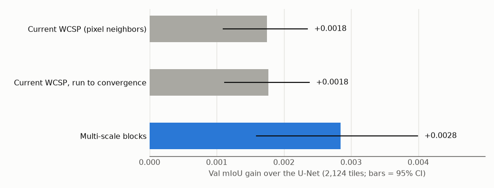
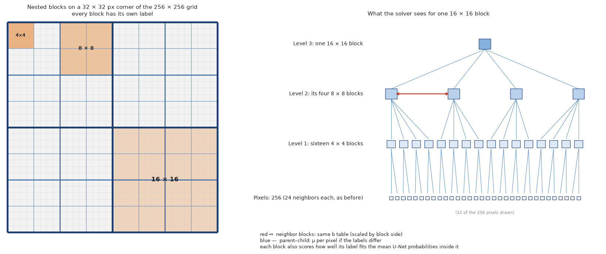
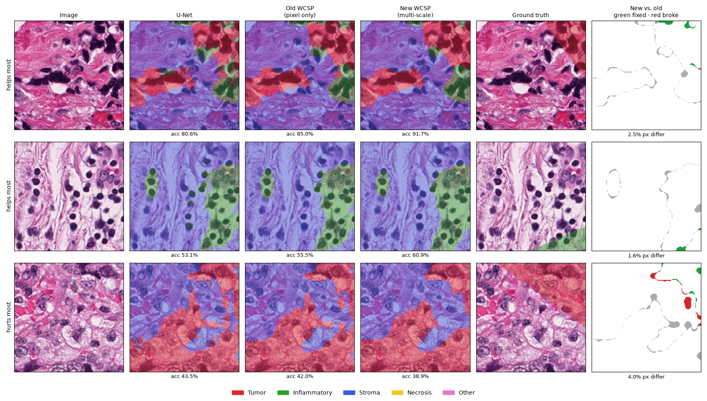
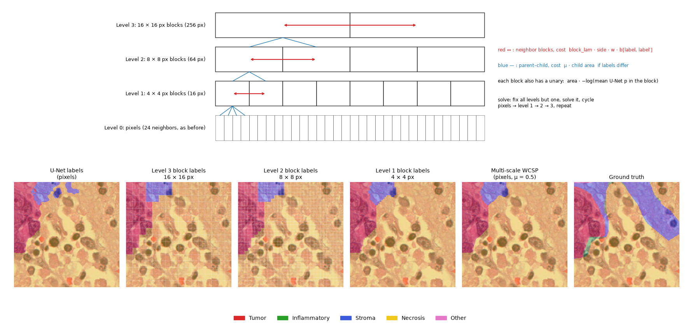
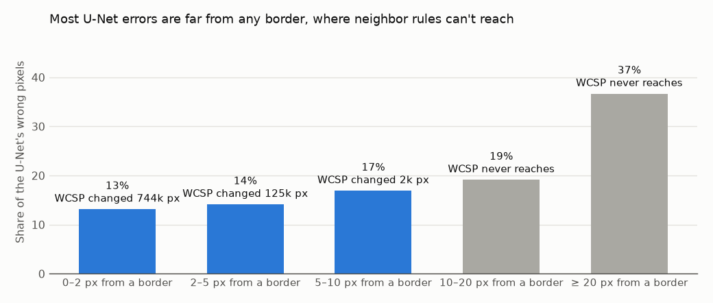
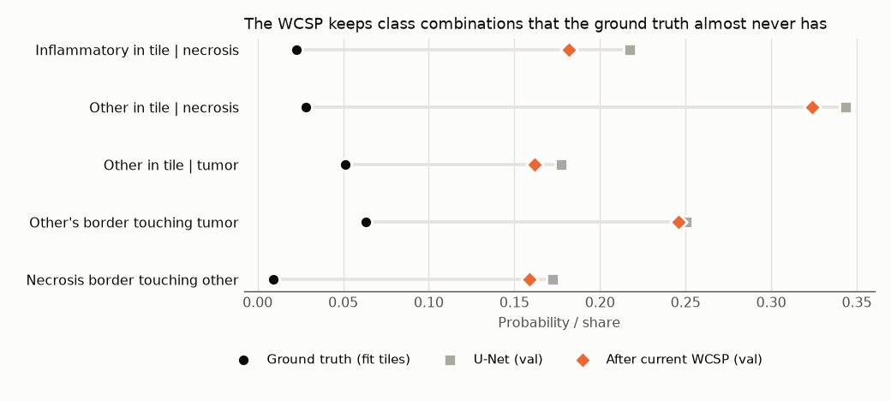
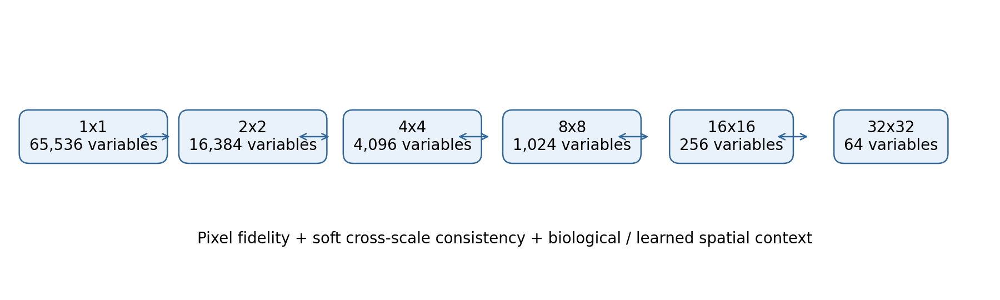
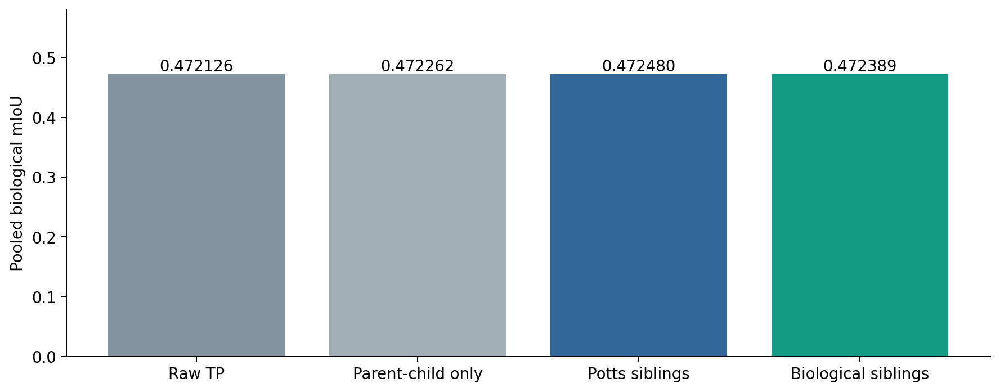
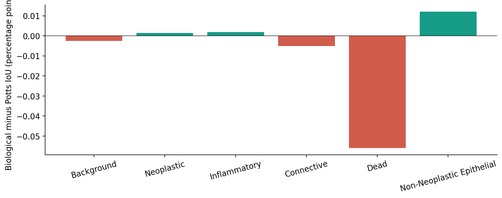

# Deliverable 6 — WCSP refinement experiments

## Summary

| Area | What we tried | Result |
|---|---|---|
| PanNuke | Block fidelity: V1 pixel unaries vs. V2 pixel + block unaries | Both ≈0.472389 biological mIoU; only 83 pixel labels differ |
| PanNuke | BCSS-style area / boundary cost scaling | Matched scaling adds +0.0017 pp vs. V2; 95% CI includes zero |
| PanNuke | Sibling ablation: none / generic Potts / biological | Potts highest numerically (0.472480); no established biological advantage |
| BCSS | Retrain the U-Net with cross-entropy | Dev mIoU 0.6362 → 0.6679 |
| BCSS | Full-resolution head + backbone | Dev mIoU 0.6797, **the best result this week** |
| BCSS | Add a pairwise loss during training | No gain over cross-entropy |
| BCSS | Add distant pixel pairs to the WCSP | No gain, and slower |
| BCSS | toulbar2 with a 2 s per-block limit | No gain over the U-Net; ICM → toulbar2 ties ICM |
| BCSS | toulbar2 without a search timer, alone or after ICM | Both jobs hit the 8-hour allocation limit; no complete accuracy result |

**Main takeaway (BCSS):** improving the classifier gained far more than improving the WCSP. Training gained about +0.04 dev mIoU, while the WCSP adds about +0.001 to +0.003.

- **PanNuke takeaway:** refinements make small aggregate changes; every variant worsens some patches. These are exploratory results on a reused comparison set, not confirmation on fresh data.

## November 8–9: multi-scale WCSP and biological rules

All runs below use the Deliverable 5 setup: pretrained U-Net, central 256 × 256, **data-derived b**, λ = 8 and ICM. Settings are chosen on dev (185 tiles) and run once on val (2,124 tiles).

### Results on val (2,124 tiles)

| Method | mIoU | Δ vs. U-Net [95% CI] | s/tile |
|---|---:|---|---:|
| U-Net | 0.6489 | — | — |
| Current WCSP (pixel neighbors) | 0.6506 | +0.0018 [+0.0011, +0.0024] | 10.2 |
| Current WCSP, run to convergence | 0.6506 | +0.0018 [+0.0011, +0.0024] | 16.7 |
| **Multi-scale blocks** | **0.6517** | **+0.0028 [+0.0016, +0.0040]** | 32.3 |

- **Multi-scale vs. current WCSP, paired:** +0.0011 [+0.0004, +0.0017]. This is the best val result so far.
- **Not from extra solver time:** run until it stops improving (up to 16 rounds), the current WCSP stays at 0.6506.

### Multi-scale blocks

Blocks of 4 × 4, 8 × 8 and 16 × 16 px each get their own label. Each block has three costs:
- **Unary:** how well the label fits the mean U-Net probabilities inside the block.
- **Neighbors:** the b table, against adjacent blocks.
- **Parent–child:** μ per pixel that disagrees with the block containing it.

| Dev setting (U-Net 0.7067, current WCSP 0.7090) | Dev mIoU |
|---|---:|
| μ = 0 / 0.1 / 0.2 / **0.5** / 1 | 0.7090 / 0.7097 / 0.7101 / **0.7108** / 0.7106 |
| 1 / 2 / 3 levels (μ = 0.2) | 0.7097 / 0.7100 / 0.7101 |
| 4 or 5 levels, adding 32 px and 64 px blocks | No change |
| No block neighbors (μ = 0.2) | 0.7096 |

The frozen settings are **μ = 0.5 with 3 levels**.

Both WCSPs change only pixels along region borders (green = fixed, red = broke). Whole regions the U-Net gets wrong stay wrong.

### Why every WCSP gain is small

- **Errors are far from borders:** 56% of the U-Net's wrong pixels are more than 10 px from any border, which no neighbor rule reaches.
- **Smoothing is already maxed out:** an oracle that perfectly fixes every island under 64 px only ties the current WCSP.
- **The table can only smooth:** every b entry is ≥ 0, so borders can only cost energy.

**What's left to fix is which classes appear in a tile.** 23% of WCSP errors are a class the tile's ground truth doesn't contain. Fixing exactly those (an oracle) would give 0.7532.

### Biological rules (running)

Each rule was checked against the fit-split ground truth first:

| Rule | Fit ground truth | Test |
|---|---|---|
| Some class pairs almost never share a tile (e.g. necrosis + inflammatory 2%) | Holds | **Class presence:** choose the tile's classes from U-Net evidence + γ · −log P(class set) from fit counts, then run the WCSP with only those classes |
| Necrosis never borders inflammatory or other (0% / 1% of its border) | Holds | **Exclusion:** raise those b entries to 15 or 50 |
| Necrosis needs tumor in the tile | 58% only, not a rule | Not tested |
| Inflammatory sits inside stroma (95% of its border) | Holds | Not tested: the WCSP output is already at 90% |

Dev sweeps are running: γ ∈ {0, 10, 30, 100, 300, 1000, 3000}, plus the two exclusion tables.

### toulbar2: time and search effort

| Run | Per-block limit | s/tile | Result |
|---|---|---:|---|
| Deliverable 5 val (λ = 4, 2,124 tiles) | 20 s | 87.2 | mIoU +0.0003; mean energy 2,824 → 2,780 vs. ICM's → 1,485 |
| Ryan, dev (181 tiles) | 2 s | 9.4 | No change from the U-Net |
| Ryan, dev | None | — | 14 tiles in 8 h before the job limit |

At 20 s per block, toulbar2 ends 75% of tiles after one round, with *higher* energy than ICM: it runs out of time before matching ICM. A per-block benchmark of search nodes, backtracks and proved optima at 2 / 20 / 120 s is running.

<!-- BEGIN PANNUKE HIERARCHY 20261109 -->
## PanNuke: three controlled follow-up experiments

- **Goal:** match or improve raw HoVer-Net TP predictions; preserve the original V1/V2 experiment.
- **Protocol:** same 100 full 256×256 patches; 200 table-fitting / 12 development patches; six labels including Background.
- **Hierarchy:** pixels → 2×2 → 4×4 → 8×8 → 16×16 → 32×32; soft parent-child consistency and scale-specific neighbor tables.

| Experiment | What changed | Finding |
|---|---|---|
| Block fidelity | V1 has pixel unaries only; V2 adds block unaries | Only 83 final pixel labels differ; no reliable added benefit |
| BCSS-style scaling | Multiply block fidelity by area, sibling costs by side, parent-child costs by child area | No reliable matched-setting advantage over V2 |
| Sibling constraints | Frozen V1; remove siblings, use Potts, or retain learned/biological costs | Potts is best numerically; biological costs do not establish added value |

### Combined results

| Method | Biological mIoU | Δ vs raw (pp) | Patch W / L / tie |
|---|---:|---:|---|
| Raw TP | 0.472126 | +0.0000 | - |
| V1: no block fidelity | 0.472389 | +0.0262 | 58 / 34 / 8 |
| V2: block fidelity | 0.472389 | +0.0263 | 58 / 34 / 8 |
| BCSS scaling: matched | 0.472407 | +0.0280 | 56 / 36 / 8 |
| BCSS scaling: dev-selected | 0.472228 | +0.0101 | 55 / 36 / 9 |
| Parent-child only | 0.472262 | +0.0136 | 57 / 35 / 8 |
| Generic Potts siblings | 0.472480 | +0.0354 | 58 / 34 / 8 |

- **V1 = biological-sibling ablation reference:** pixel labels reproduced exactly; this is the same model, not an independent extra result.
- **Target unmet:** all WCSP variants worsen some patches; Potts improves 58, worsens 34, and ties eight.

### Paired comparisons

| Comparison | Δ biological mIoU (pp) | 95% paired CI (pp) |
|---|---:|---|
| Matched scaling − V2 | +0.0017 | [-0.0054, +0.0087] |
| Dev-selected scaling − V2 | -0.0162 | [-0.0315, -0.0017] |
| Parent-child only − raw | +0.0136 | [-0.0042, +0.0299] |
| Potts − parent-child only | +0.0218 | [+0.0020, +0.0367] |
| Biological − Potts | -0.0091 | [-0.0164, +0.0022] |

- **Generic smoothing contributes:** Potts improves over parent-child alone on the reported interval.
- **Biological contribution is not established:** biological-minus-Potts interval includes zero; the point estimate is lower.

### Interpretation and limitations

- **Fragile classes:** biological costs have lower Dead IoU and slightly higher Non-Neoplastic IoU than Potts; class effects are descriptive.
- **Exploratory comparison:** these patches were already inspected; IDs 908, 2216, 2330 and 2354 also overlap upstream beta-development data.
- **Representation:** PanNuke labels nuclei; Background can dominate mixed coarse blocks. Dead fitting support is sparse.
- **Inference / solver:** reflect-padded borders, simple mismatch costs, local optima, and unverified patient independence limit conclusions.
- **BCSS comparison:** its tissue-region gains do not imply PanNuke gains; only its cost-scaling idea was adapted.
- **Not tested here:** BCSS-style oracle ceilings, class-presence models, regional-rule validation, or a matched solver-time ablation.
- **Next research questions:** retain class proportions in blocks, protect rare structures, validate rules at each scale, then confirm frozen choices on new patches.

### Report and reproducibility

- [Final detailed report](../experiments/pannuke_wcsp/scaling_siblings_20261109/report.pdf)
- [Results, figures and limitations](../experiments/pannuke_wcsp/scaling_siblings_20261109/REPORT.md)
- [Code, manifests and frozen settings](../experiments/pannuke_wcsp/scaling_siblings_20261109/README.md)

<!-- END PANNUKE HIERARCHY 20261109 -->

## BCSS

### New data preparation

Tiles were regenerated from the original images: 7,768 fit, 1,012 dev and 4,028 val, with the same 106/45 hospital-held-out split of tissue regions. **These scores can't be compared directly with Deliverable 5**, which used a different tiling. All of them are dev results; none of the retrained models has a val result yet.

### Training the U-Net (all 1,012 dev tiles, central 256 × 256)

| Model | mIoU | Δ vs. cross-entropy |
|---|---:|---:|
| Pretrained U-Net, no training | 0.6362 | −0.0317 |
| Cross-entropy | 0.6679 | — |
| Full-resolution head + backbone, cross-entropy | **0.6797** | **+0.0117** |
| Cross-entropy + 0.01 × pairwise loss | 0.6597 | −0.0082 |
| Cross-entropy + 0.1 × pairwise loss | 0.6582 | −0.0097 |
| Cross-entropy + 1 × pairwise loss | 0.6654 | −0.0026 |

- All arms ran 10 epochs on one seed, with the checkpoint chosen on dev.
- The full-resolution arm changes architecture and training field together, so its gain can't be credited to resolution alone.

### WCSP on top of the trained models (handwritten b, λ = 8)

These use a 200-tile dev selection. Only rows within one table can be compared.

| Scored on | Model | U-Net mIoU | + WCSP mIoU | s/tile |
|---|---|---:|---:|---:|
| Central field, 181 tiles | Pretrained | 0.6017 | 0.6042 | 26.6 |
| Central field, 181 tiles | Cross-entropy | 0.6441 | 0.6452 | 17.8 |
| Central field, 181 tiles | Cross-entropy + 0.01 × pairwise loss | 0.6245 | 0.6243 | 18.0 |
| Central field, 181 tiles | Cross-entropy + 0.1 × pairwise loss | 0.6241 | 0.6244 | 15.5 |
| Central field, 181 tiles | Cross-entropy + 1 × pairwise loss | 0.6293 | 0.6291 | 13.9 |
| Whole tile, 185 tiles | Pretrained | 0.6223 | 0.6255 | 153.2 |
| Whole tile, 185 tiles | Cross-entropy | 0.6182 | 0.6196 | 240.7 |
| Whole tile, 185 tiles | Full-resolution head | **0.6524** | **0.6545** | 109.2 |

For the pretrained and cross-entropy models, WCSP adds about +0.001 to +0.003 mIoU. All three pairwise-loss evaluations are now complete: WCSP changes mIoU by −0.0002, +0.0003 and −0.0002 at weights 0.01, 0.1 and 1, respectively. None beats the cross-entropy control on these same 181 dev tiles.

### Other WCSP tests (pretrained U-Net, central field, 181 dev tiles, mIoU 0.6017 before WCSP)

| Test | + WCSP mIoU | s/tile |
|---|---:|---:|
| ICM | 0.6042 | 24.7 |
| toulbar2, 2 s per block | 0.6017 | 9.4 |
| ICM → toulbar2, 2 s per block | 0.6042 | 37.1 |
| ICM on the whole grid, no distant pairs | 0.6042 | 22.0 |
| Whole-grid ICM + distant pairs (beyond 8 or 32 px) | 0.6041–0.6042 | 41.3–66.6 |

- **Distant pairs:** extra pixel pairs beyond 8 or 32 px, sampled at random, add runtime with no accuracy gain at the tested sampling rates.
- **toulbar2:** at 2 s per block it gives the same mIoU as the U-Net alone.
- **Without a search timer:** both toulbar2 jobs (alone and after ICM) hit their 8-hour SLURM limit on November 2. Streaming traces record 14 and 13 finished tiles, respectively, but neither run produced a complete shard (0/32 for each). Aggregate mIoU and mean runtime remain unavailable; these jobs are no longer running. The timeout messages are in `data/logs/bcss-toulbar-counts_6715091_{0,1}.out` and `data/logs/bcss-hybrid-counts_6715092_{0,1}.out`.

## Correction to Deliverable 5

The image term f was only scored on dev when Deliverable 5 was written, and it hurt there. Its val run has since finished: on the same 2,124 val tiles, f ties no f (mIoU 0.6507 and +0.0019 for both).

## Not finished

- **BCSS:**
  - toulbar2 without a search timer, with and without ICM first, timed out before producing complete evaluation shards.
  - The retrained models still need a held-out val evaluation with frozen settings.
- **PanNuke:** β = 0.15 needs fresh test patches.

## Next

1. Run the full-resolution model on the held-out val set, with the settings frozen first.
2. Test PanNuke β = 0.15 on patches that haven't been used.
3. Put effort into the classifier, since that's where this week's gain came from. WCSP changes have stayed small on both datasets.

<!-- BEGIN BCSS FOLLOWUP RESULTS -->
## BCSS follow-up experiments (development results)

Automatically refreshed from experiment artifacts at **2026-11-03 00:30 UTC**. Incomplete runs are explicitly marked; their partial metrics are not treated as final results.

**Protocol.** The follow-up uses the same underlying 151 BCSS ROIs and the same 106/45 hospital-held-out ROI split. Tiles were regenerated directly from the upstream images at requested 0.25 MPP: 7,768 fit, 1,012 dev, and 4,028 val tiles. Preparation version 2 preserves both axes of 16-bit grayscale masks; codes 0 and 7 are ignored. The documented earlier preparation has different tile counts, so the historical scores in [Deliverable 5](deliverable_5.md) are not a paired comparison to these follow-ups. These new results are **development results**, not a new held-out-validation result.

**Training.** Cross-entropy (CE) is the supervised pixel-classification loss. The control fine-tunes the original half-resolution U-Net with CE. The full-resolution arm trains the existing full-resolution RGB encoder/decoder refinement head **and** the pretrained backbone on the entire 512×512 tile; this is one forward pass, not shift-and-stitch. Pairwise-loss arms retain the original architecture and central field, adding a differentiable expected compatibility-table cost to CE. All arms use 10 epochs, batch 4, seed 0, and checkpoint selection on dev. The full-resolution checkpoint is selected by whole-tile dev mIoU; other checkpoints use central-crop dev mIoU.

| Training arm | Epochs logged / 10 | Best epoch | Central 256 mIoU | Whole 512 mIoU |
|---|---:|---:|---:|---:|
| Pretrained U-Net reference | 0 | 0 | 0.6362 | — |
| Original architecture, cross-entropy | 10/10 | 8 | 0.6679 | — |
| Full-resolution head + backbone, cross-entropy | 10/10 | 7 | 0.6797 | 0.6648 |
| Cross-entropy + 0.01 × pairwise | 10/10 | 8 | 0.6597 | — |
| Cross-entropy + 0.1 × pairwise | 10/10 | 10 | 0.6582 | — |
| Cross-entropy + 1 × pairwise | 10/10 | 10 | 0.6654 | — |

At the selected checkpoints, the full-resolution arm changes central-crop mIoU by +0.0117 relative to the CE control. Architecture and training field change together; this does not isolate resolution alone.
After all 10 epochs, the strongest pairwise-loss arm differs from the CE control by -0.0026 central-crop mIoU; none of the tested pairwise-loss weights improves on the CE control.

Training-table scores use all 1,012 dev tiles. Inference comparisons below use 200 evenly selected dev tiles, excluding tiles without labeled pixels in the evaluated field (181 central-field tiles; 185 whole-field tiles). Scores across those different populations must not be subtracted. Within each inference table, methods use the same scored field. WCSP uses raw probabilities, the handwritten table, λ=8, η=1, and local neighborhood normalization.

**Central-field model comparisons.**

| Method | Samples | U-Net mIoU | + WCSP mIoU | Mean solve s/tile | Status |
|---|---:|---:|---:|---:|---|
| Pretrained U-Net | 181 | 0.6017 | 0.6042 | 26.6 | Complete |
| Cross-entropy control | 181 | 0.6441 | 0.6452 | 17.8 | Complete |
| Pairwise weight 0.01 | 181 | 0.6245 | 0.6243 | 18.0 | Complete |
| Pairwise weight 0.1 | 181 | 0.6241 | 0.6244 | 15.5 | Complete |
| Pairwise weight 1 | 181 | 0.6293 | 0.6291 | 13.9 | Complete |

**Whole-field model comparisons.**

| Method | Samples | U-Net mIoU | + WCSP mIoU | Mean solve s/tile | Status |
|---|---:|---:|---:|---:|---|
| Pretrained U-Net, bilinear | 185 | 0.6223 | 0.6255 | 153.2 | Complete |
| Cross-entropy control, bilinear | 185 | 0.6182 | 0.6196 | 240.7 | Complete |
| Trained full-resolution head | 185 | 0.6524 | 0.6545 | 109.2 | Complete |

**Solver comparison on the same pretrained central-field probabilities.**

| Method | Samples | U-Net mIoU | + WCSP mIoU | Mean solve s/tile | Status |
|---|---:|---:|---:|---:|---|
| ICM, instrumented | 181 | 0.6017 | 0.6042 | 24.7 | Complete |
| Toulbar2, 2 s/block | 181 | 0.6017 | 0.6017 | 9.4 | Complete |
| ICM → Toulbar2, 2 s/block | 181 | 0.6017 | 0.6042 | 37.1 | Complete |
| Toulbar2, no search timer | — | — | — | — | Pending/incomplete: 0/32 shards |
| ICM → Toulbar2, no search timer | — | — | — | — | Pending/incomplete: 0/32 shards |

ICM permits at most 50 sweeps per block and stops early when no labels change. Block refinement permits four outer rounds and stops early on an energy plateau. The uncapped Toulbar2 arms have no internal search timer; the SLURM allocation still has an 8-hour wall limit. The earlier 2-second-capped searches are retained as separately labeled controls. A capped run that returns its starting labeling quickly is not evidence of faster optimization at comparable quality. Completing a conditioned block search does not establish a global optimum for the image.

- Toulbar2, no search timer: 14 tiles have finished according to streaming traces; 15 searches have returned with 1,668,242 nodes and 497,933 backtracks. Counters exclude searches still running; aggregate mIoU is withheld until all shards exist.
- ICM → Toulbar2, no search timer: 13 tiles have finished according to streaming traces; 11 searches have returned with 1,170,108 nodes and 257,527 backtracks. Counters exclude searches still running; aggregate mIoU is withheld until all shards exist.
Instrumented ICM used 9,320 sweeps over 1,692 block calls (5.51 sweeps/call); 3 calls reached the sweep cap. Outer stopping reasons: 151 energy plateaus and 30 round-limit stops. An outer energy plateau is not a proof of global optimality.

**Sampled distant relations.** Each unordered pair beyond Euclidean distance d is included independently with probability p. Extra edges retain the same compatibility table and distance decay, without diluting local weights or inverse-probability scaling. These runs use whole-grid ICM; the p=0 row is their matching solver control.

| Method | Samples | U-Net mIoU | + WCSP mIoU | Mean solve s/tile | Status |
|---|---:|---:|---:|---:|---|
| No distant edges (p=0) | 181 | 0.6017 | 0.6042 | 22.0 | Complete |
| d=8, p=0.000001 | 181 | 0.6017 | 0.6042 | 41.3 | Complete |
| d=8, p=0.00001 | 181 | 0.6017 | 0.6041 | 53.5 | Complete |
| d=32, p=0.000001 | 181 | 0.6017 | 0.6042 | 52.4 | Complete |
| d=32, p=0.00001 | 181 | 0.6017 | 0.6041 | 66.6 | Complete |

Observed distant-edge mIoU differences from the matching control range from -0.000039 to -0.000011. These settings show no observed accuracy gain; they add runtime. This is a dev observation, not a validation claim.

**Historical shift-and-stitch reference.** The recorded earlier 200-tile dev selection scored the central 256×256 field. Bilinear U-Net / shift-and-stitch mIoU were 0.7067 / 0.7071; with WCSP at λ=8, 0.7097 / 0.7139. Shift-and-stitch interleaves four shifted forward passes with no retraining. There is no fresh shift-and-stitch result on the current tile selection yet; do not rank these historical numbers against the new training table. Source: [BCSS benchmark notes](../benchmarks/bcss/README.md#addendum-changing-the-u-nets-output-resolution).

**Artifacts and interpretation.** Experiment definitions and reproduction commands are in [the BCSS runbook](../experiments/bcss_wcsp/TONIGHT.md). Current logs, predictions, per-tile CSVs, streaming iteration traces, and the machine-readable report snapshot are under `data/outputs/tonight/` and `data/tonight/` on the cluster. Runtime is observed per-tile wall time under concurrent cluster load, not a controlled hardware microbenchmark. Dev checkpoint selection and parameter comparisons do not replace a separately frozen validation evaluation. Energy reduction, segmentation accuracy, and solver runtime are reported as distinct outcomes.
<!-- END BCSS FOLLOWUP RESULTS -->
