# Deliverable 6 — WCSP refinement experiments

## Summary

| Area | What we tried | Result |
|---|---|---|
| PanNuke | Block fidelity: V1 pixel unaries vs. V2 pixel + block unaries | Both ≈0.472389 biological mIoU; only 83 pixel labels differ |
| PanNuke | BCSS-style area / boundary cost scaling | Matched scaling adds +0.0017 pp vs. V2; 95% CI includes zero |
| PanNuke | Sibling ablation: none / generic Potts / biological | Potts highest numerically (0.472480); no established biological advantage |
| PanNuke | Sibling decay and nucleus-level neighbor constraints | No clear gain over their matched controls |
| **PanNuke** | **Frozen patch-wide type-set WCSP, 300 new patches** | **+0.00534 mIoU vs. Raw TP and +0.00249 vs. fixed-mask voting. Both paired intervals exclude zero** |
| BCSS | Retrain the U-Net with cross-entropy | Dev mIoU 0.6362 → 0.6679 |
| BCSS | Full-resolution head + backbone | Dev mIoU 0.6797, **the best result this week** |
| BCSS | Add a pairwise loss during training | No gain over cross-entropy |
| BCSS | Add distant pixel pairs to the WCSP | No gain, and slower |
| BCSS | toulbar2 with a 2 s per-block limit | No gain over the U-Net; ICM → toulbar2 ties ICM |
| BCSS | toulbar2 without a search timer, alone or after ICM | Both jobs hit the 8-hour allocation limit; no complete accuracy result |

**Main takeaway (BCSS):** improving the classifier gained far more than improving the WCSP. Training gained about +0.04 dev mIoU, while the WCSP adds about +0.001 to +0.003.

- **PanNuke takeaway:** patch-wide type context improved mIoU on the larger replication. Dead nuclei remain a weakness.

## PanNuke: three controlled follow-up experiments

- **Goal:** match or improve raw HoVer-Net TP predictions; preserve the original V1/V2 experiment.
- **Protocol:** same 100 full 256×256 patches; 200 table-fitting / 12 development patches; six labels including Background.
- **Hierarchy:** pixels → 2×2 → 4×4 → 8×8 → 16×16 → 32×32; soft parent-child consistency and scale-specific neighbor tables.

| Experiment | What changed | Finding |
|---|---|---|
| Block fidelity | V1 has pixel unaries only; V2 adds block unaries | Only 83 final pixel labels differ; no reliable added benefit |
| BCSS-style scaling | Multiply block fidelity by area, sibling costs by side, parent-child costs by child area | No reliable matched-setting advantage over V2 |
| Sibling constraints | Frozen V1; remove siblings, use Potts, or retain learned/biological costs | Potts is best numerically; biological costs do not establish added value |

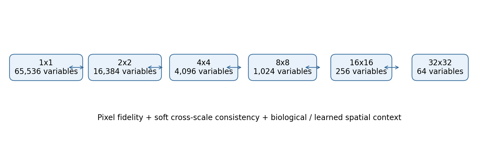

### Combined results

| Method | Biological mIoU | Δ vs raw (pp) | Patch W / L / tie |
|---|---:|---:|---|
| Raw TP | 0.472126 | +0.0000 | - |
| V1: no block fidelity | 0.472389 | +0.0262 | 58 / 34 / 8 |
| V2: block fidelity | 0.472389 | +0.0263 | 58 / 34 / 8 |
| BCSS scaling: matched | 0.472407 | +0.0280 | 56 / 36 / 8 |
| BCSS scaling: dev-selected | 0.472228 | +0.0101 | 55 / 36 / 9 |
| Parent-child only | 0.472262 | +0.0136 | 57 / 35 / 8 |
| Generic Potts siblings | 0.472480 | +0.0354 | 58 / 34 / 8 |

- **V1 = biological-sibling ablation reference:** pixel labels reproduced exactly; this is the same model, not an independent extra result.
- **Target unmet:** all WCSP variants worsen some patches; Potts improves 58, worsens 34, and ties eight.

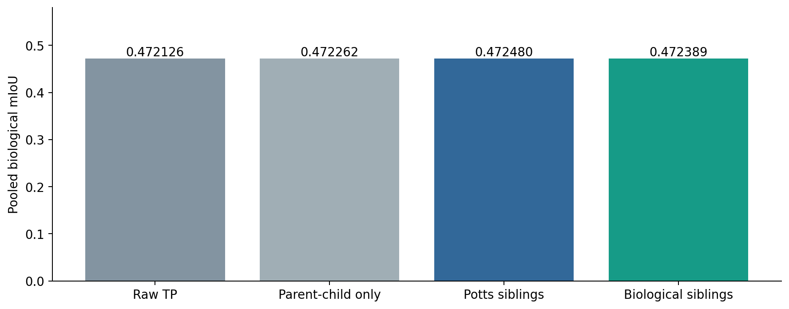

### Paired comparisons

| Comparison | Δ biological mIoU (pp) | 95% paired CI (pp) |
|---|---:|---|
| Matched scaling − V2 | +0.0017 | [-0.0054, +0.0087] |
| Dev-selected scaling − V2 | -0.0162 | [-0.0315, -0.0017] |
| Parent-child only − raw | +0.0136 | [-0.0042, +0.0299] |
| Potts − parent-child only | +0.0218 | [+0.0020, +0.0367] |
| Biological − Potts | -0.0091 | [-0.0164, +0.0022] |

- **Generic smoothing contributes:** Potts improves over parent-child alone on the reported interval.
- **Biological contribution is not established:** biological-minus-Potts interval includes zero; the point estimate is lower.

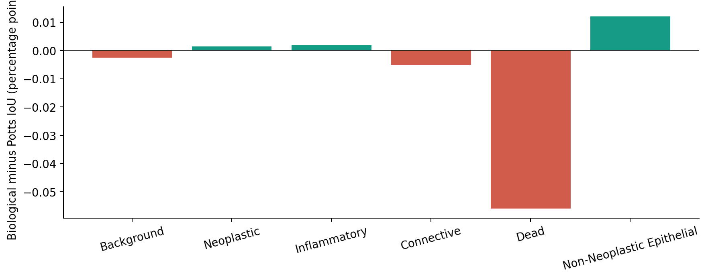

### Interpretation and limitations

- **Fragile classes:** biological costs have lower Dead IoU and slightly higher Non-Neoplastic IoU than Potts; class effects are descriptive.
- **Exploratory comparison:** these patches were already inspected; IDs 908, 2216, 2330 and 2354 also overlap upstream beta-development data.
- **Representation:** PanNuke labels nuclei; Background can dominate mixed coarse blocks. Dead fitting support is sparse.
- **Inference / solver:** reflect-padded borders, simple mismatch costs, local optima, and unverified patient independence limit conclusions.
- **BCSS comparison:** its tissue-region gains do not imply PanNuke gains; only its cost-scaling idea was adapted.
- **Not tested here:** BCSS-style oracle ceilings, class-presence models, regional-rule validation, or a matched solver-time ablation.
- **Next research questions:** retain class proportions in blocks, protect rare structures, validate rules at each scale, then confirm frozen choices on new patches.

### Report and reproducibility

- [Final detailed report](../experiments/pannuke_wcsp/scaling_siblings_20261109/report.pdf)
- [Results, figures and limitations](../experiments/pannuke_wcsp/scaling_siblings_20261109/REPORT.md)
- [Code, manifests and frozen settings](../experiments/pannuke_wcsp/scaling_siblings_20261109/README.md)

<!-- END PANNUKE HIERARCHY 20261109 -->

<!-- BEGIN PANNUKE FOLLOWUP 20261114 -->
## PanNuke follow-up: from decay to patch-wide WCSP

**Scroll order:** [First decay](#1-first-decay-sibling-weights) → [Separate schedules](#2-follow-up-separate-weights-for-each-constraint) → [Nucleus controls](#3-one-type-per-nucleus) → [Patch-wide WCSP](#4-patch-wide-wcsp-the-final-result) → [Real patch and errors](#5-what-changed-and-where-errors-remain)

### 1. First decay: sibling weights

- **Question:** does giving coarse neighbors a stronger say help? V1 had a sibling coefficient of 0.30 at every level. We kept 32×32 at 0.30, multiplied by **0.60** for each step down to a smaller block, and left the pixel sibling coefficient at 0.30.

| Level | 1×1 | 2×2 | 4×4 | 8×8 | 16×16 | 32×32 |
|---|---:|---:|---:|---:|---:|---:|
| Sibling coefficient | 0.30 | 0.03888 | 0.06480 | 0.10800 | 0.18000 | 0.30000 |

- **Result on 100 patches:** **−0.000047 mIoU** vs. equal-weight V1 [−0.000136, +0.000015]. On dev, weaker uniform block weights tied the best decay setting. Boosting only the largest blocks left the score unchanged. [First decay sweep](../experiments/pannuke_wcsp/decay_20261114/README.md)

### 2. Follow-up: separate weights for each constraint

- **Question:** would a different schedule work better? We screened 24 configurations on 48 development patches, then froze the top choice in each family and a combination of the three. We show this alongside the first decay test for comparison. The follow-up ran after the patch-wide experiment and reused its 300 comparison patches.

| Level | Sibling coefficient | Parent–child penalty (this level as child) | Fidelity weight |
|---|---:|---:|---:|
| 1×1 pixel | 0.300000 | 0.016129 | 1.00 |
| 2×2 block | 0.774194 | 0.032258 | 0.30 × confidence factor |
| 4×4 block | 0.387097 | 0.064516 | 0.30 × confidence factor |
| 8×8 block | 0.193548 | 0.129032 | 0.30 × confidence factor |
| 16×16 block | 0.096774 | 0.258065 | 0.30 × confidence factor |
| 32×32 block | 0.048387 | — | 0.30 × confidence factor |

- **Fidelity factor:** `0.25 + 0.75 × margin`, where margin is the gap between the block’s two highest mean HoVer-Net probabilities. Low-margin blocks have less influence. The parent penalty is for a label mismatch from this child to its immediate parent.

| Schedule | Compared with | Δ mIoU on 300 patches |
|---|---|---:|
| Parent–child stronger for larger children | V1 | −0.000021 |
| Siblings stronger for smaller blocks | V1 | −0.000006 |
| Confidence-weighted block fidelity | V2 | +0.000005 |
| All three together | V1 | −0.000020 |

- **Why it might not have helped:** a PanNuke block can contain several tiny nuclei, different cell types, and a lot of background. One label per block loses that mix. Changing the weight may just make the solver listen more or less to the same coarse summary. The data show that these weight schedules gave no clear gain. They do not establish the cause. [Exact weights and paired intervals](../experiments/pannuke_wcsp/family_decay_20261117/README.md)

#### Where combined decay hurt

- **Against equal-weight V1:** 134 patches improved, 137 worsened, and 29 tied. The two examples show the median loss and the largest loss among the worsened patches.

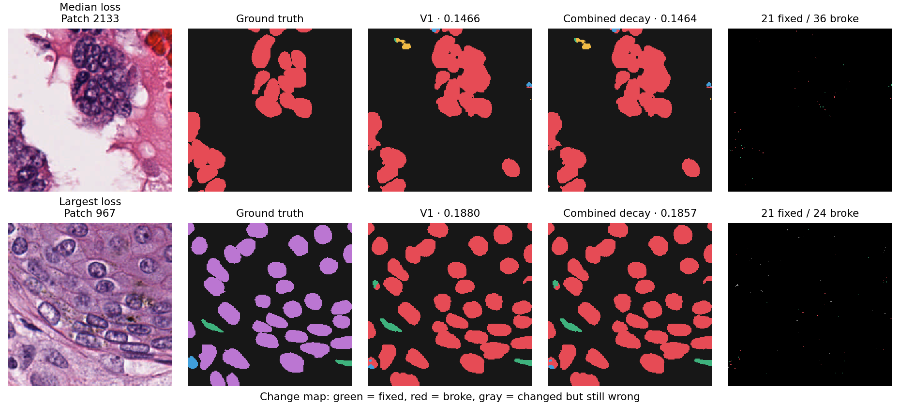

| Patch | Δ mIoU vs. V1 | What changed |
|---|---:|---|
| 2133, median loss | −0.00019 | 21 pixels fixed, 36 broke. The most common new error was Background relabeled Neoplastic (20 pixels). |
| 967, largest loss | −0.00234 | 21 pixels fixed, 24 broke, and 40 changed to a different wrong label. Both predictions leave many annotated epithelial nuclei labeled Neoplastic. |

- **What the examples suggest:** decay moved a few pixel labels but left the bigger typing error largely in place on patch 967. The parent–child schedule alone gave the same mIoU drop as combined decay on both patches. On patch 967, the sibling schedule alone also hurt (−0.00300), while adaptive fidelity tied V2 on both patches. These are two loss cases, so they do not establish which term drove the overall result.

### 3. One type per nucleus

- **Change of approach:** keep HoVer-Net’s detected outlines. Use the pixel votes inside each outline to assign one type to the whole nucleus.
- **Controls:** nucleus-neighbor Potts lost 0.00176 mIoU versus voting on the same masks. Count penalties also fell short of voting. The Raw TP-only component WCSP gained 0.00345 versus Raw TP, with an interval that included zero.
- **Why keep working on typing?** An answer-key check copied the correct types onto matched nuclei and raised mIoU from 0.4533 to 0.7020 on the earlier instance sample. This measured how much typing could change the score on the existing outlines. [Nucleus-level runs](../experiments/pannuke_wcsp/instances_20261114/README.md)

### 4. Patch-wide WCSP: the final result

- **What changed:** keep those same outlines and votes. Also ask which types the patch supports. The solver checks feasible sets of the five nucleus types and picks the assignment with the lowest total cost.
- **What helped:** compare WCSP with **fixed-mask voting** to isolate the patch rule. The change versus Raw TP includes both the move to one type per outline and the patch rule.

<strong>Optional walkthrough: which scores and which patches does the solver use?</strong>

- **One patch at a time.** The solver sees the detected outlines and type probabilities inside the current 256×256 patch. Other nuclei anywhere **inside that patch** can affect a decision through the shared type set. The solver has no links to nearby patches on the slide and does not read their predictions at inference time.
- **Local cost for each nucleus.** Every pixel inside the outline votes for its highest-probability label. We tally non-background votes. For candidate type **c**, the nucleus pays `−log((votes(c) + 0.5) / (total foreground votes + 2.5))`. More votes make a type cheaper. If every vote is Background, the method uses the summed foreground probability scores instead. The outline is fixed and must receive one of the five nucleus types.
- **What comes from other patches.** Before inference, we used **200 annotated fitting patches** to count which *sets* of nucleus types occurred. We grouped patches by nucleus count (0–7, 8–19, 20–39, 40 or more) and smoothed the frequencies so unseen sets still have finite cost. Each group gets 16 pseudo-counts spread across sets according to the overall fitted frequencies. On a new patch, its number of **detected** nuclei selects one group. The assignment pays `−log(fitted probability of the proposed type set)` **once for the entire patch**. At inference, the solver uses this frozen table. It does not look up individual fitting patches.
- **Probability support inside the current patch.** The solver also uses the full HoVer-Net scores. For each nucleus, it sums the pixel probabilities by type inside its outline and normalizes over the five foreground types. For each proposed type, it takes the **strongest** such support from any detected nucleus. Each type in the set pays `−log(strongest support)`. A rare type can still win when its local votes and probability support justify it.
- **How the solver chooses.** For every feasible nonempty type set, find the cheapest local assignment that uses every type in that set at least once. Add the fitted set cost and the support costs, then keep the lowest total. There are at most **31** sets. Human annotations on the comparison patches enter only when we score the results.

**What to say at the figure:** “Other patches taught us which type combinations are common. On this patch, we use HoVer-Net’s own votes and scores to decide if that combination fits. We keep the outlines and change only the type labels.”

| Run | Raw TP | Fixed-mask vote | Type-set WCSP | Δ vs. Raw TP [95% paired CI] | Δ vs. vote [95% paired CI] |
|---|---:|---:|---:|---:|---:|
| Initial comparison, 100 patches | 0.45436 | 0.46331 | 0.47297 | +0.01861 [+0.00341, +0.06169] | +0.00966 [+0.00144, +0.04715] |
| **Frozen replication, 300 patches** | **0.39474** | **0.39758** | **0.40007** | **+0.00534 [+0.00186, +0.00849]** | **+0.00249 [+0.00094, +0.00421]** |

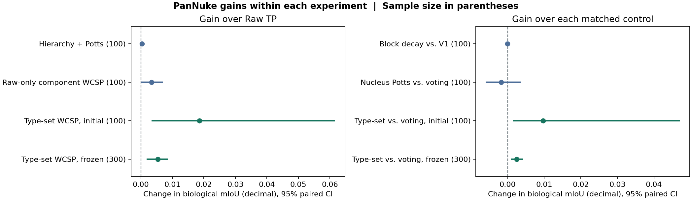

- **How to read the chart:** left compares to raw predictions, right compares to each experiment’s matched control. Each row uses its own cohort. The first type-set gain was larger numerically. The 300-patch run confirmed a smaller gain with frozen settings. [Type-set experiments](../experiments/pannuke_wcsp/presence_20261114/README.md)

### 5. What changed and where errors remain

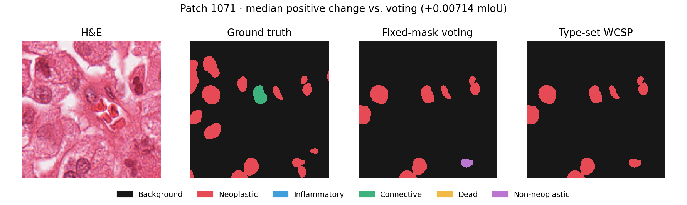

- **Read the example:** point to the dashed box in the last three panels. The annotation is red (Neoplastic), ordinary voting is purple (Non-neoplastic epithelial), and WCSP changes it back to red while keeping the outline. Patch mIoU rose from **0.08151 to 0.08865** (Δ **+0.00714**). This is the median change among improved patches.
- **Why patch context helped:** voting scores each nucleus alone. When one nucleus introduces a new type, it changes the patch-wide cost for the whole assignment. The solver charges that cost once per patch. On patch 1071, the change raised the local vote cost from **0.795 to 2.473**, but lowered the fitted type-set cost from **7.185 to 2.725**. With the model support term included, total cost fell from **8.232 to 5.199**. The ground-truth annotation agrees with the resulting type in this example.
- **Evidence across the 300 patches:** the type-set rule cut **13,137** wrong pixels assigned to a type missing from the annotation. It gained **0.00249 mIoU** over voting on identical masks. A patch prior can still penalize a real but unusual type, so this is an overall gain with class-specific limits.

- **What improved:** 22 matched nucleus types fixed and 3 broken versus voting. WCSP corrected pixels both near boundaries (3,644 fixed / 490 broken) and farther away (6,701 / 1,132). Wrong pixels assigned a type absent from the annotated patch dropped from 265,180 to 252,043. Of the remaining 1,376,016 wrong WCSP pixels, 717,071 were more than two pixels from a nucleus boundary.
- **What still needs work:** excluding Dead, mIoU rose 0.00667 versus Raw TP. In the separate 21-patch Dead-positive set, Dead IoU fell 0.03465. Only 2 of 200 fitting patches contained Dead. Patient and slide independence are unverified.
- **Diagnostic and timing:** correcting every absent-type voting error with ground truth would raise mIoU from 0.39758 to 0.48741. This answer-key check can change masks. The actual solver reproduced its 300 saved outputs in an audit and took a median 2.0 ms per patch for cached-input cost construction and solving, excluding HoVer-Net inference.

- [Teammate review PDF](../experiments/pannuke_wcsp/presence_scale_20261114/output/pdf/pannuke_review.pdf) · [Replication, per-class results and error audit](../experiments/pannuke_wcsp/presence_scale_20261114/README.md)
<!-- END PANNUKE FOLLOWUP 20261114 -->

## BCSS

### New data preparation

Tiles were regenerated from the original images: 7,768 fit, 1,012 dev and 4,028 val, with the same 106/45 hospital-held-out split of tissue regions. **These scores can't be compared directly with Deliverable 5**, which used a different tiling. All of them are dev results; none of the retrained models has a val result yet.

### Training the U-Net (all 1,012 dev tiles, central 256 × 256)

| Model | mIoU | Δ vs. cross-entropy |
|---|---:|---:|
| Pretrained U-Net, no training | 0.6362 | −0.0317 |
| Cross-entropy | 0.6679 | — |
| Full-resolution head + backbone, cross-entropy | **0.6797** | **+0.0117** |
| Cross-entropy + 0.01 × pairwise loss | 0.6597 | −0.0082 |
| Cross-entropy + 0.1 × pairwise loss | 0.6582 | −0.0097 |
| Cross-entropy + 1 × pairwise loss | 0.6654 | −0.0026 |

- All arms ran 10 epochs on one seed, with the checkpoint chosen on dev.
- The full-resolution arm changes architecture and training field together, so its gain can't be credited to resolution alone.

### WCSP on top of the trained models (handwritten b, λ = 8)

These use a 200-tile dev selection. Only rows within one table can be compared.

| Scored on | Model | U-Net mIoU | + WCSP mIoU | s/tile |
|---|---|---:|---:|---:|
| Central field, 181 tiles | Pretrained | 0.6017 | 0.6042 | 26.6 |
| Central field, 181 tiles | Cross-entropy | 0.6441 | 0.6452 | 17.8 |
| Central field, 181 tiles | Cross-entropy + 0.01 × pairwise loss | 0.6245 | 0.6243 | 18.0 |
| Central field, 181 tiles | Cross-entropy + 0.1 × pairwise loss | 0.6241 | 0.6244 | 15.5 |
| Central field, 181 tiles | Cross-entropy + 1 × pairwise loss | 0.6293 | 0.6291 | 13.9 |
| Whole tile, 185 tiles | Pretrained | 0.6223 | 0.6255 | 153.2 |
| Whole tile, 185 tiles | Cross-entropy | 0.6182 | 0.6196 | 240.7 |
| Whole tile, 185 tiles | Full-resolution head | **0.6524** | **0.6545** | 109.2 |

For the pretrained and cross-entropy models, WCSP adds about +0.001 to +0.003 mIoU. All three pairwise-loss evaluations are now complete: WCSP changes mIoU by −0.0002, +0.0003 and −0.0002 at weights 0.01, 0.1 and 1, respectively. None beats the cross-entropy control on these same 181 dev tiles.

### Other WCSP tests (pretrained U-Net, central field, 181 dev tiles, mIoU 0.6017 before WCSP)

| Test | + WCSP mIoU | s/tile |
|---|---:|---:|
| ICM | 0.6042 | 24.7 |
| toulbar2, 2 s per block | 0.6017 | 9.4 |
| ICM → toulbar2, 2 s per block | 0.6042 | 37.1 |
| ICM on the whole grid, no distant pairs | 0.6042 | 22.0 |
| Whole-grid ICM + distant pairs (beyond 8 or 32 px) | 0.6041–0.6042 | 41.3–66.6 |

- **Distant pairs:** extra pixel pairs beyond 8 or 32 px, sampled at random, add runtime with no accuracy gain at the tested sampling rates.
- **toulbar2:** at 2 s per block it gives the same mIoU as the U-Net alone.
- **Without a search timer:** both toulbar2 jobs (alone and after ICM) hit their 8-hour SLURM limit on November 2. Streaming traces record 14 and 13 finished tiles, respectively, but neither run produced a complete shard (0/32 for each). Aggregate mIoU and mean runtime remain unavailable; these jobs are no longer running. The timeout messages are in `data/logs/bcss-toulbar-counts_6715091_{0,1}.out` and `data/logs/bcss-hybrid-counts_6715092_{0,1}.out`.

## Correction to Deliverable 5

The image term f was only scored on dev when Deliverable 5 was written, and it hurt there. Its val run has since finished: on the same 2,124 val tiles, f ties no f (mIoU 0.6507 and +0.0019 for both).

## Not finished

- **BCSS:**
  - toulbar2 without a search timer, with and without ICM first, timed out before producing complete evaluation shards.
  - The retrained models still need a held-out val evaluation with frozen settings.
- **PanNuke:** β = 0.15 needs fresh test patches.

## Next

1. Run the full-resolution model on the held-out val set, with the settings frozen first.
2. Test PanNuke β = 0.15 on patches that haven't been used.
3. Put effort into the classifier, since that's where this week's gain came from. WCSP changes have stayed small on both datasets.

<!-- BEGIN BCSS FOLLOWUP RESULTS -->
## BCSS follow-up experiments (development results)

Automatically refreshed from experiment artifacts at **2026-11-03 00:30 UTC**. Incomplete runs are explicitly marked; their partial metrics are not treated as final results.

**Protocol.** The follow-up uses the same underlying 151 BCSS ROIs and the same 106/45 hospital-held-out ROI split. Tiles were regenerated directly from the upstream images at requested 0.25 MPP: 7,768 fit, 1,012 dev, and 4,028 val tiles. Preparation version 2 preserves both axes of 16-bit grayscale masks; codes 0 and 7 are ignored. The documented earlier preparation has different tile counts, so the historical scores in [Deliverable 5](deliverable_5.md) are not a paired comparison to these follow-ups. These new results are **development results**, not a new held-out-validation result.

**Training.** Cross-entropy (CE) is the supervised pixel-classification loss. The control fine-tunes the original half-resolution U-Net with CE. The full-resolution arm trains the existing full-resolution RGB encoder/decoder refinement head **and** the pretrained backbone on the entire 512×512 tile; this is one forward pass, not shift-and-stitch. Pairwise-loss arms retain the original architecture and central field, adding a differentiable expected compatibility-table cost to CE. All arms use 10 epochs, batch 4, seed 0, and checkpoint selection on dev. The full-resolution checkpoint is selected by whole-tile dev mIoU; other checkpoints use central-crop dev mIoU.

| Training arm | Epochs logged / 10 | Best epoch | Central 256 mIoU | Whole 512 mIoU |
|---|---:|---:|---:|---:|
| Pretrained U-Net reference | 0 | 0 | 0.6362 | — |
| Original architecture, cross-entropy | 10/10 | 8 | 0.6679 | — |
| Full-resolution head + backbone, cross-entropy | 10/10 | 7 | 0.6797 | 0.6648 |
| Cross-entropy + 0.01 × pairwise | 10/10 | 8 | 0.6597 | — |
| Cross-entropy + 0.1 × pairwise | 10/10 | 10 | 0.6582 | — |
| Cross-entropy + 1 × pairwise | 10/10 | 10 | 0.6654 | — |

At the selected checkpoints, the full-resolution arm changes central-crop mIoU by +0.0117 relative to the CE control. Architecture and training field change together; this does not isolate resolution alone.
After all 10 epochs, the strongest pairwise-loss arm differs from the CE control by -0.0026 central-crop mIoU; none of the tested pairwise-loss weights improves on the CE control.

Training-table scores use all 1,012 dev tiles. Inference comparisons below use 200 evenly selected dev tiles, excluding tiles without labeled pixels in the evaluated field (181 central-field tiles; 185 whole-field tiles). Scores across those different populations must not be subtracted. Within each inference table, methods use the same scored field. WCSP uses raw probabilities, the handwritten table, λ=8, η=1, and local neighborhood normalization.

**Central-field model comparisons.**

| Method | Samples | U-Net mIoU | + WCSP mIoU | Mean solve s/tile | Status |
|---|---:|---:|---:|---:|---|
| Pretrained U-Net | 181 | 0.6017 | 0.6042 | 26.6 | Complete |
| Cross-entropy control | 181 | 0.6441 | 0.6452 | 17.8 | Complete |
| Pairwise weight 0.01 | 181 | 0.6245 | 0.6243 | 18.0 | Complete |
| Pairwise weight 0.1 | 181 | 0.6241 | 0.6244 | 15.5 | Complete |
| Pairwise weight 1 | 181 | 0.6293 | 0.6291 | 13.9 | Complete |

**Whole-field model comparisons.**

| Method | Samples | U-Net mIoU | + WCSP mIoU | Mean solve s/tile | Status |
|---|---:|---:|---:|---:|---|
| Pretrained U-Net, bilinear | 185 | 0.6223 | 0.6255 | 153.2 | Complete |
| Cross-entropy control, bilinear | 185 | 0.6182 | 0.6196 | 240.7 | Complete |
| Trained full-resolution head | 185 | 0.6524 | 0.6545 | 109.2 | Complete |

**Solver comparison on the same pretrained central-field probabilities.**

| Method | Samples | U-Net mIoU | + WCSP mIoU | Mean solve s/tile | Status |
|---|---:|---:|---:|---:|---|
| ICM, instrumented | 181 | 0.6017 | 0.6042 | 24.7 | Complete |
| Toulbar2, 2 s/block | 181 | 0.6017 | 0.6017 | 9.4 | Complete |
| ICM → Toulbar2, 2 s/block | 181 | 0.6017 | 0.6042 | 37.1 | Complete |
| Toulbar2, no search timer | — | — | — | — | Pending/incomplete: 0/32 shards |
| ICM → Toulbar2, no search timer | — | — | — | — | Pending/incomplete: 0/32 shards |

ICM permits at most 50 sweeps per block and stops early when no labels change. Block refinement permits four outer rounds and stops early on an energy plateau. The uncapped Toulbar2 arms have no internal search timer; the SLURM allocation still has an 8-hour wall limit. The earlier 2-second-capped searches are retained as separately labeled controls. A capped run that returns its starting labeling quickly is not evidence of faster optimization at comparable quality. Completing a conditioned block search does not establish a global optimum for the image.

- Toulbar2, no search timer: 14 tiles have finished according to streaming traces; 15 searches have returned with 1,668,242 nodes and 497,933 backtracks. Counters exclude searches still running; aggregate mIoU is withheld until all shards exist.
- ICM → Toulbar2, no search timer: 13 tiles have finished according to streaming traces; 11 searches have returned with 1,170,108 nodes and 257,527 backtracks. Counters exclude searches still running; aggregate mIoU is withheld until all shards exist.
Instrumented ICM used 9,320 sweeps over 1,692 block calls (5.51 sweeps/call); 3 calls reached the sweep cap. Outer stopping reasons: 151 energy plateaus and 30 round-limit stops. An outer energy plateau is not a proof of global optimality.

**Sampled distant relations.** Each unordered pair beyond Euclidean distance d is included independently with probability p. Extra edges retain the same compatibility table and distance decay, without diluting local weights or inverse-probability scaling. These runs use whole-grid ICM; the p=0 row is their matching solver control.

| Method | Samples | U-Net mIoU | + WCSP mIoU | Mean solve s/tile | Status |
|---|---:|---:|---:|---:|---|
| No distant edges (p=0) | 181 | 0.6017 | 0.6042 | 22.0 | Complete |
| d=8, p=0.000001 | 181 | 0.6017 | 0.6042 | 41.3 | Complete |
| d=8, p=0.00001 | 181 | 0.6017 | 0.6041 | 53.5 | Complete |
| d=32, p=0.000001 | 181 | 0.6017 | 0.6042 | 52.4 | Complete |
| d=32, p=0.00001 | 181 | 0.6017 | 0.6041 | 66.6 | Complete |

Observed distant-edge mIoU differences from the matching control range from -0.000039 to -0.000011. These settings show no observed accuracy gain; they add runtime. This is a dev observation, not a validation claim.

**Historical shift-and-stitch reference.** The recorded earlier 200-tile dev selection scored the central 256×256 field. Bilinear U-Net / shift-and-stitch mIoU were 0.7067 / 0.7071; with WCSP at λ=8, 0.7097 / 0.7139. Shift-and-stitch interleaves four shifted forward passes with no retraining. There is no fresh shift-and-stitch result on the current tile selection yet; do not rank these historical numbers against the new training table. Source: [BCSS benchmark notes](../benchmarks/bcss/README.md#addendum-changing-the-u-nets-output-resolution).

**Artifacts and interpretation.** Experiment definitions and reproduction commands are in [the BCSS runbook](../experiments/bcss_wcsp/TONIGHT.md). Current logs, predictions, per-tile CSVs, streaming iteration traces, and the machine-readable report snapshot are under `data/outputs/tonight/` and `data/tonight/` on the cluster. Runtime is observed per-tile wall time under concurrent cluster load, not a controlled hardware microbenchmark. Dev checkpoint selection and parameter comparisons do not replace a separately frozen validation evaluation. Energy reduction, segmentation accuracy, and solver runtime are reported as distinct outcomes.
<!-- END BCSS FOLLOWUP RESULTS -->

## November 8–9: multi-scale WCSP and biological rules

All runs below use the Deliverable 5 setup: pretrained U-Net, central 256 × 256, **data-derived b**, λ = 8 and ICM. Settings are chosen on dev (185 tiles) and run once on val (2,124 tiles).

**Note:** this is the original half-resolution U-Net. The full-resolution U-Net from the BCSS section above is stored where our accounts can't read it, so none of these results use it.

### Results on val (2,124 tiles)

| Method | mIoU | Δ vs. U-Net [95% CI] | s/tile |
|---|---:|---|---:|
| U-Net | 0.6489 | — | — |
| Current WCSP, 4 rounds (default) | 0.6506 | +0.0018 [+0.0011, +0.0024] | 10.2 |
| Current WCSP, run until no improvement (≤ 16 rounds) | 0.6506 | +0.0018 [+0.0011, +0.0024] | 16.7 |
| **Multi-scale blocks** | **0.6517** | **+0.0028 [+0.0016, +0.0040]** | 32.3 |

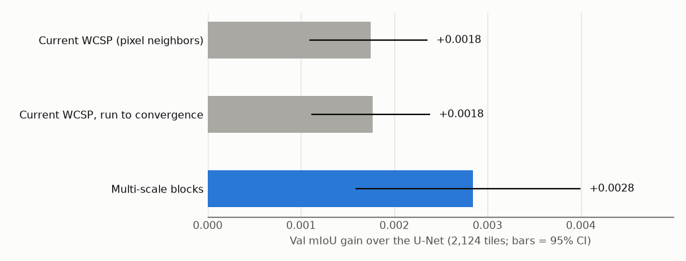

- **Multi-scale vs. current WCSP, paired:** +0.0011 [+0.0004, +0.0017]. This is the best val result so far.
- **Not from extra solver time:** run until it stops improving (up to 16 rounds), the current WCSP stays at 0.6506.

### Multi-scale blocks

Blocks of 4 × 4, 8 × 8 and 16 × 16 px each get their own label. Each block has three costs:
- **Unary:** how well the label fits the mean U-Net probabilities inside the block.
- **Neighbors:** the b table, against adjacent blocks.
- **Parent–child:** μ per pixel that disagrees with the block containing it.

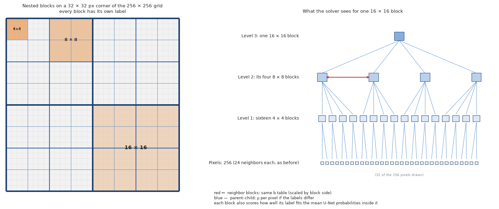

| Dev setting (U-Net 0.7067, current WCSP 0.7090) | Dev mIoU |
|---|---:|
| μ = 0 / 0.1 / 0.2 / **0.5** / 1 | 0.7090 / 0.7097 / 0.7101 / **0.7108** / 0.7106 |
| 1 / 2 / 3 levels (μ = 0.2) | 0.7097 / 0.7100 / 0.7101 |
| 4 or 5 levels, adding 32 px and 64 px blocks | No change |
| No block neighbors (μ = 0.2) | 0.7096 |

The frozen settings are **μ = 0.5 with 3 levels**.

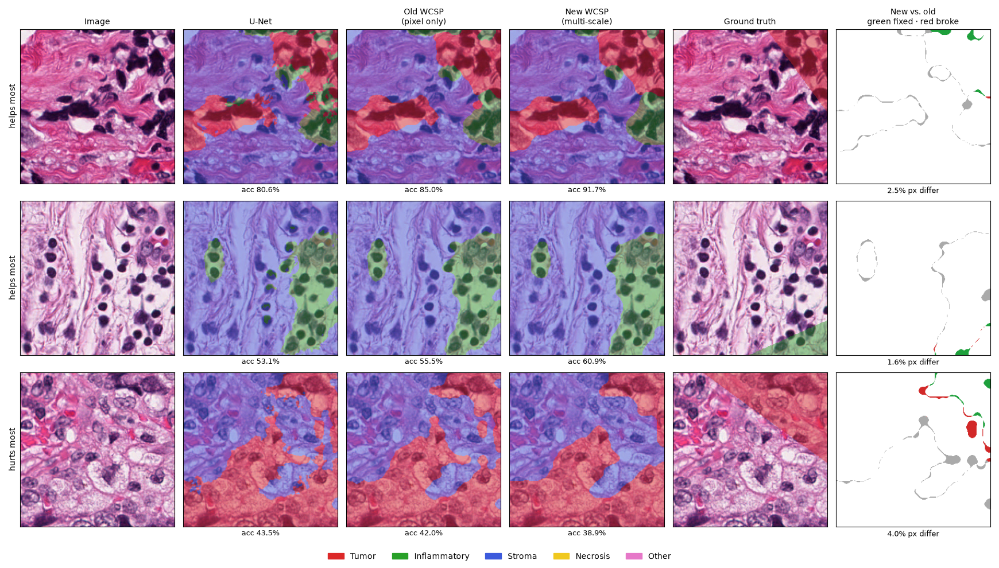

Both WCSPs change only pixels along region borders (green = fixed, red = broke). Whole regions the U-Net gets wrong stay wrong.

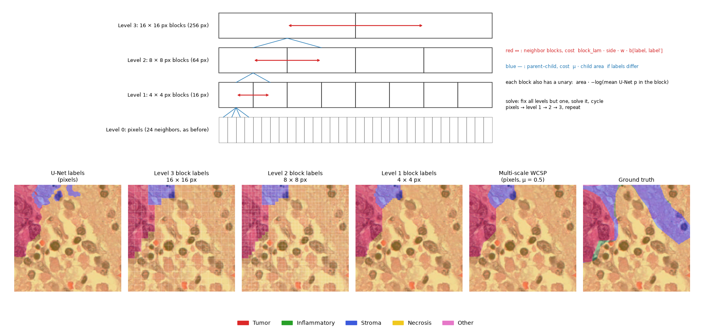

### Why every WCSP gain is small

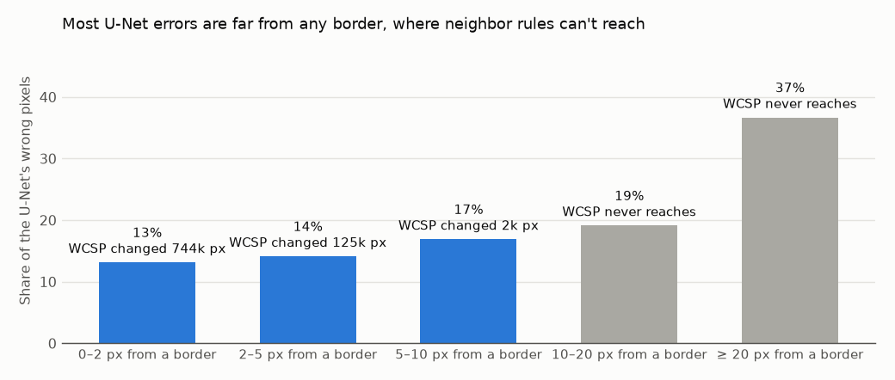

- **Errors are far from borders:** 56% of the U-Net's wrong pixels are more than 10 px from any border, which no neighbor rule reaches.
- **Smoothing is already maxed out:** an oracle that perfectly fixes every island under 64 px only ties the current WCSP.
- **The table can only smooth:** every b entry is ≥ 0, so borders can only cost energy.

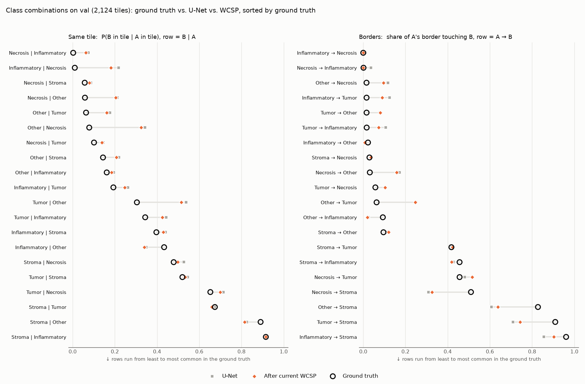

**What's left to fix is which classes appear in a tile.** 23% of WCSP errors are a class the tile's ground truth doesn't contain. Fixing exactly those (an oracle) would give 0.7532.

### Biological rules (running)

Each rule was checked against the fit-split ground truth first:

| Rule | Fit ground truth | Test |
|---|---|---|
| Some class pairs almost never share a tile (e.g. necrosis + inflammatory 2%) | Holds | **Class presence:** choose the tile's classes from U-Net evidence + γ · −log P(class set) from fit counts, then run the WCSP with only those classes |
| Necrosis never borders inflammatory or other (0% / 1% of its border) | Holds | **Exclusion:** raise those b entries to 15 or 50 |
| Necrosis needs tumor in the tile | 58% only, not a rule | Not tested |
| Inflammatory sits inside stroma (95% of its border) | Holds | Not tested: the WCSP output is already at 90% |

Dev sweeps are running: γ ∈ {0, 10, 30, 100, 300, 1000, 3000}, plus the two exclusion tables.

### toulbar2: time and search effort

Each 256 × 256 tile (65,536 px) is solved as 5 blocks: four 100 × 100 corners (10,000 px each) and the 56 px-wide cross between them (25,536 px).

| Run | Per-block limit | s/tile | Result |
|---|---|---:|---|
| Deliverable 5 val (λ = 4, 2,124 tiles) | 20 s | 87.2 | mIoU +0.0003; mean energy 2,824 → 2,780 vs. ICM's → 1,485 |
| Ryan, dev (181 tiles) | 2 s | 9.4 | No change from the U-Net |
| Ryan, dev | None | — | 14 tiles in 8 h before the job limit |

At 20 s per block, toulbar2 ends 75% of tiles after one round, with *higher* energy than ICM: it runs out of time before matching ICM. A per-block benchmark of search nodes, backtracks and proved optima at 2 / 20 / 120 s is running.

## November 15–16: BCSS rule results, decay sweep and toulbar2 effort

Same setup as the November 8–9 section: pretrained U-Net, central 256 × 256, data-derived b, λ = 8, dev = 185 tiles (U-Net 0.7067, current WCSP 0.7090).

### Which classes appear in a tile matters most

All 20 class pairs × 2 statistics on val, sorted from least to most common in the ground truth (black ring). The U-Net over-predicts rare combinations, and the WCSP only moves slightly toward the truth. For example, inflammatory | necrosis is 0.01 in truth, 0.22 from the U-Net and 0.18 after the WCSP.

| Rule tested on dev | Dev mIoU | Δ vs. current WCSP |
|---|---:|---:|
| **Class presence, γ = 3000** (choose the tile's class set, then WCSP) | **0.7229** | **+0.0139** |
| Class presence, γ = 100 / 300 / 1000 | 0.7102 / 0.7117 / 0.7139 | +0.0012 / +0.0027 / +0.0049 |
| Class presence, γ = 10k / 30k / 100k (too strong) | 0.7094 / 0.6887 / 0.5449 | — |
| Necrosis–inflammatory and necrosis–other exclusions, b = 15 / 50 | 0.7095 / 0.7094 | +0.0005 / +0.0004 |
| Same, plus tumor–other b = 15 | 0.7096 | +0.0006 |

- **vs. U-Net:** class presence at γ = 3000 is +0.0162 [+0.0045, +0.0275] (ROI bootstrap). The gain comes mainly from "other" (IoU 0.607 → 0.653) and necrosis (0.652 → 0.666).
- **γ was chosen on these tiles**, so it still needs one frozen val run.
- **Exclusions barely matter:** those borders are already rare in the outputs.

### Rules measured in the data, not yet encoded

| Rule | Fit ground truth | Val: truth / U-Net / WCSP |
|---|---|---|
| A class is in a tile if a neighboring tile has it | Necrosis: 50% if a neighbor has it, 0.7% if none does | — |
| Inflammatory regions sit in stroma | 96% of regions mostly bordered by stroma | 98% / 84% / 90% |
| Necrosis forms large regions | Median 26,575 px | Median 12,696 / 31 / 2,174 px; 244 / 1,359 / 432 regions |

From the literature, worth trying next:
- Inflammatory needs tumor nearby (TIL scoring, Hendry 2017).
- Necrosis is enclosed by tumor, and tumor regions are compact (pushing borders in triple-negative tumors).

Not to encode: a tumor–fat exclusion (tumor meets fat at the invasive front, Dirat 2011), or forcing necrosis at the tumor's center (fibrotic foci, Hasebe).

### Decay sweep: no gain

This uses the same design as the PanNuke sibling-decay sweep: neighbor weights are anchored at the coarsest level (16 px blocks, 8), and each finer level is multiplied by d. The base is the frozen multi-scale setting (μ = 0.5, 3 levels).

| Condition | Pixels | 4 px | 8 px | 16 px |
|---|---:|---:|---:|---:|
| Control (multi-scale, dev 0.7108) | 8 | 8 | 8 | 8 |
| Blocks decay, d ∈ {0.8, 0.6, 0.4, 0.2} | 8 | 8d² | 8d | 8 |
| All levels decay | 8d³ | 8d² | 8d | 8 |
| Pixels only decay | 8d³ | 8 | 8 | 8 |
| Uniform blocks, u ∈ {2, 4, 6} | 8 | u | u | u |
| Coarse boost, c ∈ {12, 16} | 8 | 8 | c | c |

Each condition also has a matched **Potts** control: every off-diagonal b entry is set to 4.0, the mean of the data-derived table. That gives 23 dev runs.

| Condition (dev mIoU) | d = 0.8 | 0.6 | 0.4 | 0.2 |
|---|---:|---:|---:|---:|
| Blocks decay | 0.7107 | 0.7106 | 0.7103 | 0.7100 |
| All levels decay | 0.7105 | 0.7100 | 0.7095 | 0.7081 |
| Pixels only decay | 0.7107 | 0.7101 | 0.7095 | 0.7092 |
| Potts + blocks decay | 0.7107 | 0.7104 | 0.7103 | 0.7099 |

Control 0.7108; Potts control 0.7106; uniform blocks 2 / 4 / 6: 0.7100 / 0.7105 / 0.7107; coarse boost 12 / 16: 0.7108 / 0.7108. No schedule beats the control, and stronger decay hurts, as on PanNuke. The data-derived table barely beats Potts (0.7108 vs. 0.7106): neighbor smoothing is saturated.

### toulbar2: search effort per block

Each block is solved once, starting from the U-Net labels, on 8 dev tiles.

| Limit | Block | Mean time | Found a solution | Proved optimal | Energy ≤ ICM's |
|---|---|---:|---:|---:|---:|
| 2 s | corner (10,000 px) | 1.1 s | 72% | 56% | 62% |
| 2 s | cross (25,536 px) | 1.8 s | 25% | 25% | 25% |
| 20 s | corner | 7.5 s | 84% | 69% | 72% |
| 20 s | cross | 13.8 s | 62% | 38% | 50% |
| 120 s | corner | 40.2 s | 100% | 69% | 81% |
| 120 s | cross | 76.6 s | 88% | 38% | 62% |

ICM takes 0.6 s per corner and about 5 s per cross. Even at 120 s, toulbar2 proves only 38% of cross blocks optimal.

### Full-resolution U-Net

The decay sweep above uses the half-resolution U-Net. Ryan has since shared the frozen full-resolution development inputs (`data/fullres_multiscale_20261115/`, Git LFS), so the rule results below can be rerun at full resolution.

## November 22: every data-derived rule tested, then combined

Full write-up: [experiments/bcss_wcsp/rules/README.md](../experiments/bcss_wcsp/rules/README.md). Dev, 185 tiles; U-Net 0.7067, WCSP 0.7090.

| Setting | Dev mIoU | Δ vs. U-Net |
|---|---:|---:|
| WCSP | 0.7090 | +0.0023 |
| WCSP + class presence (γ = 3000) | 0.7229 | +0.0162 |
| **Cluster WCSP + class presence** | **0.7242** | **+0.0175** |

- **Only the presence rule matters.** Every other rule that helps alone (a per-class cost on "other" or necrosis, a minimum class share, clusters) removes the same false "other" and necrosis, so on top of presence it adds ≤ 0.001 or hurts.
- **Two literature rules fail in the data:** necrosis bordering tumor (51% of fit-truth necrosis regions have < 10% tumor border), and ROI-level presence (every ROI contains nearly every class).
- **Fix:** SLIC clustering ignored the image under skimage 0.26 (float input is rescaled to [0, 1]), so the first cluster runs were plain grids; fixed in `wcsp/solve/clusters.py`.
- **Still to do:** one frozen val run of cluster WCSP + presence.

