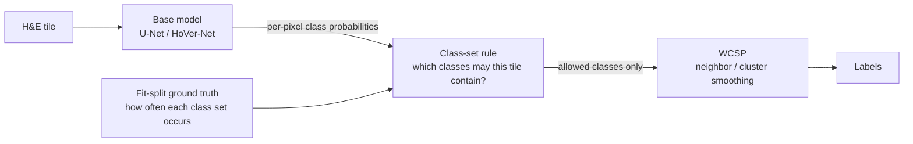
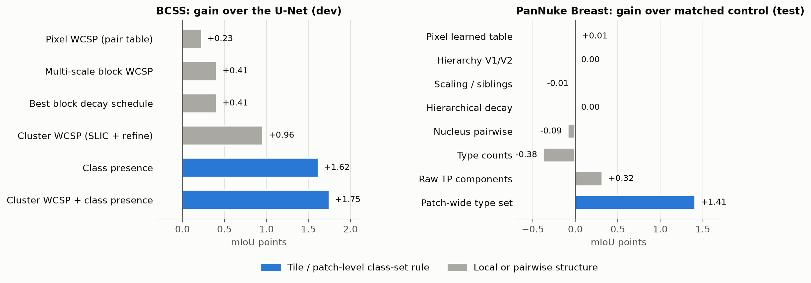
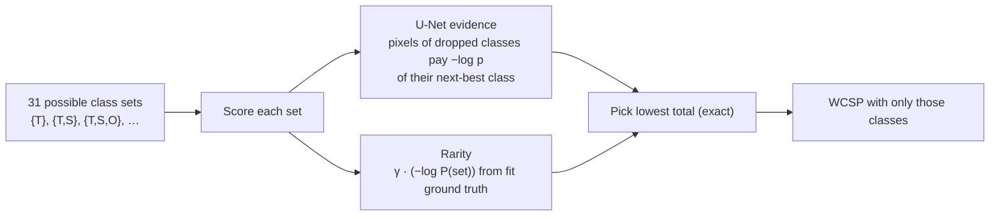
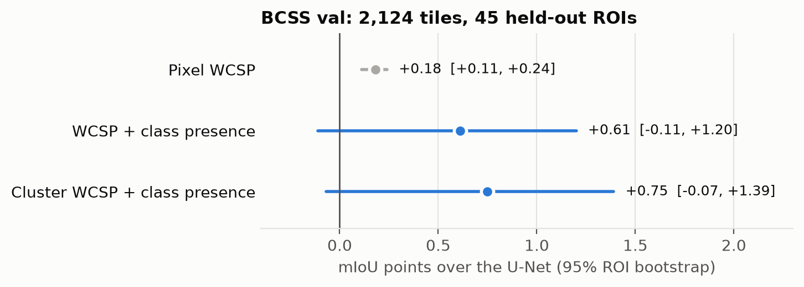
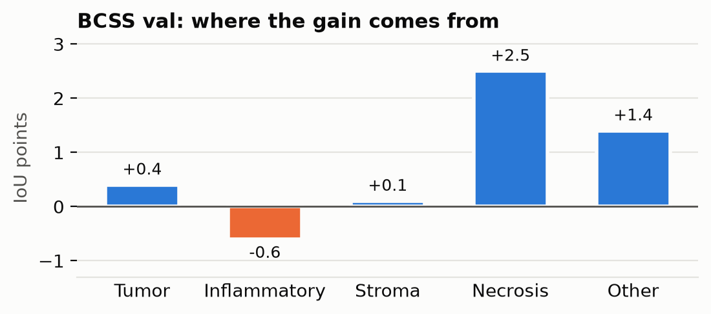
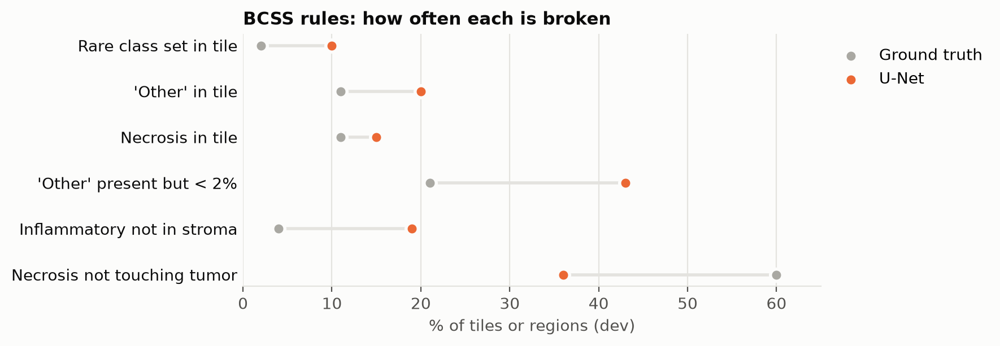
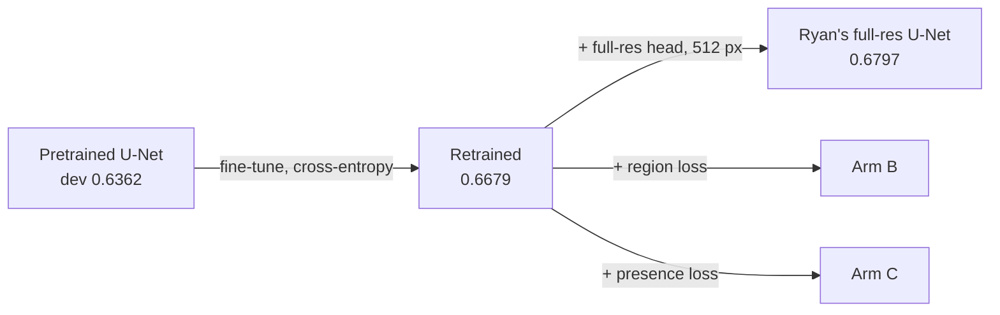

# Deliverable 7: tile-level class rules for histopathology WCSP

**November 23, 2026 · BCSS (tissue regions) and PanNuke (cell nuclei)**

> **One finding across both datasets.** Local structure (neighbor smoothing, block hierarchies, decay schedules, pairwise tables) adds 0 to 0.4 mIoU points. A single **tile- or patch-level class-set rule** (which classes may appear together) adds **+0.75 (BCSS val) to +1.41 (PanNuke Breast test)** on held-out data, and helps on a stronger base model too. It works because the base models' main error is **inventing a class in a tile**, not drawing borders badly.

| | BCSS | PanNuke |
|---|---|---|
| Task | Tissue regions (5 classes) | Nucleus types (5 classes) |
| Base model | TIAToolbox U-Net (+ Ryan's full-res U-Net) | HoVer-Net, frozen |
| WCSP variable | Pixel, block, or SLIC cluster | One nucleus |
| Winning rule | **Class presence** | **Patch-wide type set** |
| Held-out gain | **+0.75** val (cluster WCSP + presence) | **+1.41** Breast test, vs. matched control |

---

## 1. Pipeline

## 2. What helps, on both datasets

- **Blue (set rule)** is the only family that helps clearly on both datasets.
- **Gray (local structure)** is near zero on PanNuke. On BCSS it gives at most +0.4, except cluster WCSP (+0.96), which is a better solver for the same objective rather than new information.

## 3. The class-set rule

| Class set (fit ground truth) | P | −log P |
|---|---:|---:|
| Tumor + Stroma | 0.271 | 1.31 |
| Inflammatory + Stroma | 0.127 | 2.06 |
| Tumor + Stroma + Other | 0.020 | 3.93 |
| Necrosis + Inflammatory | 0.0004 | 7.74 |

- **Which class is dropped:** the one that costs the least U-Net evidence relative to how much rarer it makes the set. In practice that is a small, low-confidence region; a large, confident one survives.
- **Why pairwise rules can't do this:** a false region pays only along its border and usually borders a common neighbor (stroma). What is wrong is that the class exists in the tile at all.
- **PanNuke's type set** is the same objective over nuclei, with the prior conditioned on nucleus count and fit on Breast patches.

## 4. BCSS

**Setup:** U-Net probabilities, data-derived pair table, λ = 8. Development: 185 dev tiles. Held out: all 2,124 val tiles (45 ROIs from held-out hospitals). γ = 3000 was chosen on dev and frozen.

### Held-out result

| Method | Dev mIoU | Val mIoU | Val Δ vs U-Net |
|---|---:|---:|---:|
| U-Net | 0.7067 | 0.6489 | — |
| Pixel WCSP | 0.7090 | 0.6506 | +0.18 |
| WCSP + class presence | 0.7229 | 0.6550 | +0.61 (p = 0.047) |
| **Cluster WCSP + class presence** | **0.7242** | **0.6564** | **+0.75 (p = 0.039)** |

The dev gain shrinks on val, as expected, because γ was chosen on dev. It is borderline at the 45-ROI level (the 95% interval touches 0) and is 4× the gain of WCSP alone.

### Where it comes from

The rule removes false **necrosis** and false **"other"**. It occasionally drops real inflammatory (−0.6).

### Rules: measured in the data first, then tested

| Rule | Data says | Alone (dev Δ vs WCSP) | On top of presence |
|---|---|---:|---:|
| **Class presence** | U-Net breaks it 5× more than the truth | **+1.39** | — |
| Cluster WCSP | — | +0.73 | **+0.13** |
| Min. share of "other" (5%) | 43% vs 21% | +0.29 | 0 |
| Inflammatory inside stroma | 19% vs 4% | +0.07 | −0.01 |
| Necrosis min. size | 1.8 vs 1.3 pieces/tile | +0.19 | +0.02 |
| Necrosis touches tumor | **Truth breaks it 60%** | not encoded | — |
| ROI-level presence | Every ROI has every class | not encoded | — |
| Per-class costs | — | up to +0.68 | hand-tuned on dev; not adopted |

Every rule that helps alone removes the same false "other" and necrosis, so on top of presence they add nothing.

## 5. PanNuke

| Cohort | Raw HoVer-Net | Fixed-mask vote | Type-set WCSP | Gain vs vote |
|---|---:|---:|---:|---:|
| Mixed organs, 300 new patches (global prior) | 0.3947 | 0.3976 | 0.4001 | +0.25 |
| Dead-positive stress set, 21 patches | 0.3741 | 0.3732 | 0.3970 | +2.38 |
| **Breast only, 169 test (Breast-fit prior)** | 0.4323 | 0.4344 | **0.4484** | **+1.41** [0.51, 2.50], Holm-corrected over 8 families |

- **Fitting the prior per organ matters:** on the same Breast patches, the Breast-fit rule beats the global one by +1.00.
- **Colon and Adrenal:** pending, same protocol (fit → dev → freeze → test once).

## 6. Fixing the U-Net itself (in progress)

**Question:** can training teach the U-Net what the rules fix, so it needs no post-processing? Primary metric: **raw U-Net output**. WCSP is only an optional smoother afterwards.

v2 tiling (0.25 MPP; 7,768 fit / 1,012 dev / 4,028 val). Dev mIoU on the central 256 crop.

| Model | Training loss | Raw dev mIoU | Status |
|---|---|---:|---|
| Pretrained U-Net | — | 0.6362 | |
| **A**: retrained (Ryan) | Cross-entropy | **0.6679** | Done (control) |
| Retrained (Ryan) | + pairwise WCSP loss (0.01 / 0.1 / 1) | 0.6597 / 0.6582 / 0.6654 | Worse |
| **B** | + region consistency: pixels of each **ground-truth** region should agree | *pending* | Restarting |
| **C** | + tile presence: BCE on the true class set | *pending* | Restarting |
| Full-res U-Net (Ryan) | Cross-entropy, 512 px + full-res head | 0.6797 | Done (reference) |

- **Same recipe for every arm:** 10 epochs, batch 4, seed 0, learning rate 1e-4; only the loss changes. A is Ryan's run with this exact recipe.
- **Read the raw column:** B > A means the U-Net learned coherent regions; C > A means it stopped inventing classes on its own.
- **B's region loss:** cross-entropy charges each wrong pixel the same. The region loss also charges a true region predicted as a patchwork of classes, and adds nothing for one predicted coherently.

**The rule still helps on the stronger model.** Ryan's full-res U-Net on his 185 frozen dev tiles (whole 512 tile; γ scaled by area, 3000 × 4):

| Full-res U-Net | mIoU | Δ | Necrosis | Inflammatory | Other |
|---|---:|---:|---:|---:|---:|
| Raw | 0.6524 | — | 0.688 | 0.680 | 0.507 |
| + WCSP | 0.6547 | +0.23 | 0.693 | 0.682 | 0.509 |
| **+ presence + WCSP** | **0.6610** | **+0.86** | **0.723** | **0.706** | 0.484 |

The prior was fit on the old tiling, and 121 of 185 tiles lose a class ("other" drops −2.3). A prior refit on the v2 tiles is next.

## 7. What did not help

| Idea | Dataset | Result |
|---|---|---|
| Block hierarchy decay (23 schedules) | BCSS, PanNuke | ≤ 0 vs. control |
| Biological pair table vs. Potts | BCSS | 0.7108 vs. 0.7106 |
| Nucleus pairwise, type counts | PanNuke | −0.09, −0.38 |
| Pairwise WCSP loss in training | BCSS | −0.25 to −0.97 |
| Necrosis-touches-tumor, ROI presence | BCSS | Fail in the data; not encoded |

## 8. Next

1. Fill section 6: arms B and C, then the best arm on val. Refit the presence prior on v2 and run full-res + presence on val.
2. PanNuke: Colon and Adrenal with the Breast protocol, plus a "which classes changed" breakdown like BCSS's.
3. PanNuke fine-tuning: HoVer-Net with a type-set presence loss (the same ablation as section 6).

Code: `wcsp/solve/presence.py`, `clusters.py`, `regions.py`; `benchmarks/bcss/scripts/structure_losses.py`. Full BCSS rule write-up: `experiments/bcss_wcsp/rules/README.md`. PanNuke: `experiments/pannuke_wcsp/` (branch `organ-wcsp-breast`). Figures: `deliverables/figures_20261123/make_figures.py`.
