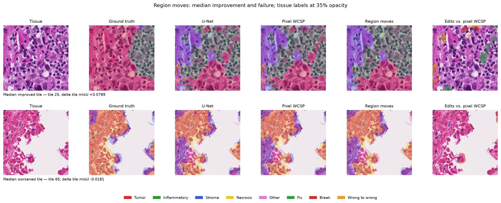

# Deliverable 7

**Web version:** https://urvib3.github.io/csci-401-capstone-histopathology/deliverable7/

*November 23, 2026 · PanNuke (cell nuclei) and BCSS (tissue regions)*

---

## Recap of results

mIoU, with the change vs. the base model in brackets. "—" = not run (yet).

**BCSS protocol in this recap:** the earlier pretrained U-Net / central-256
evaluation. The trained **full-512** model and its correction experiments are
reported [separately below](bcss_full512_details.md#bcss-full-resolution-correction-experiments);
their absolute scores use a different model and prediction field.

| Method | PanNuke · Breast test | BCSS · dev | BCSS · val |
|---|:---:|:---:|:---:|
| Base | 0.4323 | 0.7067 | 0.6489 |
| Pair (HW) | — | 0.7097 (+0.0030) | 0.6507 (+0.0019) |
| Pair (DD) | 0.4324 (+0.0001) | 0.7090 (+0.0023) | 0.6506 (+0.0018) |
| Hier | 0.4323 (0.0000) | 0.7107 (+0.0040) | 0.6517 (+0.0028) |
| Hier+Decay | 0.4323 (0.0000) | 0.7108 (+0.0041) | 0.6517 (+0.0029) |
| Cluster | 0.4344 (+0.0020) | 0.7163 (+0.0095) | 0.6544 (+0.0055) |
| **Presence** | — | **0.7229 (+0.0162)** | **0.6550 (+0.0061)** |
| **Pres+Clust** | **0.4484 (+0.0161)** | **0.7242 (+0.0175)** | **0.6564 (+0.0075)** |

**Base** HoVer-Net / U-Net · **Pair (HW / DD)** pixel WCSP, handwritten / data-derived table · **Hier** multi-scale blocks · **Hier+Decay** with level decay · **Cluster** one label per nucleus (PanNuke) or SLIC superpixel (BCSS) · **Presence** drop classes that shouldn't be in the tile · **Pres+Clust** both

**Takeaway:** smoothing (pixel, hierarchical, decay) barely moves either dataset. Presence, which removes classes that shouldn't be in a tile, gives the only clear gain on both.

PanNuke: `experiments/pannuke_wcsp/organ_wcsp/breast/evaluation.json` (branch `organ-wcsp-breast`); there, "cluster" means one label per detected nucleus. BCSS: run summaries, λ = 8, SLIC superpixels for "cluster".

---

## Problems

**The U-Net has limitations, and WCSP right now is only a smoother, so it can't fix them.** Smoothing cleans up noisy borders; the real errors are bigger.

| Problem | Dataset | What goes wrong | What could fix it |
|---|---|---|---|
| **Segmentation** | BCSS | One true region is broken into many pieces | Train the U-Net to keep regions whole |
| **Class identification** | BCSS | A whole region gets the wrong class, or a class that isn't in the tile | Strong data-derived rules (e.g. presence), not light smoothing |
| **Mixed tissue types** | PanNuke | Patches from all organs share one model and one prior, so no organ is fit well | Run per tissue type: fit and tune on one organ at a time |

---

## PanNuke

### Preliminary experiments

*Frozen HoVer-Net · 400 dev patches (folds 1 and 3, all organs except Adrenal) · no training*

On PanNuke, a **segmentation** error is an outline mistake (a nucleus missed, invented, or drawn the wrong size); a **class identification** error is the right nucleus with the wrong cell type.

| Test | Result |
|---|---|
| Wrong pixels that are segmentation errors | **69%** |
| Wrong pixels that are class identification errors | **31%** |
| True nuclei HoVer-Net finds | 80% |
| Found nuclei with the right type (voting → presence) | 80.7% → **82.8%** |
| Presence on HoVer-Net | 0.4541 → **0.4797** (+0.0256) |
| Upper bound: true types given per patch | **0.5262** (+0.0721) |
| Upper bound: every found nucleus the right type | **0.6902** (+0.2361) |

**Most wrong pixels are outlines, which WCSP can't touch**, but type mistakes cost most of the score. Presence recovers about a third of what a perfect presence rule could (+0.0256 of +0.0721).

### Results

#### This week's experiments

| Date | Experiment | Test set | Result (mIoU) |
|---|---|---|---|
| Nov 17 | Hierarchy decay: sibling, parent–child and fidelity schedules | 300 mixed-organ patches | All = raw HoVer-Net (0.3947, Δ ≈ 0); presence 0.4001 |
| **Nov 22** | **Breast: all 8 WCSP families fit and tuned on Breast only** | 169 Breast | **Only presence helps: 0.4344 → 0.4484 (+0.0141)** |
| Nov 22–23 | Colon: same protocol | 106 Colon | Presence +0.0019 (not significant) |
| Nov 22 | Adrenal gland: same protocol | 144 Adrenal | Presence +0.0026 (not significant) |
| **Nov 23** | **Wider presence sweep: 1,584 settings** | 600 fresh patches | **0.4326 → 0.4450 (+0.0124)** |
| Nov 23 | Preliminary error analysis | 400 dev patches | 69% segmentation, 31% class identification |
| Nov 23 | BCSS-style presence on Breast | Breast fold 2 | 0.4484 → 0.4519 (exploratory) |

*Gains are vs. fixed-mask voting (one label per detected nucleus), PanNuke's matched control.*

#### Per organ (fit and tuned on one tissue type)

| Organ | Test patches | Voting | Presence | Gain [95% CI] | Works? |
|---|---:|---:|---:|---:|---|
| **Breast** | 169 | 0.4344 | 0.4484 | +0.0141 [+0.0078, +0.0213] | **Yes** (Holm p = 0.003) |
| Colon | 106 | 0.4267 | 0.4286 | +0.0019 [−0.0013, +0.0055] | No |
| Adrenal gland | 144 | 0.3404 | 0.3429 | +0.0026 [−0.0052, +0.0111] | No |

The other seven families move mIoU by less than ±0.004 on every organ. **Per-organ tuning only paid off on Breast**; on Breast, fitting on Breast alone beats fitting on all tissue types (0.4384 → 0.4484).

#### Wider presence sweep (600 fresh patches, folds 1 and 3)

| Method | mIoU | vs. voting [95% CI] |
|---|---:|---:|
| HoVer-Net, raw | 0.4337 | |
| HoVer-Net, voting | 0.4326 | — |
| Presence, original setting | 0.4369 | +0.0043 [+0.0020, +0.0072] |
| **Presence, swept (strength 12, per-organ counts)** | **0.4450** | **+0.0124 [+0.0021, +0.0233]** |

**Stronger presence helps**, mostly on Breast and Colon; the 16 smaller organs see no gain.

---

## BCSS

### Preliminary experiments

*Full-resolution U-Net · 185 dev tiles · no training*

**Question:** is **segmentation** (wrong shape) or **class identification** (wrong tissue) the bigger problem?

**Method:** in each true region, if the U-Net's most common label is right, its wrong pixels are segmentation errors; if not, they are class identification errors.

#### Test 1 · How much of each class is wrong?

About even on average (9.4% vs 12.2%). Class identification dominates for "other" and stroma.

#### Test 2 · What is fixing each one worth?

Either fix is worth about +0.10 to +0.12. Presence and smoothing recover a small fraction.

### Results

#### 1 · WCSP fixes (after the U-Net)

- **Presence:** remove classes whose combination is rare in the training ground truth unless the U-Net is confident, then smooth with WCSP.
- **Cluster:** label ~256 SLIC patches of similar colour as single units, then refine pixels.

Presence + cluster is best (+0.0075 on held-out val), but far below the ~+0.1 available. On the full-resolution U-Net, presence adds +0.0086.

##### Is the bottleneck the class set or WCSP?

| Dev (185 tiles) | Tiles with the exact true class set | mIoU |
|---|---:|---:|
| U-Net | 56.8% | 0.7067 |
| WCSP + presence (our class set) | 66.5% | 0.7229 (+0.0162) |
| **WCSP + true class set (upper bound)** | 100% | **0.7883 (+0.0816)** |

**Picking the class set is the bottleneck:** with the right set, WCSP gains five times more. Presence still gets a third of tiles' sets wrong.

##### Other data-derived rules tried

| Rule (from training ground truth) | Alone (Δ vs WCSP) | On top of presence |
|---|---:|---:|
| **Presence: rare class combinations cost more** | **+0.0139** | — |
| Neighbor tiles: a class is likely if an adjacent tile has it | +0.0039 | −0.0023 |
| Extra cost on "other" / necrosis | +0.0068 / +0.0055 | −0.0070 / +0.0024* |
| "Other" must cover ≥ 5% of the tile | +0.0029 | 0.0000 |
| Necrosis regions ≥ 1,024 px | +0.0010 | +0.0002 |
| Inflammatory must border stroma | +0.0007 | −0.0001 |
| Minimum piece size, every class | 0.0000 | — |
| Necrosis must touch tumor · ROI-level presence | not encoded: the ground truth breaks them | |

**Why presence only:** it is one prior learned from data with one strength setting, and it gives most of the gain. The other rules remove the same false "other" and necrosis, so on top of presence they add nothing; the one exception (*necrosis cost) is a per-class value hand-tuned on dev, which we treat as a hack and leave out.

#### 2 · U-Net training losses (changing the model itself)

- **B · Segmentation loss:** pixels in the same true region should get the same prediction.
- **C · Presence loss:** the model's predicted class set should match the tile's true class set.

| Model | Targets | Pilot, 2 epochs (start 0.6450) | Full, 10 epochs |
|---|---|:---:|:---:|
| A · cross-entropy | — | 0.5553 | 0.6679 |
| B · + segmentation loss | Segmentation | 0.5533 | next |
| C · + presence loss | Class identification | 0.5608 | next |

The 2-epoch pilot is too short: every arm ends below its starting point. The 10-epoch runs decide whether B or C beats A.

#### 3 · Full-resolution corrections

WCSP fixes rerun on the **full-resolution U-Net** (whole 512 px tiles), with a refit presence prior and a new **region move**: relabel a whole connected region of the current labels at once.

| Full-res U-Net | Dev (185) | Val (3,229 scored tiles) |
|---|---:|---:|
| U-Net | 0.6524 | 0.6707 |
| WCSP | 0.6547 (+0.0023) | 0.6724 (+0.0018) |
| Multi-scale WCSP | 0.6570 (+0.0046) | 0.6736 (+0.0029) |
| Presence (γ = 4,000) + multi-scale | 0.6648 (+0.0124) | next |
| **Region moves** | **0.6670 (+0.0146)** | next |

Masks show tissue labels at 35% opacity. The final column marks corrections against pixel WCSP: green = fixed, red = broken, orange = still wrong. Examples are the median dev improvement and failure, selected after inspection.

Region moves and presence are the best dev results on the stronger model; neither has run on val yet. Methods, sweep snapshot and intervals: [details](bcss_full512_details.md).

*Settings from dev sweeps: WCSP λ = 8, presence γ = 3,000, 256 SLIC patches. Multi-scale blocks and 23 decay schedules gave no gain.*
