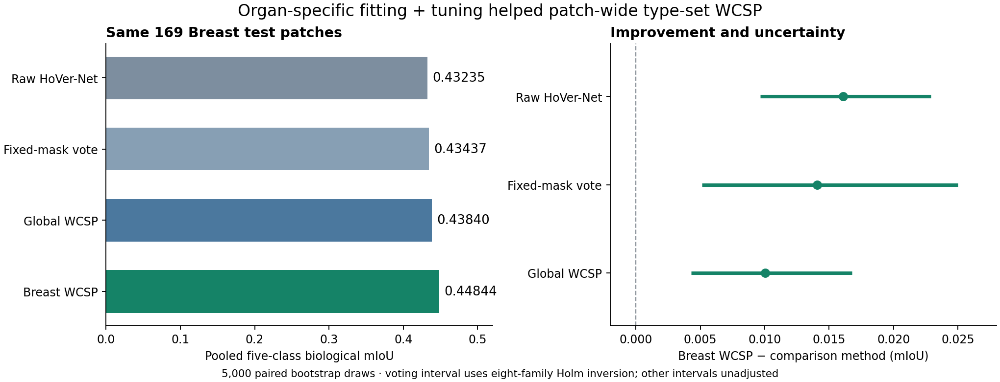
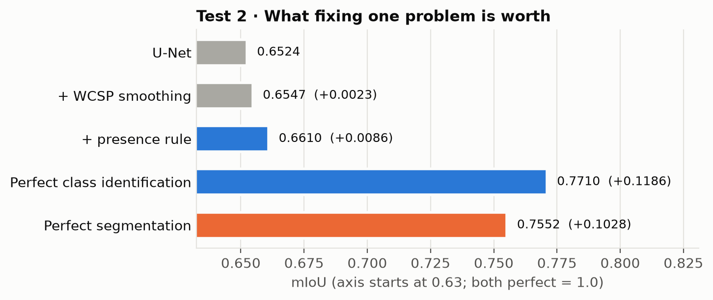

# Deliverable 7

**Web version:** https://urvib3.github.io/csci-401-capstone-histopathology/deliverable7/

*November 23, 2026 · PanNuke (cell nuclei) and BCSS (tissue regions)*

---

## Recap of results

mIoU, with the change vs. the base model in brackets. "—" = not run (yet).

| Method | PanNuke · Breast test | BCSS · dev | BCSS · val |
|---|:---:|:---:|:---:|
| Base | 0.4323 | 0.7067 | 0.6489 |
| Pair (HW) | — | 0.7097 (+0.0030) | 0.6507 (+0.0019) |
| Pair (DD) | 0.4324 (+0.0001) | 0.7090 (+0.0023) | 0.6506 (+0.0018) |
| Hier | 0.4323 (0.0000) | 0.7107 (+0.0040) | 0.6517 (+0.0028) |
| Hier+Decay | 0.4323 (0.0000) | 0.7108 (+0.0041) | *running* |
| Cluster | 0.4344 (+0.0020) | 0.7163 (+0.0095) | *running* |
| **Presence** | — | **0.7229 (+0.0162)** | **0.6550 (+0.0061)** |
| **Pres+Clust** | **0.4484 (+0.0161)** | **0.7242 (+0.0175)** | **0.6564 (+0.0075)** |

**Base** HoVer-Net / U-Net · **Pair (HW / DD)** pixel WCSP, handwritten / data-derived table · **Hier** multi-scale blocks · **Hier+Decay** with level decay · **Cluster** one label per nucleus (PanNuke) or SLIC superpixel (BCSS) · **Presence** drop classes that shouldn't be in the tile · **Pres+Clust** both

**Takeaway:** smoothing (pixel, hierarchical, decay) barely moves either dataset. Presence, which removes classes that shouldn't be in a tile, gives the only clear gain on both.

PanNuke: `experiments/pannuke_wcsp/organ_wcsp/breast/evaluation.json` (branch `organ-wcsp-breast`); there, "cluster" means one label per detected nucleus. BCSS: run summaries, λ = 8, SLIC superpixels for "cluster".

---

## Problems

**The U-Net has limitations, and WCSP right now is only a smoother, so it can't fix them.** Smoothing cleans up noisy borders; the real errors are bigger.

| Problem | Dataset | What goes wrong | What could fix it |
|---|---|---|---|
| **Segmentation** | BCSS | One true region is broken into many pieces | Train the U-Net to keep regions whole |
| **Class identification** | BCSS | A whole region gets the wrong class, or a class that isn't in the tile | Strong data-derived rules (e.g. presence), not light smoothing |
| **Mixed tissue types** | PanNuke | Patches from all organs share one model and one prior, so no organ is fit well | Run per tissue type: fit and tune on one organ at a time |

*PanNuke: fitting on Breast only beats fitting on all tissue types, on the same 169 Breast test patches (Global WCSP 0.4384 → Breast WCSP 0.4484).*

---

## BCSS preliminary tests

*Full-resolution U-Net · 185 BCSS dev tiles · no training*

### Test 1 · Which problem causes the errors?

**Method:** look at each true region (one connected piece of one class in the ground truth) and the U-Net's labels inside it.
- **Example A:** a true stroma region of 100 pixels; the U-Net calls 90 stroma and 10 tumor. It got the region right, so the 10 wrong pixels are **segmentation** errors.
- **Example B:** a true stroma region of 100 pixels; the U-Net calls 70 "other" and 30 stroma. It misread the region, so the 70 wrong pixels are **class identification** errors.

**Answer:** about half each (48% segmentation, 52% class identification). "Other" and stroma fail mostly by class identification; inflammatory and necrosis mostly by segmentation.

### Test 2 · What is fixing each problem worth?

**Method:** make one problem perfect, keep the U-Net for the other, and re-score. No WCSP.
- **Perfect class identification:** keep the U-Net's own regions, and give each one the class most of its true pixels have.
- **Perfect segmentation:** keep the true regions, and give each one the class the U-Net predicts for most of it.
- **Both perfect** = the ground truth (1.0).

**Answer:** both problems are worth about the same: perfect class identification +0.1186, perfect segmentation +0.1028. Our presence rule recovers +0.0086 and smoothing +0.0023, a small fraction of either.

---

## Current experiments: fixing the U-Net itself

Same training recipe as the cross-entropy baseline; only the loss changes. Score = raw U-Net, no post-processing.

| Model | Added loss | Fixes | Dev mIoU |
|---|---|---|:---:|
| A (baseline) | none | — | 0.6679 |
| B | Region loss: pixels in the same true region should agree | Segmentation | — |
| C | Presence loss: predict which classes are in the tile | Class identification | — |

**Success = B or C beats A.**
