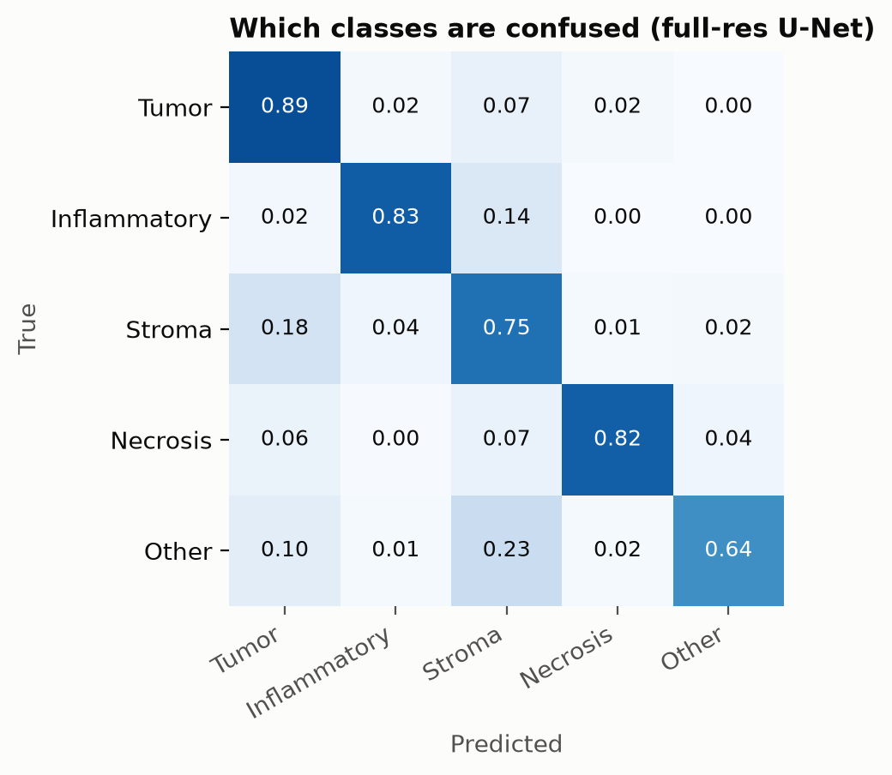
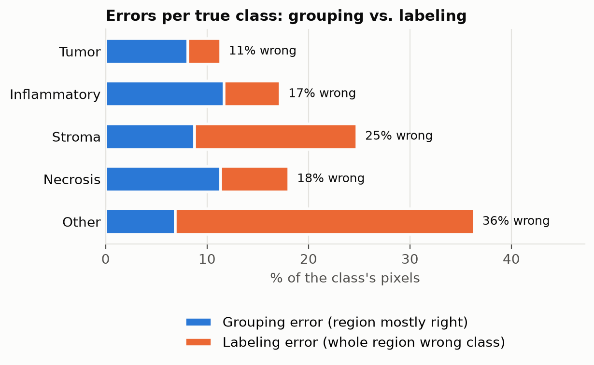

# Deliverable 7: what limits the segmenter, and how to fix it

**November 23, 2026 · BCSS (tissue regions) and PanNuke (cell nuclei)**

## 1. Recap: what we tried

**BCSS** (TIAToolbox U-Net; mIoU; Δ in points vs. the U-Net)

| Method | Dev (185 tiles) | Val (2,124 tiles, held out) |
|---|---:|---:|
| U-Net | 0.7067 | 0.6489 |
| Pixel WCSP (data-derived pair table) | +0.23 | +0.18 |
| Multi-scale block WCSP / decay schedules (23) | +0.41 / ≤ +0.41 | — |
| Cluster WCSP (SLIC superpixels) | +0.96 | — |
| WCSP + class presence | +1.62 | +0.61 |
| **Cluster WCSP + class presence** | **+1.75** | **+0.75** |
| Extra rules on top of presence (region size, border, per-class costs) | ≤ +0.02 | — |

**PanNuke** (frozen HoVer-Net; Breast test, 169 patches; Δ vs. each family's matched control)

| Family | Δ |
|---|---:|
| Pixel table, hierarchy, scaling, decay | −0.01 to +0.01 |
| Nucleus pairwise, type counts | −0.09, −0.38 |
| **Patch-wide type set** (PanNuke's presence rule) | **+1.41** (Holm-corrected, 8 families) |

Both datasets agree: local smoothing adds almost nothing, while a rule over **which classes a tile contains** adds 1–1.5 points.

## 2. Hypothesis

> The segmenter's errors are not mostly noisy borders, which is all WCSP smoothing can fix. They are of two kinds:
> 1. **Grouping:** one true region is broken into many pieces.
> 2. **Labeling:** a whole region is given the wrong class, often one that shouldn't be in the tile at all.
>
> Presence fixes part of (2). Training the U-Net with region and presence losses could fix both at the source.

## 3. Preliminary tests

All on Ryan's full-resolution U-Net (the strongest model; dev 0.6797 on the 256 crop) using his 185 frozen dev tiles (whole 512 px tiles), with no training.

### 3a. Which classes are wrong

*(per-class table: below)*

### 3b. Is it grouping or labeling?

| Measure | Value | Reading |
|---|---:|---|
| Pixel error rate | 18.7% | |
| **Errors that are grouping** (region mostly right, pixels break away) | **48%** | Region loss can fix these |
| **Errors that are labeling** (whole region wrong class) | **52%** | Needs the right class |
| Predicted pieces per true region | 9.9 | Truth = 1; heavily fragmented |
| Region coverage IoU (ignoring class) | 0.69 | |
| Boundary F1 (4 px = 1 µm) | 0.12 | Too strict for hand-drawn polygons; treat as indicative |

### 3c. How much could each fix gain? (WCSP + presence, and upper bounds)

| Setting | mIoU | Δ vs. raw |
|---|---:|---:|
| U-Net (raw) | 0.6524 | — |
| + WCSP | 0.6547 | +0.23 |
| + presence + WCSP (prior from the old tiling; γ scaled by area) | 0.6610 | +0.86 |
| **Oracle: true class set + WCSP** (perfect presence) | — | — |
| **Oracle: each true region predicted coherently** (perfect grouping) | — | — |

## 4. Current experiments: fixing the U-Net itself

Same recipe as Ryan's cross-entropy model (v2 tiles at 0.25 MPP, central 256, 10 epochs, batch 4, seed 0); **only the loss changes**. Metric: **raw** dev mIoU, with no post-processing.

| Arm | Loss | Targets | Pilot, 2 epochs (300 dev tiles) | Full, 10 epochs (1,012 dev) | + presence + WCSP |
|---|---|---|---:|---:|---:|
| A | Cross-entropy | — | — | 0.6679 (Ryan) | — |
| B | + region consistency: pixels of each **ground-truth** region agree | Grouping errors | — | — | — |
| C | + tile presence: BCE on the true class set | Labeling errors | — | — | — |
| Ref. | Ryan's full-res U-Net (512 px + full-res head) | — | — | 0.6797 | — |

Success criteria: B > A (fewer pieces per region), C > A (fewer invented classes), and the "+ presence" column shrinking for C, which would mean the model learned the rule.

Code: `experiments/bcss_wcsp/rules/{fullres_presence_dev,oracle_tests,grouping_tests}.py`, `benchmarks/bcss/scripts/structure_losses.py`, `wcsp/solve/presence.py`. Figures: `deliverables/figures_20261123/`. BCSS rule details: `experiments/bcss_wcsp/rules/README.md`. PanNuke: branch `organ-wcsp-breast`.
