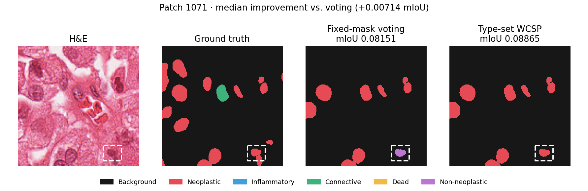

# Deliverable 7

**Web version:** https://urvib3.github.io/csci-401-capstone-histopathology/deliverable7/

*November 23, 2026 · PanNuke (cell nuclei) and BCSS (tissue regions)*

---

## Recap of results

mIoU, with the change vs. the base model in brackets. "—" = not run (yet).

| Method | PanNuke · Breast test | BCSS · dev | BCSS · val |
|---|:---:|:---:|:---:|
| Base | 0.4323 | 0.7067 | 0.6489 |
| Pair (HW) | — | 0.7097 (+0.0030) | 0.6507 (+0.0019) |
| Pair (DD) | 0.4324 (+0.0001) | 0.7090 (+0.0023) | 0.6506 (+0.0018) |
| Hier | 0.4323 (0.0000) | 0.7107 (+0.0040) | 0.6517 (+0.0028) |
| Hier+Decay | 0.4323 (0.0000) | 0.7108 (+0.0041) | *running* |
| Cluster | 0.4344 (+0.0020) | 0.7163 (+0.0095) | *running* |
| **Presence** | — | **0.7229 (+0.0162)** | **0.6550 (+0.0061)** |
| **Pres+Clust** | **0.4484 (+0.0161)** | **0.7242 (+0.0175)** | **0.6564 (+0.0075)** |

**Base** HoVer-Net / U-Net · **Pair (HW / DD)** pixel WCSP, handwritten / data-derived table · **Hier** multi-scale blocks · **Hier+Decay** with level decay · **Cluster** one label per nucleus (PanNuke) or SLIC superpixel (BCSS) · **Presence** drop classes that shouldn't be in the tile · **Pres+Clust** both

**Takeaway:** smoothing (pixel, hierarchical, decay) barely moves either dataset. Presence, which removes classes that shouldn't be in a tile, gives the only clear gain on both.

PanNuke: `experiments/pannuke_wcsp/organ_wcsp/breast/evaluation.json` (branch `organ-wcsp-breast`); there, "cluster" means one label per detected nucleus. BCSS: run summaries, λ = 8, SLIC superpixels for "cluster".

---

## Hypothesis

**The U-Net has limitations, and WCSP right now is only a smoother, so it can't fix them.** Smoothing cleans up noisy borders. The U-Net's real errors are bigger than that:

| Problem | What goes wrong | Evidence | What could fix it |
|---|---|---|---|
| **Segmentation** | One true region is broken into many pieces | ~10 predicted pieces per true region; 48% of wrong pixels | Training the U-Net to keep regions whole (region loss) |
| **Class identification** | A whole region is given the wrong class, or a class that isn't in the tile | 52% of wrong pixels; "other" 36% wrong, stroma 25%; "other" predicted in 20% of tiles vs 11% in truth | Strong data-derived rules (e.g. presence), not light smoothing; a better classifier |
| **Too many tissue types** (PanNuke only) | Patches from all organs share one model and prior, so cell types from other organs leak in | Breast-only prior beats the all-organ prior by +0.0100 on the same Breast patches | Run per tissue type: fit and tune on one organ at a time |

**How a wrong pixel is assigned to a problem:** take each true region (one connected piece of one class in the ground truth) and find the class the U-Net predicts for most of its pixels.
- **Majority correct:** the U-Net identified the region's class, so its wrong pixels are **segmentation** errors (stray pieces and borders).
- **Majority wrong:** the U-Net called the whole region the wrong class, so its wrong pixels are **class identification** errors.

*PanNuke example: in a tumor patch, one nucleus is given a type that doesn't belong (non-neoplastic, purple). The type-set rule removes it.*

---

## Preliminary tests

*Full-resolution U-Net, 185 dev tiles, no training.*

| Test | Result |
|---|---|
| Wrong pixels that are **segmentation** errors | **48%** |
| Wrong pixels that are **class identification** errors | **52%** |
| Predicted pieces per true region | **~10** (should be 1) |
| Presence + smoothing on this model | 0.6524 → **0.6610** (+0.0086) |
| Upper bound: true classes given per tile | **0.7163** (+0.0639) |
| Upper bound: every true region coherent | **0.7768** (+0.1244) |

**Our presence rule gets only +0.0086 of a possible +0.0639**, so knowing the right classes is worth far more than the rule currently recovers. Coherent regions are worth even more (+0.1244). Both are what training arms B and C target.

**Worst classes: "other" (36% wrong) and stroma (25%), and both are mostly class identification errors.** Inflammatory and necrosis errors are mostly segmentation.

---

## Current experiments: fixing the U-Net itself

Same training recipe as the cross-entropy baseline; only the loss changes. Score = raw U-Net, no post-processing.

| Model | Added loss | Fixes | Dev mIoU |
|---|---|---|:---:|
| A (baseline) | none | — | 0.6679 |
| B | Region loss: pixels in the same true region should agree | Segmentation | — |
| C | Presence loss: predict which classes are in the tile | Class identification | — |

**Success = B or C beats A.**
