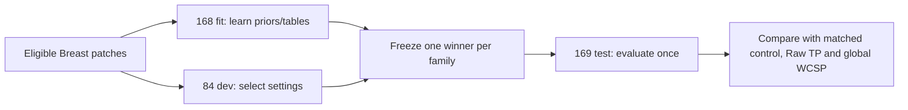
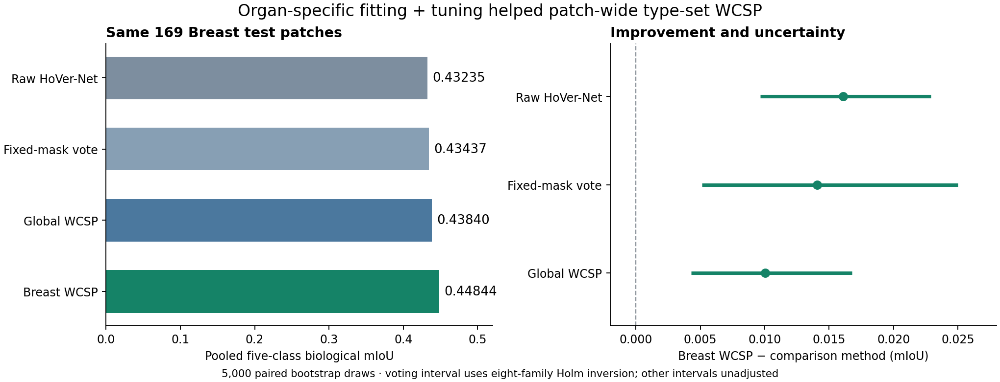
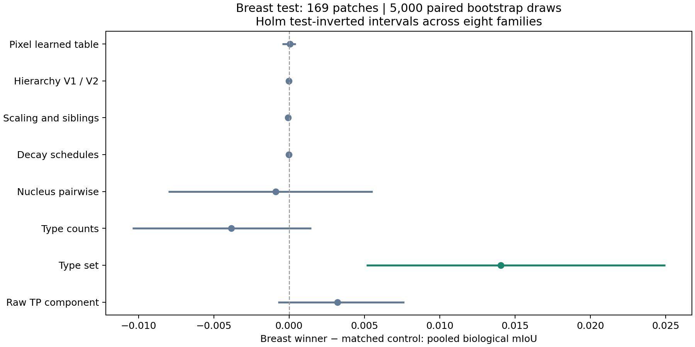
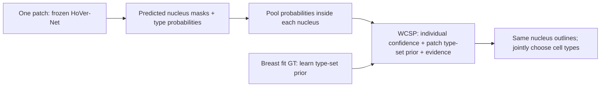
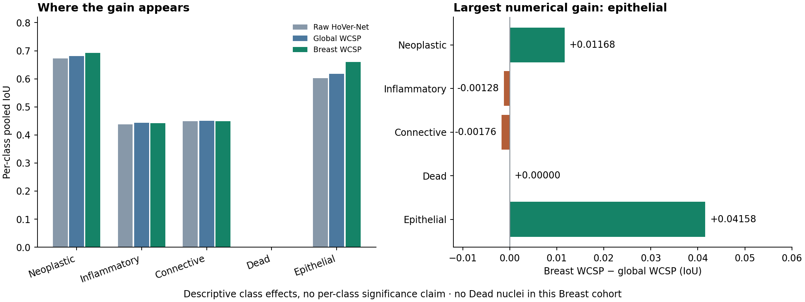

# PanNuke — organ-specific WCSP

- **Presentation:** organ-specific fitting and tuning; HoVer-Net stays frozen.
- **Metric:** pooled five-biological-class mIoU; all scores and gains use decimals.
- **Review companion:** [teammate update](TEAM_UPDATE_20261122.md).

| Tissue source | Experiment status | Main finding |
|---|---|---|
| **Breast** | **8 families completed; 169 test patches** | **Type-set WCSP: 0.44844; global WCSP: 0.43840 on the same patches** |
| Colon | Pending | No organ-specific result yet |
| Adrenal | Pending | No organ-specific result yet |

## 1. Breast

### Question and controlled setup

- **Question:** does learning Breast-specific cell-type context help more than our previous globally fitted WCSP?
- **Data:** PanNuke fold 2, tissue label `Breast`; full 256×256 patches.
- **Split:** 168 fit / 84 dev / 169 test; seed `20261122`; exclude 1,235 previously used patch IDs.
- **Fit:** learn tables and priors from Breast fit ground truth only.
- **Dev:** tune each family; freeze one winner before its test evaluation.
- **Test:** same cached HoVer-Net probabilities and masks for all models; no HoVer-Net retraining.
- **Compute:** families 1–4 use a fixed random 32-patch dev subset; families 5–8 use all 84 dev patches.

### Main result: patch-wide type-set WCSP

| Method on the same 169 Breast test patches | Biological mIoU | Without Dead |
|---|---:|---:|
| Raw HoVer-Net TP argmax | 0.432348 | 0.540436 |
| Fixed-mask voting | 0.434374 | 0.542968 |
| Previous global type-set WCSP | 0.438396 | 0.547994 |
| **Breast-specific type-set WCSP** | **0.448441** | **0.560551** |

| Breast WCSP compared with | Gain in mIoU | Paired interval |
|---|---:|---|
| Raw HoVer-Net | **+0.016093** | [0.009666, 0.022922] |
| Fixed-mask vote | **+0.014067** | **[0.005140, 0.024989], eight-family Holm test-inverted** |
| Previous global WCSP | **+0.010045** | [0.004293, 0.016759] |

- **Supported gain:** type-set WCSP is the only family with a positive matched-control interval after correction across eight families.
- **Organ-specific benefit:** Breast fitting **plus** Breast tuning beats the previous global model on the same Breast patches.
- **Scope:** does not establish that separating by organ helps every method, every organ or every patch.
- **Fair historical comparison:** rerun the global frozen configuration on this Breast test set; do not compare absolute scores across different historical cohorts.

### What we tried: all eight families

| # | Experiment | What changed / Breast dev winner | Test mIoU | Gain vs matched control | Supported gain? |
|---|---|---|---:|---:|---|
| 1 | Pixel learned table | 24-neighbor label compatibility; β = 0.05 | 0.432412 | +0.000064 | No |
| 2 | Hierarchy V1 / V2 | Pixel unaries vs added block unaries; V1 selected | 0.432328 | -0.000021 | No |
| 3 | Scaling and siblings | Area/boundary scaling × none/Potts/biological siblings; unscaled, no siblings selected | 0.432258 | -0.000074 | No |
| 4 | Hierarchical decay | Sibling factors 0.4/0.6/0.8 plus parent, sibling, fidelity and combined schedules; factor 0.4 selected | 0.432305 | -0.000023 | No |
| 5 | Nucleus pairwise | Potts/hybrid relationships and optional area costs; log-mean unary, hybrid β = 0.25, area off | 0.433482 | -0.000892 | No |
| 6 | Type counts | Penalize unlikely numbers of each cell type; log-mean, model counts, strength 0.5 | 0.430543 | -0.003831 | No |
| **7** | **Patch-wide type set** | **Which types occur together; mean unary + evidence, strength 4** | **0.448441** | **+0.014067** | **Yes** |
| 8 | Raw TP components | Encourage agreement within connected foreground components; strength 2, size limit 65,536, adaptive off | 0.435567 | +0.003218 | No |

- **Matched controls:** Raw TP for 1, 2 and 8; Breast-tuned V2 for 3; constant-weight V1 for selected decay in 4; fixed-mask vote for 5–7.
- **V1:** pixel fidelity only. **V2:** pixel + block fidelity. Both use soft parent–child relationships and six levels: pixels → 2×2 → 4×4 → 8×8 → 16×16 → 32×32.
- **Interpretation:** near-zero or uncertain gains are inconclusive; an interval including zero does not prove equivalence.

### What the winning WCSP actually does

- **Variable:** one predicted nucleus; **labels:** five biological cell types.
- **Individual cost:** changing a confident nucleus is more expensive than changing an uncertain one.
- **Patch cost:** prefer type combinations supported by Breast fit data; discourage a type with little model evidence anywhere in the patch.
- **Exact type-set solver:** consider up to 31 nonempty type sets; find the lowest-cost assignment for each; choose the best combined cost.
- **Fixed:** nucleus outlines and background pixels. No neighboring patches are read during a patch's optimization.
- **Still WCSP:** yes—minimizes individual costs plus a constraint coupling the nucleus types across a patch.
- **Hierarchy distinction:** the winning type-set model does **not** use the pixel/block hierarchy; that was tested separately in families 2–4.

### Where the gain appears—and limits

- **Largest numerical gain vs global WCSP:** non-neoplastic epithelial IoU; class effects are descriptive, not separately significance-tested.
- **Patch-level outcome vs vote:** 36 wins / 18 losses / 115 ties; pooled gain is not improvement on every patch.
- **Dead:** no Dead nuclei in fit, dev or test; no claim of improved Dead detection. Fixed-five-class scoring retains Dead at IoU 0.
- **Unverified:** patient/slide independence and pretrained checkpoint exposure to fold 2.
- **Small dev sample:** particularly the 32-patch hierarchy subset.
- **Statistics:** 5,000 paired patch bootstrap draws, seed `20261122`; matched-control decisions use eight-family Holm inversion. Raw/global intervals are unadjusted; Holm intervals are decision-compatible, not ordinary simultaneous coverage intervals.
- **Takeaway:** Breast-specific context helped the strongest patch-wide objective; mechanism and cross-organ generalization still need controlled follow-up.
- **Full audit:** [Breast experiment README](organ_wcsp/breast/README.md), [frozen settings](organ_wcsp/breast/frozen.json), [test statistics](organ_wcsp/breast/evaluation.json), [validation](organ_wcsp/breast/validation.json).

## 2. Colon

- **Status:** organ-specific experiments not run; no Colon score or improvement claim.
- **Next protocol:** filter fold 2 to tissue label `Colon`; exclude all previously used IDs; create a separate fit/dev/test split before metrics.
- **Fit and tune:** learn Colon tables/priors on fit only; select settings on dev; freeze before test.
- **Comparison:** Colon-specific winner vs its matched control, Raw TP and the same global frozen configuration on identical Colon test patches.
- **Feasibility:** count eligible patches first; stop the requested protocol if test would contain fewer than 60 patches.
- **Presentation placeholder:** add the eight-family table, paired-interval plot and class analysis after completion.

## 3. Adrenal

- **Status:** organ-specific experiments not run; no Adrenal score or improvement claim.
- **Dataset label:** `Adrenal_gland`; this identifies tissue source, not a specific cancer subtype.
- **Next protocol:** filter fold 2, exclude previously used IDs, check class support and create a separate split before metrics.
- **Fit and tune:** learn Adrenal tables/priors on fit only; select on dev; freeze before test.
- **Comparison:** Adrenal-specific winner vs its matched control, Raw TP and the global frozen configuration on the same test patches.
- **Feasibility:** count eligible patches first; a small remaining cohort may not support the ≥60-test-patch requirement. No count has been measured for this protocol yet.
- **Presentation placeholder:** add results and limitations after completing an eligible evaluation.

