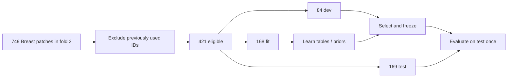
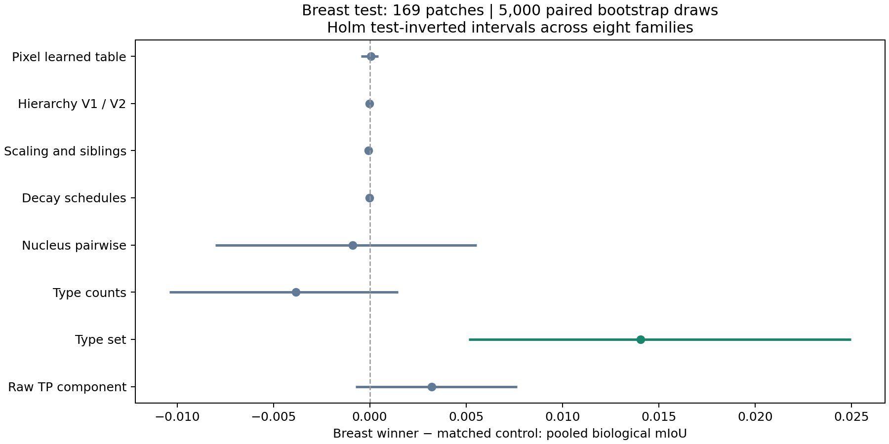
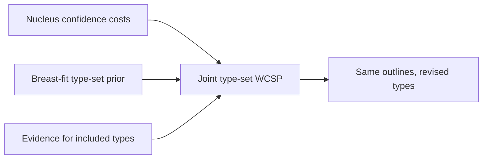
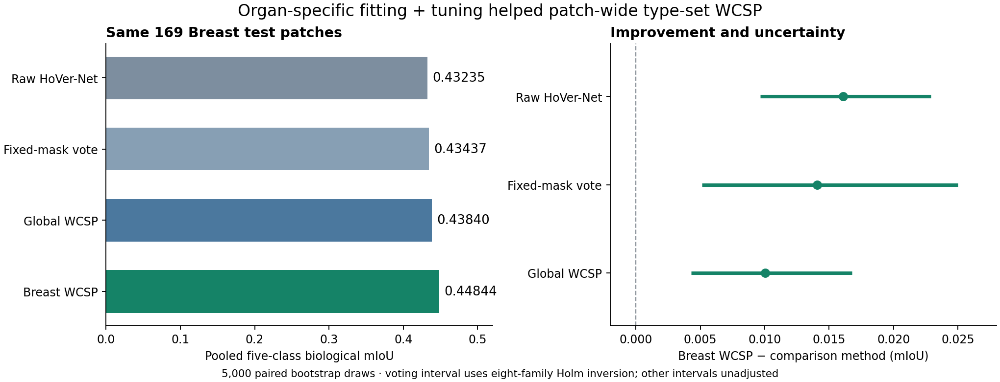
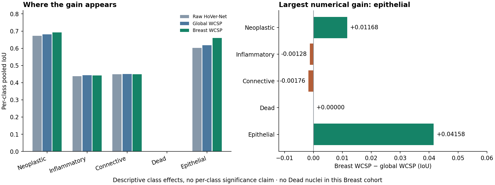

# PanNuke teammate review — organ-specific WCSP, 22 November 2026

- **Presentation entry point:** [PanNuke README](README.md).
- **Completed organ:** Breast. **Pending:** Colon and Adrenal; no organ-specific results claimed for either.
- **Branch:** `organ-wcsp-breast`.
- **Review goal:** understand what changed, whether the improvement is supported, and what remains to test.

## 1. Three completed tasks

| Task | Work completed | Review artifact |
|---|---|---|
| Prepare a clean organ-specific comparison | Breast filter, prior-ID exclusions, isolated fit/dev/test, shared frozen HoVer-Net inference | [Split](organ_wcsp/breast/split.json), [inference receipts](organ_wcsp/breast/inference_test.json) |
| Refit and tune all eight WCSP families | Fit-only tables/priors; dev selection; freeze winners; one-time test evaluation | [Every dev row](organ_wcsp/breast/development.json), [frozen settings](organ_wcsp/breast/frozen.json) |
| Analyze and package results | Paired bootstrap, eight-family Holm decisions, per-class and patch-level outcomes, figures and validation | [Evaluation](organ_wcsp/breast/evaluation.json), [technical README](organ_wcsp/breast/README.md) |

- **Recorded compute:** expansion fit + dev = 151.92 seconds; expansion test = 160.27 seconds.
- **Excluded from those timings:** environment recovery, data preparation, HoVer-Net inference, pilot dev, writing and review. These are not estimates of human working hours.

## 2. What changed from the previous approach

| Component | Previous global approach | This Breast experiment |
|---|---|---|
| HoVer-Net | Frozen PanNuke checkpoint | Same frozen checkpoint; no retraining |
| Context learned by WCSP | Historical mixed-organ fitting data | Breast fit patches only |
| Model selection | Historical global frozen settings | Breast dev selection per family |
| Evaluation | Historical mixed-organ test cohort | New 169-patch Breast cohort |
| Fair comparator | Original global config and tables | Run unchanged on those same 169 Breast patches |

- **Important:** “Breast-specific” changes both learned priors/tables and chosen settings. This experiment does not isolate those two effects.
- **Tissue source, not cancer subtype:** `Breast`, `Colon` and `Adrenal_gland` are PanNuke tissue labels.
- **No test-driven rescue:** negative and inconclusive family results are retained; no winner was retuned after its test evaluation.

## 3. Protocol to review

- **Exclusions:** union of `excluded_ids` and every test ID in the historical `presence_scale_20261114/split.json`; 1,235 distinct IDs across fold 2.
- **Partition:** shuffle eligible Breast IDs with `np.random.default_rng(20261122)`; floor 0.4 fit, floor 0.2 dev, remainder test.
- **No cropping:** full 256×256 inference; four overlapping tiles, reflect padding 46, original HoVer-Net watershed post-processing.
- **Checkpoint SHA256:** `789b2be8bdaf532627f584a009f83b3ba06e04c0e55c1635252ff12785ef57e8`.
- **Fit-only learning:** scale-specific pixel tables, nucleus tables/area likelihoods, type frequencies and nucleus-count-banded type-set priors.
- **Type-set bands:** boundaries `[8, 20, 40]`; fit supports `[14, 72, 62, 20]`. No band required merging because each already had at least ten fit patches.
- **Dev selection:** highest pooled five-class mIoU; within 0.0001 choose the declared simpler/weaker setting.
- **Dev subset:** fixed seeded 32 patches for pixel/hierarchy/scaling/decay; full 84 for nucleus/count/type-set/raw-component families.
- **Staged run:** type-set pilot passed its predeclared continuation gate; remaining families then ran. Pilot test outcomes were reused without rerunning its winner.

## 4. Findings across all eight families

| Family | Breast mIoU | Gain over matched control | Interpretation |
|---|---:|---:|---|
| Pixel learned table | 0.432412 | +0.000064 | Inconclusive |
| Hierarchy V1 / V2 | 0.432328 | -0.000021 | Inconclusive; V1 selected |
| Scaling / siblings | 0.432258 | -0.000074 | Inconclusive; unscaled/no siblings selected |
| Decay | 0.432305 | -0.000023 | Inconclusive; factor 0.4 selected |
| Nucleus pairwise | 0.433482 | -0.000892 | Inconclusive |
| Type counts | 0.430543 | -0.003831 | Inconclusive |
| **Patch-wide type set** | **0.448441** | **+0.014067** | **Supported positive gain after Holm correction** |
| Raw TP components | 0.435567 | +0.003218 | Inconclusive after correction |

- **Controls differ by objective:** Raw TP for pixel/hierarchy/components; tuned V2 for scaling/siblings; original constant-weight V1 for selected decay; fixed-mask vote for nucleus pairwise/counts/type sets.
- **Do not rank gains without checking the comparator.** The figure reports each family's gain over its own matched control.
- **Five-class mIoU:** average IoU for Neoplastic, Inflammatory, Connective, Dead and Non-neoplastic epithelial; Background excluded from the mean, but background errors still affect unions.
- **Without Dead:** reported alongside the primary metric; Dead remains in the primary fixed-five-class mean at IoU 0 in this cohort.

## 5. Explain the winning model in simple terms

- HoVer-Net provides **nucleus outlines** and **per-pixel type probabilities**.
- Pool foreground type probabilities inside each predicted nucleus to obtain five candidate label costs.
- Treat each nucleus as a WCSP variable; keep its outline fixed.
- Learn which combinations of cell types appear in Breast fit patches, conditioned on the number of nuclei.
- Evaluate possible type sets for the current patch; balance individual confidence, the learned set prior and evidence supporting each included type.
- Jointly choose the minimum-cost nucleus labels; map them back to pixels.
- Other nuclei **inside the same patch** provide context. Other patches contribute only through the fit-time prior; their images or predictions are not read during current-patch optimization.

### Exact selected objective

- **Winner:** `mean_presence_evidence_4`.
- **Nucleus probability:** `q_i(k)` = pooled foreground TP probability for type `k`, normalized across the five biological labels.
- **Unary:** `U_i(k) = -log(q_i(k))`, with numerical clipping as in the original code.
- **Set:** `S(y)` = biological types used by the assigned nucleus labels.
- **Prior:** `π_b(S)` = smoothed Breast-fit probability of type set `S` in predicted nucleus-count band `b`.

$$
E(y)=\sum_i U_i(y_i)+4\left[-\log\pi_b(S(y))+
\sum_{k\in S(y)}-\log\left(\max_i q_i(k)\right)\right].
$$

- **Solver:** enumerate up to 31 nonempty sets; Hungarian assignment enforces that every type in the chosen set has a distinct exemplar nucleus; retain the minimum combined cost.
- **Why this is WCSP:** label variables, individual costs and a higher-order patch constraint define one scalar optimization objective.
- **What is fixed:** detected nucleus boundaries and background pixels; missed nuclei and inaccurate outlines are not repaired.
- **Hierarchy:** this winner does not use the pixel/block hierarchy. Hierarchical variants were evaluated separately.
- **Biology:** the type-set constraint is a learned contextual prior; it does not establish the validity of the four earlier biological rules or directly apply their pairwise cost matrix.

## 6. Does separating by organ help?

| Same Breast test set | mIoU | Breast winner minus comparator | Paired interval |
|---|---:|---:|---|
| Raw HoVer-Net | 0.432348 | +0.016093 | [0.009666, 0.022922] |
| Fixed-mask vote | 0.434374 | +0.014067 | [0.005140, 0.024989], Holm test-inverted |
| Previous global type-set WCSP | 0.438396 | +0.010045 | [0.004293, 0.016759] |
| **Breast-specific type-set WCSP** | **0.448441** | — | — |

- **Supported conclusion:** Breast-specific fitting and tuning improved this type-set approach on these Breast patches.
- **Not established:** organ-specific learning alone caused the gain; every family benefits; Colon or Adrenal will show the same behavior.
- **Additional diagnostic:** pilot matched-mean-unary control = 0.433816; type-set WCSP adds +0.014625, unadjusted paired interval [0.009137, 0.021073]. This supports a contribution beyond changing vote aggregation to mean probabilities.
- **No historical score mixing:** compare global and Breast models on the same test set rather than subtracting scores from different cohorts.

## 7. What improved, and what still failed?

- **Largest numerical improvement vs global:** epithelial IoU; class effects are descriptive, without separate per-class significance tests.
- **Versus voting:** 36 patch wins / 18 losses / 115 ties.
- **Versus Raw TP:** 104 wins / 62 losses / 3 ties.
- **Versus the global type-set model:** 25 wins / 14 losses / 130 ties.
- **Takeaway:** pooled improvement is not a guarantee that every patch gets better.
- **Decay observation:** after tuning multiple schedules, its gain over constant-weight V1 remained near zero; changing scale weights did not establish a useful improvement here.
- **Working hypothesis:** patch type-set context can influence uncertain nucleus identities without forcing nearby nuclei to share a type. This fits the observed advantage but is not a demonstrated causal explanation.

## 8. Limitations and review questions

- **Independence:** patient/slide independence unverified; checkpoint exposure to fold 2 unknown.
- **Rare labels:** no Dead nuclei in Breast fit, dev or test; smoothed probabilities retain the label, but do not create evidence for it.
- **Selection:** small dev sample; subset used for slower families; one test pass per frozen winner.
- **Adaptive continuation:** expansion followed a successful pilot on the same Breast test cohort; disclosed in the protocol.
- **Statistics:** 5,000 paired patch bootstrap replicates, seed `20261122`; pooled confusion matrices before IoU calculation.
- **Multiplicity:** eight-family Holm decisions for matched controls; type-set adjusted p = 0.003199. Raw/global and extra unary comparisons are unadjusted exploratory comparisons.
- **Intervals:** Holm test-inverted intervals hold the other seven zero-null p-values fixed; decision-compatible, not ordinary simultaneous coverage intervals.
- **Review question:** do we agree to retain fixed five-class mIoU as primary, while also showing without-Dead mIoU?
- **Review question:** should the next organ replication run the full suite, or start with the type-set objective and predeclare continuation?
- **Review question:** in a future fresh split, should we separately vary learned prior and hyperparameters to distinguish why organ specificity helped?

## 9. Handoff and next steps

| Organ | Completed | Remaining |
|---|---|---|
| Breast | Fit/dev/test, eight families, statistics, validation, presentation | Team review; no retuning on these test outcomes |
| Colon | Presentation placeholder | Count eligible patches; separate fit/dev/test; refit, tune, freeze and test |
| Adrenal | Presentation placeholder | Check `Adrenal_gland` eligibility, ≥60 test patches and class support before committing to protocol |

- **Code entry:** [run_all.py](organ_wcsp/breast/run_all.py); adapters import original objectives/solvers without executing their historical split entry points.
- **Reproduction:** [exact commands and runtime caveats](organ_wcsp/breast/README.md#exact-commands).
- **Figures only:** `.venv/bin/python experiments/pannuke_wcsp/organ_wcsp/breast/presentation.py` reads saved metrics; it does not rerun inference, tune settings or touch test predictions.
- **Validation:** split reconstructed from archive; fit-only priors reconstructed; all eight selections, saved metrics, intervals, Holm decisions and original source hashes verified.
- **Repository cleanup:** one redundant pilot confusion copy removed; canonical pilot and final sufficient statistics retained. Data, model weights, inference caches and logs stay out of Git.
- **Publication scope:** PanNuke experiment and presentation branch; BCSS files and Deliverable 6 unchanged by this update.
