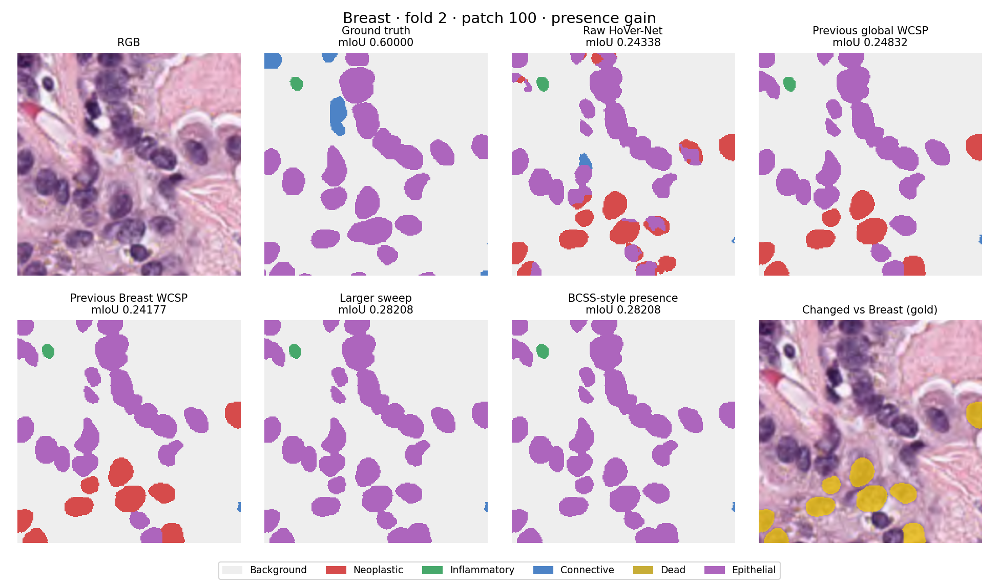
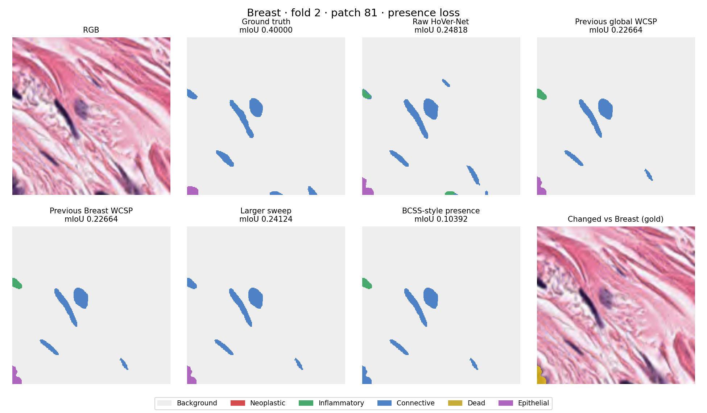
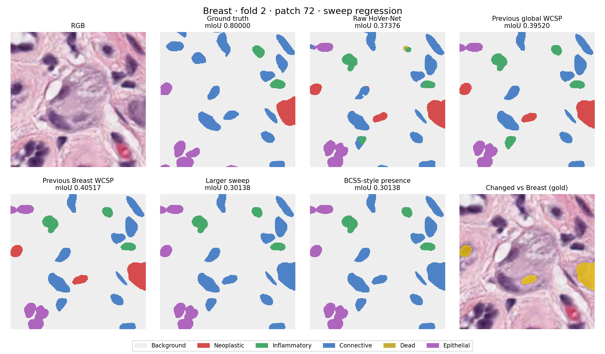

# Breast patch comparisons

- Full 256×256 Breast patches, fold 2. Same frozen HoVer-Net; nucleus outlines fixed for WCSP.
- Compare raw → previous global → previous Breast → larger sweep → BCSS-style allowed classes.
- Gold overlay marks pixels changed by BCSS-style presence relative to previous Breast WCSP.
- Examples are selected illustrations, including failures; use cohort statistics for overall conclusions.
- Full-cohort mIoU: previous Breast **0.448441**; larger sweep **0.447948**; BCSS-style presence **0.451867**. Fold-2 follow-up is exploratory.

## Presence Gain — patch 100

## Presence Loss — patch 81

## Sweep Regression — patch 72

