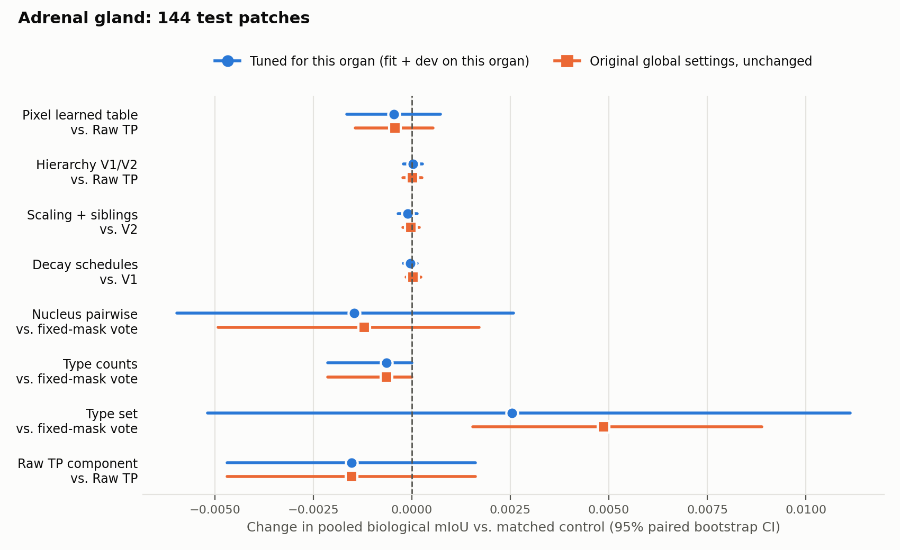

# Adrenal gland: every PanNuke WCSP family, tuned for one organ

**Question:** does any WCSP experiment work when fit and tuned on a single organ instead of all organs?

**Answer for Adrenal gland: no.** None of the 8 families beat its matched control after tuning on Adrenal, and organ tuning never beat the original global settings. The one positive result is that the **original global type-set WCSP, unchanged, improved Adrenal by +0.0049 mIoU** over fixed-mask voting [+0.0016, +0.0089]. These patches came from two PanNuke folds no earlier experiment used, so this replicates the Deliverable 6 result on a new organ.



## Results (144 test patches, scored once)

HoVer-Net Raw TP: **0.3447** biological mIoU. Fixed-mask vote: **0.3404**.

| Family | Organ-tuned winner (dev) | Control | Organ-tuned Δ vs. control [95% CI] | Holm p | Global Δ vs. control [95% CI] |
|---|---|---|---:|---:|---:|
| Pixel learned table | β = 0.5 | Raw TP | −0.00046 [−0.00165, +0.00073] | 1.00 | −0.00043 [−0.00144, +0.00054] |
| Hierarchy V1/V2 | sibling 0.3, parent 0.1, γ 0 | Raw TP | +0.00002 [−0.00021, +0.00027] | 1.00 | +0.00002 [−0.00022, +0.00026] |
| Scaling + siblings | scaled, parent 0.3 | V2 | −0.00010 [−0.00035, +0.00013] | 1.00 | −0.00003 [−0.00023, +0.00019] |
| Decay schedules | parent ∝ side⁻¹ | V1 | −0.00004 [−0.00022, +0.00014] | 1.00 | +0.00003 [−0.00015, +0.00023] |
| Nucleus pairwise | mean unary, Potts, β = 2 | Vote | −0.00147 [−0.00597, +0.00258] | 1.00 | −0.00121 [−0.00492, +0.00171] |
| Type counts | vote, count_model, 0.25 | Vote | −0.00065 [−0.00214, +0.00000] | 1.00 | −0.00065 [−0.00214, +0.00000] |
| **Type set** | vote, presence, strength 4 | Vote | +0.00255 [−0.00519, +0.01113] | 1.00 | **+0.00487 [+0.00155, +0.00889]** |
| Raw TP component | strength 2, no size limit | Raw TP | −0.00153 [−0.00469, +0.00161] | 1.00 | −0.00153 [−0.00469, +0.00161] |

"Works" was defined before testing: a Holm-adjusted (8 families) paired-bootstrap p < 0.05 against the matched control, with a positive gain. No organ-tuned family meets it. The global type-set row has unadjusted p = 0.0012 and Holm-adjusted p = 0.0096 over the 8 global comparisons. That Holm step was added after seeing the results. The global configs themselves were fixed in advance and listed in `frozen.json` before test.

## What we learned

- **Tuning on one organ overfit.** Type set went from +0.0114 over vote on dev (73 patches) to +0.0026 on test, with an interval spanning zero. Dev picked strength 4, the strongest setting in the grid. On test, that strong prior cut Inflammatory IoU by 0.034 while raising Non-neoplastic epithelial by 0.034. Pixel-table tuning likewise picked β = 0.5, the edge of its grid.
- **The global type-set prior transfers.** Fit on 200 mixed-organ patches, it gained over voting on three of the four non-Dead classes: Neoplastic +0.005, Connective +0.010, Non-neoplastic epithelial +0.009. Inflammatory was flat (−0.0003).
- **Pixel-level families (table, hierarchy, scaling, decay) stay flat**, with changes under ±0.0005, as in Deliverable 6. Organ-specific tables don't change that.
- **On Adrenal, voting is worse than Raw TP** (0.3404 vs. 0.3447). So "type set beats vote" doesn't mean it beats raw HoVer-Net here: the global type set reaches 0.3452, about +0.0005 over Raw TP.
- **Dead IoU is 0.** Adrenal has almost no Dead nuclei, and the five-class mean still includes Dead.

### By fold (point estimates only)

| Fold | Test patches | Raw TP | Vote | Organ type set − vote |
|---|---:|---:|---:|---:|
| 1 | 53 | 0.3492 | 0.3481 | +0.0071 |
| 2 | 29 | 0.3657 | 0.3640 | +0.0024 |
| 3 | 62 | 0.3380 | 0.3277 | +0.0013 |

Raw TP is not higher on folds 1 and 3 than on fold 2, so there's no sign that HoVer-Net trained on them. That doesn't rule it out.

## Setup

- **Data:** PanNuke folds 1, 2 and 3, Adrenal_gland patches only. Fold 2 alone had only 73 unused Adrenal patches, which would leave 29 for test. Previously used fold 2 IDs are excluded. Each fold is split 40% fit / 20% dev / 40% test with `default_rng(20261122)`, then pooled: **145 fit / 73 dev / 144 test**.
- **HoVer-Net:** the frozen `hovernet_fast-pannuke` checkpoint with the same full-patch inference as `instances_20261114` (4 tiles, reflect padding 46, watershed). Checkpoint, archive and architecture hashes match the earlier runs.
- **Fitting:** type-set prior, hierarchy tables, pixel table and nucleus tables come from Adrenal fit-split ground truth only. Sparse nucleus-count bands were merged, leaving cuts at 8 and 20.
- **Tuning:** 205 settings over the 8 families on dev, plus the combined decay schedule. The best dev mIoU wins; within 0.0001, the simpler or weaker setting wins.
- **Statistics:** 5,000 paired bootstrap replicates over whole patches, seed 20261122, with confusion matrices pooled before IoU.

Every choice and its reason is in [DECISIONS.md](DECISIONS.md).

## Files

| File | Contents |
|---|---|
| `split.json` | Patch IDs per split and fold |
| `priors_and_tables.json` | Everything fitted on the Adrenal fit split |
| `development.json` | Dev score of every setting |
| `frozen.json` | Winners, controls and selection rule, written before test |
| `evaluation.json` | Test results: every comparison, per class, per fold, no-Dead |
| `confusions.npz`, `per_patch.csv` | Per-patch confusion matrices and mIoU |
| `summary.png` | The figure above |
| `inference_scored.json` | HoVer-Net checkpoint and architecture hashes, plus the patch IDs it ran on |

## Reproduce

```bash
.venv/bin/python experiments/pannuke_wcsp/organ_wcsp/run_all.py prepare --organ Adrenal_gland --folds 1,2,3
.venv/bin/python experiments/pannuke_wcsp/organ_wcsp/run_all.py infer   --organ Adrenal_gland
.venv/bin/python experiments/pannuke_wcsp/organ_wcsp/run_all.py dev     --organ Adrenal_gland
.venv/bin/python experiments/pannuke_wcsp/organ_wcsp/run_all.py test    --organ Adrenal_gland
.venv/bin/python experiments/pannuke_wcsp/organ_wcsp/make_summary.py   --organ Adrenal_gland
```

`dev` refuses to run once `frozen.json` exists, and `test` refuses once `evaluation.json` exists. Requires `fold_1.zip`, `fold_2.zip` and `fold_3.zip` in `benchmarks/pannuke/data/`, plus the HoVer-Net weights in `benchmarks/pannuke/data/cache/models/`. Timing on an M-series Mac, CPU only: about 3 s per patch for HoVer-Net, 4 min for dev and 1.5 min for test.

**Caveats:** PanNuke has no patient or slide IDs, so patches from the same slide can land in different splits. Which folds HoVer-Net was trained on is unknown. The dev set has 73 patches.
