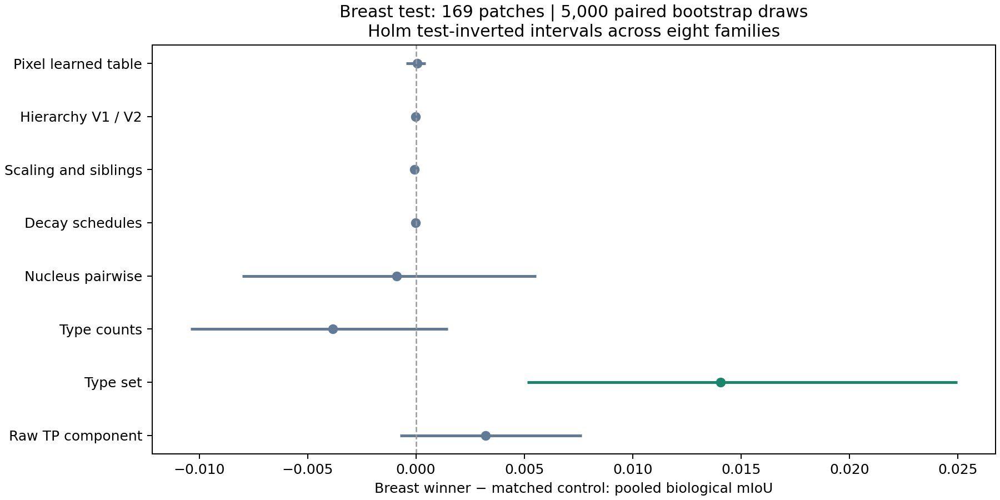

| Family | Breast mIoU | Control mIoU | Gain | Holm interval | Works | Beats global |
|---|---:|---:|---:|---|---|---|
| Pixel learned table | 0.432412 | 0.432348 | +0.000064 | [-0.000452, +0.000443] | No | No |
| Hierarchy V1 / V2 | 0.432328 | 0.432348 | -0.000021 | [-0.000215, +0.000166] | No | No |
| Scaling and siblings | 0.432258 | 0.432332 | -0.000074 | [-0.000191, +0.000040] | No | No |
| Decay schedules | 0.432305 | 0.432328 | -0.000023 | [-0.000056, +0.000007] | No | No |
| Nucleus pairwise | 0.433482 | 0.434374 | -0.000892 | [-0.008019, +0.005552] | No | No |
| Type counts | 0.430543 | 0.434374 | -0.003831 | [-0.010409, +0.001463] | No | No |
| Type set | 0.448441 | 0.434374 | +0.014067 | [+0.005140, +0.024989] | Yes | Yes |
| Raw TP component | 0.435567 | 0.432348 | +0.003218 | [-0.000737, +0.007648] | No | No |

# Breast-only WCSP: controlled eight-family comparison



- **Split:** 168 fit / 84 dev / 169 test; seed 20261122; 1,235 previously used IDs excluded.
- Breast only, PanNuke fold 2; full 256×256 patches. Split saved before metrics. Previous experiment directories unchanged.
- **Raw TP baseline:** 0.432348. **Fixed-mask vote:** 0.434374.
- Type-set pilot passed the predeclared gate against Raw TP, vote and the global model; remaining seven families then ran. Pilot outcomes preserved in pilot_* files.
- All tables and priors refitted on fit GT only. Nucleus-count bands merged until support ≥10; actual boundaries and counts are in priors_and_tables.json.
- Fixed random 32-patch dev subset for families 1–4 to bound full-resolution sweep time; all 84 dev patches for families 5–8. Exact IDs in expansion_protocol.json.
- One winner per family: highest pooled five-class dev mIoU; within 0.0001 choose the declared simpler/weaker setting. Every row and simplicity tuple saved in development.json.
- Frozen settings written before expansion test. Pilot test results reused, not rerun. Test is protected against accidental reruns.

## What was tuned

| Family | Breast dev grid | Matched control |
|---|---|---|
| Pixel | β = 0.05, 0.10, 0.15, 0.30, 0.50; 24-neighbor learned/biological table | Raw TP |
| Hierarchy | V1 pixel unaries / V2 pixel + block unaries; shared (sibling,parent) = (0.1,0.03), (0.3,0.1), (0.6,0.3); block γ = 0.1,0.3,1 | Raw TP |
| Scaling / siblings | Area/boundary scaling off/on × none/Potts/biological; scaled parent = 0.01,0.03,0.1,0.3,0.5; remaining coefficients from tuned V2 | Breast-tuned V2 |
| Decay | Sibling factors 0.4,0.6,0.8; original parent, sibling, fidelity, adaptive schedules; dev-selected combined schedule | Original constant-weight V1 or V2, using Breast tables, according to block fidelity |
| Nucleus pairwise | Original Potts/hybrid β grid × vote/mean/log_mean × no area/area-weight 0.25/0.75 | Fixed-mask vote |
| Counts | count_model/count_blend × vote/mean/log_mean × strength 0.25,0.5,1,2,4 | Fixed-mask vote |
| Type set | presence/presence_evidence × vote/mean/log_mean × strength 0.25,0.5,1,2,4 | Fixed-mask vote |
| Raw component | Original strength 0,0.1,0.25,0.5,1,2; size limit 128,256,65536; confidence gating off/on | Raw TP |

Nucleus area is an individual-type likelihood term, not a third pairwise table. Both Potts and hybrid pairwise models were tested with and without it. Hierarchy blocks are soft dominant-class variables, matching the original implemented objective; no hard majority constraint was added.

## Frozen winners and global comparison

| Family | Breast setting | Global mIoU | Breast − global (95% CI) |
|---|---|---:|---|
| Pixel learned table | `{"name": "pixel_beta_0.05", "kind": "flat", "beta": 0.05}` | 0.432604 | -0.000192 [-0.000530, +0.000148] |
| Hierarchy V1 / V2 | `{"name": "hierarchy_s0.3_p0.1_g0", "kind": "hierarchy", "sibling": 0.3, "parent": 0.1, "gamma": 0.0, "scaled": false}` | 0.432308 | +0.000020 [-0.000016, +0.000056] |
| Scaling and siblings | `{"name": "scale_False_none_0.1", "kind": "hierarchy", "sibling": 0.3, "parent": 0.1, "gamma": 0.1, "scaled": false, "siblings": "none"}` | 0.432347 | -0.000090 [-0.000198, +0.000032] |
| Decay schedules | `{"name": "decay_0.4", "kind": "decay", "schedule": {"name": "decay_0.4", "beta": [0.3, 0.007680000000000001, 0.019200000000000005, 0.04800000000000001, 0.12, 0.3], "parent": [0.1, 0.1, 0.1, 0.1, 0.1], "gamma": [0.0, 0.0, 0.0, 0.0, 0.0], "adaptive": false, "table": "hybrid"}}` | 0.432366 | -0.000061 [-0.000173, +0.000049] |
| Nucleus pairwise | `{"name": "log_mean_hybrid_0.25", "unary": "log_mean", "table": "hybrid", "beta": 0.25, "area_weight": 0}` | 0.434798 | -0.001316 [-0.005097, +0.002585] |
| Type counts | `{"name": "log_mean_count_model_0.5", "mode": "count_model", "unary": "log_mean", "strength": 0.5}` | 0.434181 | -0.003638 [-0.008637, +0.000382] |
| Type set | `{"name": "mean_presence_evidence_4", "mode": "presence_evidence", "unary": "mean", "strength": 4}` | 0.438396 | +0.010045 [+0.004293, +0.016759] |
| Raw TP component | `{"strength": 2.0, "limit": 65536, "adaptive": false}` | 0.435567 | +0.000000 [+0.000000, +0.000000] |

- Global configs and tables are pinned to repository commit 19e8df5, not retuned. Hierarchy global V1/V2 follows the selected variant; scaling uses original calibrated scaling; decay uses original final combined schedule.
- Global comparisons change both fit data and selected settings. They do not isolate the causal effect of organ specificity. Absolute scores on this Breast cohort cannot be compared directly with historical mixed-organ scores.

## Per-class test IoU

| Method | Neoplastic | Inflammatory | Connective | Dead | Epithelial | mIoU without Dead |
|---|---:|---:|---:|---:|---:|---:|
| raw_tp | 0.672886 | 0.437530 | 0.448952 | 0.000000 | 0.602374 | 0.540436 |
| vote | 0.679418 | 0.436290 | 0.448484 | 0.000000 | 0.607678 | 0.542968 |
| breast_pixel | 0.673547 | 0.436944 | 0.449020 | 0.000000 | 0.602550 | 0.540515 |
| breast_hierarchy | 0.673112 | 0.437285 | 0.448858 | 0.000000 | 0.602383 | 0.540410 |
| breast_scaling_siblings | 0.672879 | 0.437324 | 0.448758 | 0.000000 | 0.602329 | 0.540322 |
| breast_decay | 0.673047 | 0.437235 | 0.448871 | 0.000000 | 0.602371 | 0.540381 |
| breast_nucleus_pairwise | 0.678600 | 0.434736 | 0.445288 | 0.000000 | 0.608786 | 0.541853 |
| breast_type_counts | 0.675819 | 0.431608 | 0.445748 | 0.000000 | 0.599541 | 0.538179 |
| breast_type_set | 0.692409 | 0.441622 | 0.448707 | 0.000000 | 0.659467 | 0.560551 |
| breast_raw_component | 0.677816 | 0.438227 | 0.448904 | 0.000000 | 0.612886 | 0.544458 |

## Wins / losses / ties

| Family | Against matched control | Against Raw TP | Against global |
|---|---|---|---|
| Pixel learned table | 90 / 75 / 4 | 90 / 75 / 4 | 81 / 85 / 3 |
| Hierarchy V1 / V2 | 65 / 100 / 4 | 65 / 100 / 4 | 64 / 64 / 41 |
| Scaling and siblings | 73 / 87 / 9 | 63 / 102 / 4 | 67 / 99 / 3 |
| Decay schedules | 48 / 48 / 73 | 64 / 101 / 4 | 71 / 95 / 3 |
| Nucleus pairwise | 15 / 12 / 142 | 91 / 75 / 3 | 13 / 15 / 141 |
| Type counts | 10 / 16 / 143 | 86 / 80 / 3 | 10 / 14 / 145 |
| Type set | 36 / 18 / 115 | 104 / 62 / 3 | 25 / 14 / 130 |
| Raw TP component | 71 / 50 / 48 | 71 / 50 / 48 | 0 / 0 / 169 |

## Exact commands

From repository root, for a fresh environment:

```sh
git switch organ-wcsp-breast
uv venv --python 3.12 .venv
uv pip install -r requirements.txt tiatoolbox numba pyyaml
python3 experiments/pannuke_wcsp/organ_wcsp/breast/fetch_sources.py
# Place fold_2.zip and the verified checkpoint in the paths below.
B=experiments/pannuke_wcsp/organ_wcsp/breast
.venv/bin/python "$B/run_all.py" prepare
.venv/bin/python "$B/run_all.py" infer_dev --gpu
.venv/bin/python "$B/run_all.py" dev
.venv/bin/python "$B/run_all.py" infer_test --gpu
.venv/bin/python "$B/run_all.py" test
# Continue only if the predeclared pilot gate passed:
.venv/bin/python "$B/run_all.py" all_dev
.venv/bin/python "$B/run_all.py" all_test
.venv/bin/python "$B/report.py"
.venv/bin/python "$B/validate.py"
```

- Existing results are immutable: these commands are a reconstruction recipe for a clean copy, not instructions to overwrite this run.
- Data: benchmarks/pannuke/data/fold_2.zip from https://warwick.ac.uk/fac/cross_fac/tia/data/pannuke/fold_2.zip. Weights: benchmarks/pannuke/data/cache/models/hovernet_fast-pannuke.pth.
- Required checkpoint SHA256: 789b2be8bdaf532627f584a009f83b3ba06e04c0e55c1635252ff12785ef57e8.
- Actual runtime: uv executable unavailable; an existing Python 3.12 environment had iCloud-evicted packages. Matching local package copies under /tmp/breast-pilot-runtime and isolated Python bypassed stalled cloud reads. See runtime.json. Actual invocation:

```sh
PYTHONPATH=/tmp/breast-pilot-runtime PYTHONPYCACHEPREFIX=/tmp/capstone-pycache \
  /Library/Frameworks/Python.framework/Versions/3.12/bin/python3.12 -S -u "$B/run_all.py" all_dev
# Same prefix for all_test, report.py and validate.py.
```

## Timings and caveats

- Expansion fit + dev: 151.92 seconds. Expansion test: 160.27 seconds.
- Pilot cached evaluation + bootstrap: 0.32 seconds. Per-candidate timings are included for pixel/hierarchy sweeps.
- Inference: same frozen checkpoint, four overlapping tiles, reflect padding 46, original watershed, Apple MPS. Dev/test receipts contain model/source hashes and IDs. No cropping.
- Patient/slide independence unverified; pretrained checkpoint exposure to Fold 2 unknown. Results describe these patches, not clinical generalization.
- Small dev set, especially the 32-patch hierarchy subset. All evaluated settings are retained; test was not used to tune them.
- Dead has no fit, dev or test nuclei. Smoothed tables retain all labels, but no organ-specific Dead evidence was learned. Fixed five-class mIoU uses IoU=0 for zero union; without-Dead mIoU is also reported.
- Local search solvers audit local minima and nonincreasing energy; global optimality is not claimed. Nucleus type-set/count and raw-star objectives use their original exact subproblem solvers.
- 5,000 paired patch bootstrap draws, seed 20261122. Primary matched-control decisions use Holm across eight families; test-inverted intervals hold the other seven zero-null p-values fixed. These are decision-compatible intervals, not ordinary simultaneous coverage intervals. Raw/global intervals are unadjusted exploratory comparisons.
- “Works” requires a positive Holm interval and adjusted p < 0.05. A negative significant change is harm, not success. Effects near zero are inconclusive, not proof of equivalence.
- The user requested expansion conditional on a successful pilot. This adaptive continuation is disclosed; the final Holm family count still includes all eight families.
- Data, inference caches, downloaded source references and model weights are ignored. Only code, compact configs, statistics and presentation artifacts are committed.
