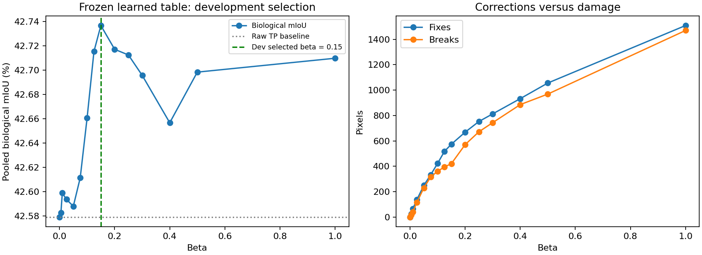

# PanNuke learned-table beta sweep: selected beta 0.15

**Current candidate: beta = 0.15**, selected by pooled biological mIoU on 20 development patches. This is a development result, not a final-test improvement claim. The existing [D5 beta=0.30 evaluation](../pannuke_d5/RESULTS.md) is preserved unchanged. No new final evaluation has been run.

## Why sweep again?

The earlier handwritten-table sweep on 15 development patches selected beta 0.30 using its then-current patch-averaged metric. Its saved notebook reported biological mIoU 36.9035% at beta zero and 37.6986% at beta 0.30. That metric excluded zero-union classes and differs from the current pooled, fixed-five-class metric. The learned table also changes pairwise values and normalization, so the previous numeric beta need not remain best. This sweep keeps the D5 trained 80% data / 20% prior table unchanged and varies only beta.

## Results

| Metric | Raw TP | Beta 0.15 | Beta 0.30 |
|---|---:|---:|---:|
| Pooled biological mIoU | 42.5791% | **42.7366%** | 42.6956% |
| Pooled six-class mIoU | 50.9742% | **51.1022%** | 51.0624% |
| Pixel accuracy | 90.5627% | **90.5912%** | 90.5756% |
| Changed pixels | 0 | 1,206 | 1,899 |
| Wrong → correct | 0 | 574 | 813 |
| Correct → wrong | 0 | 421 | 744 |
| Net corrections | 0 | **153** | 69 |

Beta 0.15 improves development biological mIoU by **0.1575 percentage points** over raw TP and **0.0410 points** over 0.30. These are small differences selected on this development set; generalization requires a fresh evaluation. Absolute scores must not be compared to the older test set as a method improvement because patch membership differs.



- [Full report and example images](REPORT.md)
- [All 15 beta results](aggregate_beta.csv) and [300 per-patch results](per_patch.csv)
- [Selected candidate configuration](selected_config.json)
- [Per-class comparison](per_class.png)

## Frozen protocol

- Twenty development patches, selected before inference using GT class coverage, tissue diversity and seeded tie order (seed 20261103). Exact membership is in `development_manifest.csv` and `protocol.json`.
- No overlap with D5's 200 cost-fitting patches or 20 test patches; recorded previous experiment selections are also excluded. `exclusion_sources.json` retains portable provenance; `prior_workspace/` denotes older workspace artifacts rather than files required for reproduction.
- Coverage across Background / Neoplastic / Inflammatory / Connective / Dead / Non-Neoplastic: **20 / 13 / 8 / 12 / 3 / 4 patches**. This class-enriched sample is not prevalence-representative.
- Betas: **0, 0.005, 0.01, 0.025, 0.05, 0.075, 0.10, 0.125, 0.15, 0.20, 0.25, 0.30, 0.40, 0.50, 1.0**. Select the highest pooled biological mIoU; exact ties favor the smaller beta.
- All 26,896 pixels are six-label WCSP variables. Unary: shifted `-log(max(P,1e-12))`. Pairwise: `beta * learned_table[a,b] / distance`; 24 neighbors, eta=1. No NP/HV/instances enter WCSP.
- Every run initializes independently from raw TP argmax. Unchanged D5 `core.py`: strict raster ICM, maximum 100 rounds, independent energy and local-move audits.
- All 300 runs reached audited single-pixel local minima; no round limits. Beta zero exactly matches raw TP. Saved prediction recounts reproduce all reported IoUs, accuracies and change counts. No global optimum is claimed.
- Inference was performed once per patch (15.929s total); all beta solves including audits took 9.128s; model setup took 18.805s. Do not sum the inference time repeated across per-beta CSV rows.

## Reproduction and verification

Recorded environment: Python 3.10, NumPy 2.2.6, Numba 0.64.0, Torch 2.9.1, TIAToolbox 2.0.1; Matplotlib and PyYAML are also required. D5 recorded Torch 2.12.0 / TIAToolbox 2.1.2, so this environment difference is explicit. The checkpoint SHA256 matches D5 and the six channel labels are verified from the loaded model. Full provenance is in `environment.json` and `protocol.json`.

The published runner reuses the exact frozen development IDs and table. It does not repeat split selection or execute the final test. Provide extracted Fold 2 files under `images/fold2/{images,types}.npy` and `masks/fold2/masks.npy`; keep datasets and checkpoints local.

```bash
# NumPy-only independent artifact check; no model or dataset needed:
python experiments/pannuke_wcsp/pannuke_learned_table_beta_dev/verify.py

# Fresh output directory required; existing output is never overwritten:
python experiments/pannuke_wcsp/pannuke_learned_table_beta_dev/run.py \
  --data-root benchmarks/pannuke/data \
  --checkpoint /path/to/hovernet_fast-pannuke.pth \
  --output /path/to/new-development-reproduction

# Recount predictions and rebuild figures/report (requires local RGB data):
python experiments/pannuke_wcsp/pannuke_learned_table_beta_dev/report.py \
  --results /path/to/new-development-reproduction \
  --data-root benchmarks/pannuke/data
```

The committed prediction bundles contain GT, baseline and per-beta labels; raw logits/probabilities and checkpoints remain local. Audit JSON and per-patch confusion matrices are included. Publication strips machine-specific paths and caches without changing scientific settings or labels.

Patient/slide separation and pretrained HoVer-Net exposure are unverified. Exclusions cover recorded previous selections, not all possible unrecorded use. Freeze the selected configuration before a new evaluation; do not use the previous test results for further tuning.
