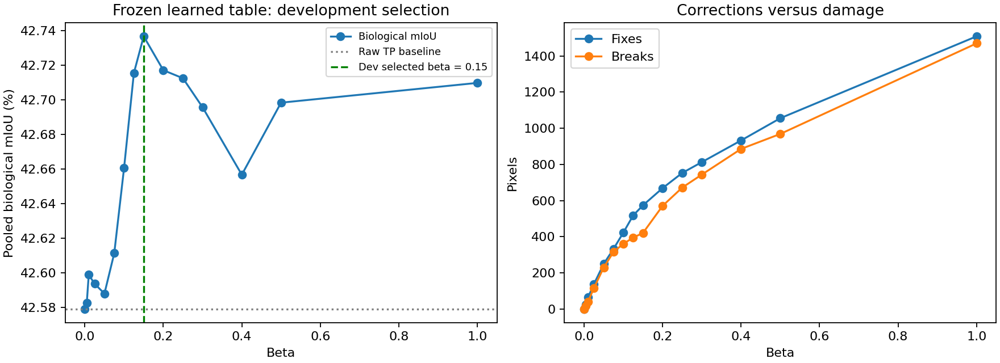
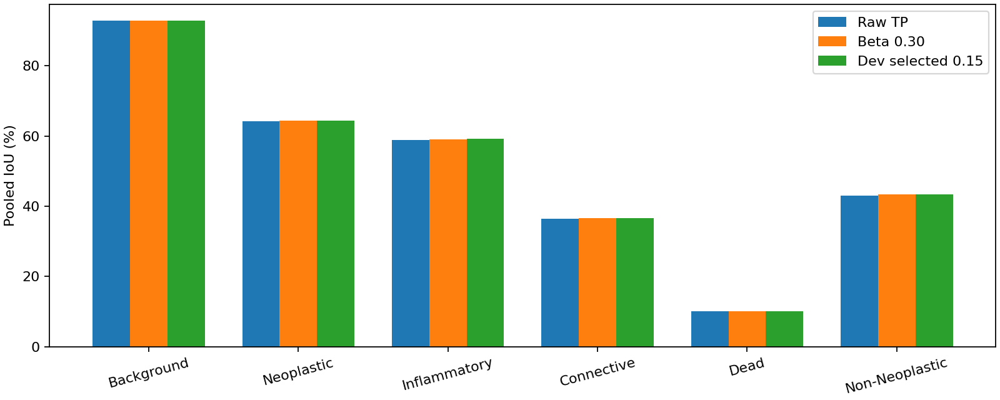
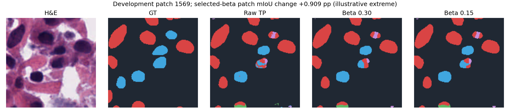
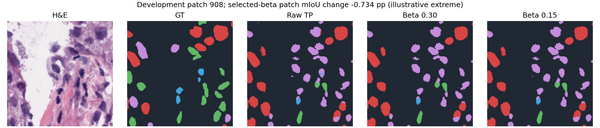

# Frozen learned-table beta sweep — development only

The D5 learned 80/20 data/prior table is unchanged. Twenty development patches are disjoint from its 200 fitting patches, its 20 test patches, and recorded previous selections. Selection used GT coverage and tissue diversity before inference. No final test was run.

Selected beta by pooled fixed-five-class mIoU: **0.15**. This is a development selection result, not evidence of generalization.

| Beta | Bio mIoU % | Six-class mIoU % | Accuracy % | Changed | Fixes | Breaks | Local minima /20 | Solver seconds |
|---:|---:|---:|---:|---:|---:|---:|---:|---:|
| 0 | 42.5791 | 50.9742 | 90.5627 | 0 | 0 | 0 | 20 | 0.422 |
| 0.005 | 42.5826 | 50.9771 | 90.5642 | 59 | 26 | 18 | 20 | 0.520 |
| 0.01 | 42.5988 | 50.9907 | 90.5672 | 133 | 65 | 41 | 20 | 0.424 |
| 0.025 | 42.5936 | 50.9859 | 90.5668 | 312 | 138 | 116 | 20 | 0.459 |
| 0.05 | 42.5880 | 50.9806 | 90.5664 | 586 | 250 | 230 | 20 | 0.515 |
| 0.075 | 42.6113 | 50.9985 | 90.5659 | 797 | 333 | 316 | 20 | 0.536 |
| 0.1 | 42.6605 | 51.0388 | 90.5742 | 949 | 423 | 361 | 20 | 0.572 |
| 0.125 | 42.7153 | 51.0841 | 90.5856 | 1104 | 518 | 395 | 20 | 0.594 |
| 0.15 | 42.7366 | 51.1022 | 90.5912 | 1206 | 574 | 421 | 20 | 0.593 |
| 0.2 | 42.7170 | 51.0835 | 90.5809 | 1490 | 669 | 571 | 20 | 0.689 |
| 0.25 | 42.7124 | 51.0774 | 90.5778 | 1721 | 753 | 672 | 20 | 0.710 |
| 0.3 | 42.6956 | 51.0624 | 90.5756 | 1899 | 813 | 744 | 20 | 0.739 |
| 0.4 | 42.6566 | 51.0280 | 90.5715 | 2223 | 933 | 886 | 20 | 0.733 |
| 0.5 | 42.6982 | 51.0605 | 90.5789 | 2497 | 1056 | 969 | 20 | 0.740 |
| 1 | 42.7097 | 51.0580 | 90.5700 | 3672 | 1509 | 1470 | 20 | 0.884 |

Inference once per patch: 15.929s total; model setup 18.805s. Solver timing includes energy and local-minimum audits. Do not sum inference times repeated across per-beta CSV rows.

## Interpretation and limits

Beta selection changes only the global multiplier. All runs initialize independently from raw TP argmax. Same copied D5 objective, 24 neighbors, eta=1, strict raster ICM, maximum 100 rounds. Beta zero matches argmax exactly. Every saved prediction was independently recounted to verify all reported IoUs, accuracy and change counts. Local minima do not imply global optima.

Development membership is class-enriched, not prevalence-representative. Historical exclusions cover recorded selections, not all possible unrecorded use. Patient/slide separation and HoVer-Net pretraining exposure are unverified. A new untouched evaluation set is needed after selection; do not tune against the earlier 20-patch result.

Local environment uses TIAToolbox 2.0.1 and PyTorch 2.9.1 rather than D5 recorded 2.1.2/2.12.0. Checkpoint SHA256 is identical, channel labels are checked, raw six-channel TP forward is used. Absolute scores also differ because development membership differs.

## Visuals

