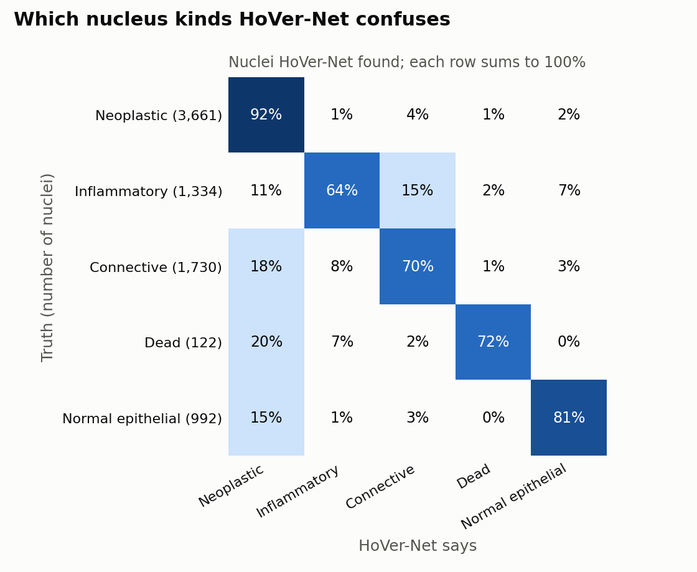
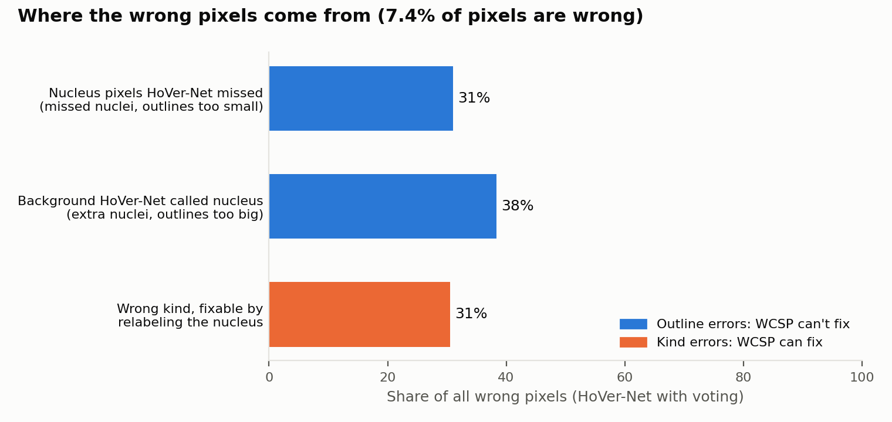
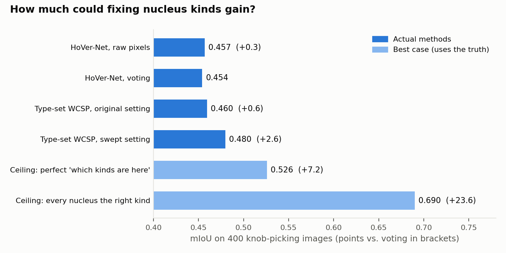
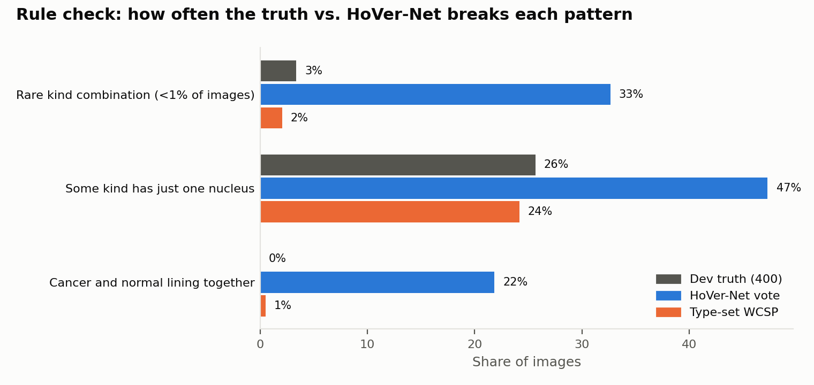
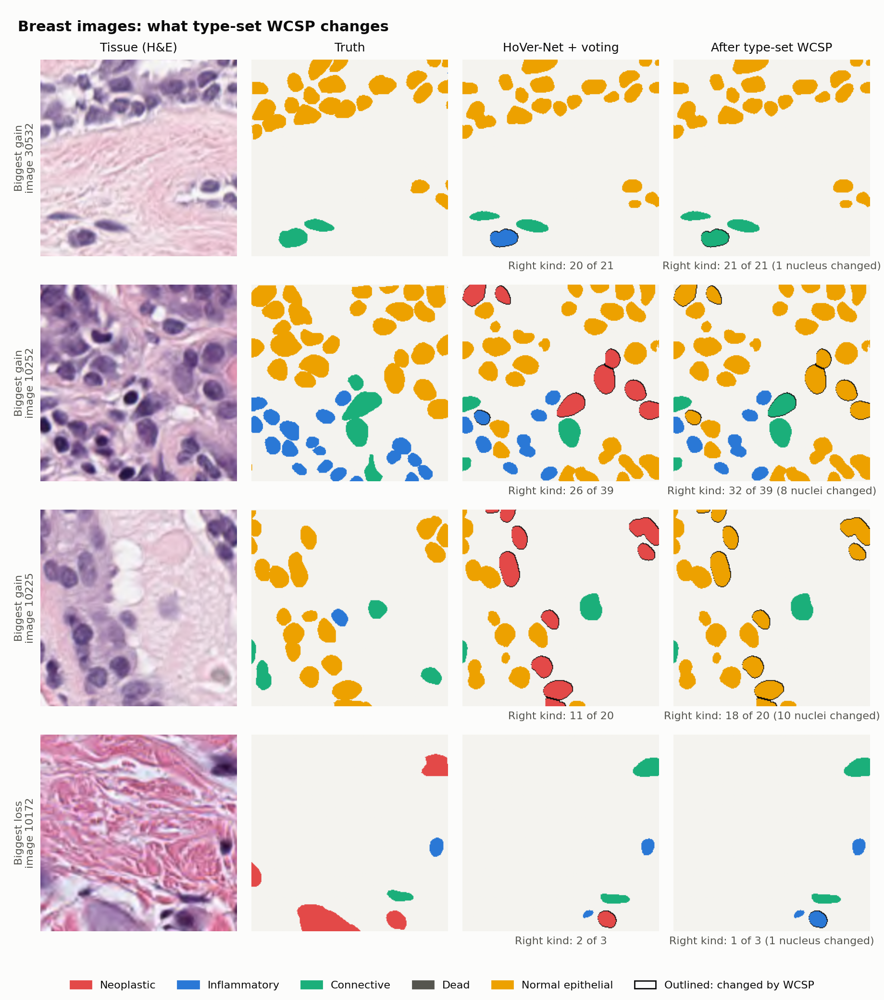

# PanNuke preliminary tests: where HoVer-Net goes wrong

The PanNuke half of Deliverable 7's "preliminary tests", mirroring what BCSS did (`deliverables/deliverable_7.md` §3, `experiments/bcss_wcsp/rules/README.md` §2).

**Data:** the 400 knob-picking images and 4,089 counting images from `type_set_sweep_20261123` (PanNuke folds 1 and 3, every organ except Adrenal). The 600 final-score images are not used. Frozen HoVer-Net; no training. "Type-set WCSP" means the swept setting frozen in that experiment.

## Summary

1. **HoVer-Net's single biggest labeling mistake is putting cancer and normal lining cells in the same image.** It does that in 22% of images; the truth does it in 0.6%. 15% of normal lining nuclei are called cancer.
2. **About 70% of wrong pixels are outline errors** (missed nuclei, extra nuclei, outlines too big or too small). WCSP only relabels nuclei, so it can't touch these. The other 30% are wrong-kind errors, and almost all of those can be fixed by relabeling whole nuclei.
3. **Kind errors still matter far more for the score than their pixel share suggests.** If every nucleus HoVer-Net drew had the right kind, mIoU would go from 0.454 to 0.690 (+23.6 points), because small classes (Dead, Inflammatory) weigh as much as large ones.
4. **A perfect "which kinds are in this image" rule would reach 0.526 (+7.2).** Type-set WCSP gets 0.480 (+2.6 on these images), so it captures about a third of what that kind of rule could ever give.

## 3a. Which kinds get confused



Among the 7,839 nuclei HoVer-Net found (overlap with a true nucleus above 0.5), 80.7% get the right kind with voting and 82.8% after type-set WCSP.

- **Everything drifts toward "Neoplastic" (cancer).** 18% of connective, 20% of dead, 15% of normal lining and 11% of immune nuclei are called cancer.
- **Immune and connective nuclei swap:** 15% of immune nuclei are called connective, and 8% the other way.
- Cancer itself is rarely missed (92% right).

## 3b. Outline errors vs. kind errors



7.4% of pixels are wrong. HoVer-Net found 80% of true nuclei (7,839 of 9,830) and drew 10,188.

| Where wrong pixels come from | Share | Can WCSP fix it? |
|---|---:|---|
| Nucleus pixels HoVer-Net missed (missed nuclei, outlines too small) | 31% | No |
| Background HoVer-Net called nucleus (extra nuclei, outlines too big) | 38% | No |
| Wrong kind on a nucleus HoVer-Net drew | 31% | Yes, by relabeling the nucleus |

Wrong-kind pixels inside merged or split nuclei, which relabeling can't fix, are 0.1%.

This is the PanNuke version of BCSS's grouping-vs-labeling split. BCSS's fix for grouping is a region loss during training; PanNuke's equivalent would be HoVer-Net's own outline training.

## 3c. Ceilings



| Setting | mIoU | vs. voting |
|---|---:|---:|
| HoVer-Net, raw pixels | 0.457 | +0.3 |
| HoVer-Net, voting | 0.454 | — |
| Type-set WCSP, original setting | 0.460 | +0.6 |
| Type-set WCSP, swept setting | 0.480 | +2.6 |
| **Ceiling: perfect "which kinds are here"** (true kind set, then best labeling) | **0.526** | **+7.2** |
| **Ceiling: every nucleus the right kind** (outlines unchanged) | **0.690** | **+23.6** |

Per kind (IoU), voting → type-set WCSP → perfect "which kinds" → every nucleus right:

| Kind | Voting | Type-set WCSP | Perfect kinds-present | Every nucleus right |
|---|---:|---:|---:|---:|
| Neoplastic | 0.652 | 0.667 | 0.705 | 0.763 |
| Inflammatory | 0.454 | 0.454 | 0.498 | 0.791 |
| Connective | 0.429 | 0.438 | 0.474 | 0.687 |
| Dead | 0.210 | 0.249 | 0.286 | 0.478 |
| Normal epithelial | 0.526 | **0.590** | 0.668 | 0.732 |

The remaining gap after "which kinds" is mostly immune vs. connective. Both kinds are usually present in the same image, so an image-level rule can't separate them. That would need a per-nucleus cue (shape, size, texture).

## Rule check: does the truth follow it, and does HoVer-Net?

Same test as BCSS §2: a rule is worth encoding only if the truth follows it and HoVer-Net doesn't.



| Pattern (share of images) | Counting truth (4,089) | Dev truth (400) | HoVer-Net | Type-set WCSP | Encode? |
|---|---:|---:|---:|---:|---|
| Rare kind combination (under 1% of images) | 4.6% | 3.4% | **32.6%** | 2.1% | Yes: the type-set cost |
| Cancer and normal lining together | 0.6% | 0.0% | **21.9%** | 0.5% | Yes: already covered by the type-set cost |
| Some kind has exactly one nucleus | 27.8% | 25.6% | **47.3%** | 24.2% | Already covered |
| Contains Dead | 3.3% | 3.9% | **19.3%** | 2.6% | Already covered |
| Contains Inflammatory | 55.4% | 56.0% | 54.8% | **47.6%** | **WCSP now under-predicts it** |
| Contains Normal epithelial | 20.2% | 16.8% | 30.8% | 14.1% | WCSP slightly under-predicts |
| Kinds per image (average) | 2.15 | 2.17 | 2.64 | 2.11 | |

The type-set cost already fixes every image-level pattern HoVer-Net breaks. It overshoots for immune cells: it removes them from 8% more images than it should, because a few lone immune nuclei look like the "one odd nucleus" it is designed to remove.

Most common kind combinations in the counting truth: cancer + immune + connective (21%), cancer + connective (15%), immune + connective (14%), immune + connective + normal lining (10%), connective only (9%), cancer only (8%).

## Breast examples



Of the 120 Breast images among the 400, type-set WCSP improves 28, worsens 16, and leaves 76 unchanged. The figure shows the three biggest gains and the biggest loss (rule fixed in advance: largest and smallest per-image change). Outlined nuclei are the ones WCSP relabeled.

- **Rows 2 and 3 show the main fix:** HoVer-Net scatters "cancer" nuclei through normal breast lining. WCSP sees that cancer and normal lining almost never appear together and relabels them.
- **Row 2 also shows a mistake:** one real immune nucleus becomes normal lining.
- **The loss (row 4):** HoVer-Net found only 3 of the true nuclei. WCSP turned its one "cancer" nucleus into immune, and it was actually cancer.

## Files

`analyze.py` produces everything: `results.json` (all numbers), `breast_examples.json` (which images and why), and the five figures.

```bash
.venv/bin/python experiments/pannuke_wcsp/prelim_20261123/analyze.py
```

Needs the cache from `type_set_sweep_20261123` (`sweep.py prepare` and `infer`).
