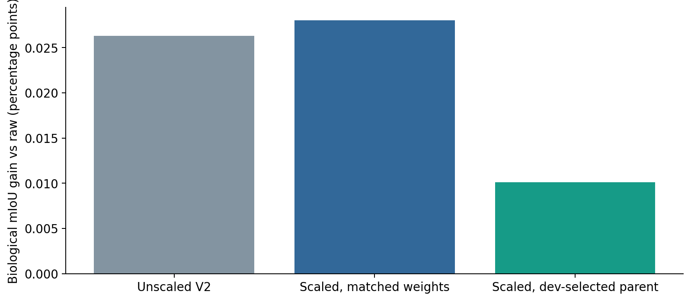
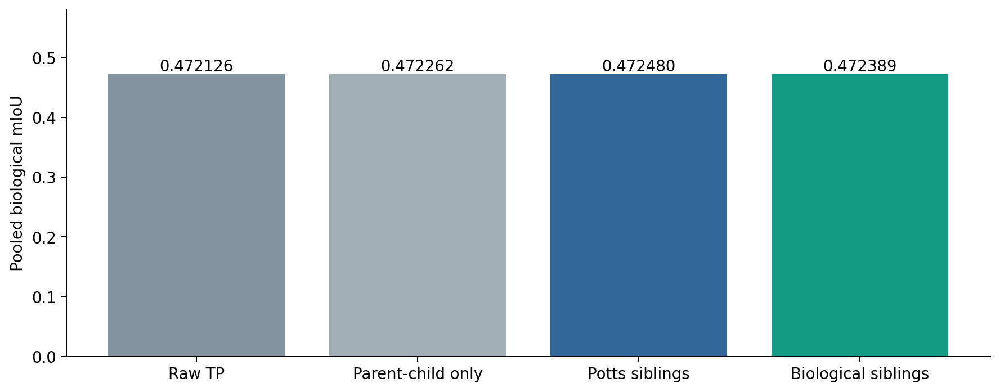
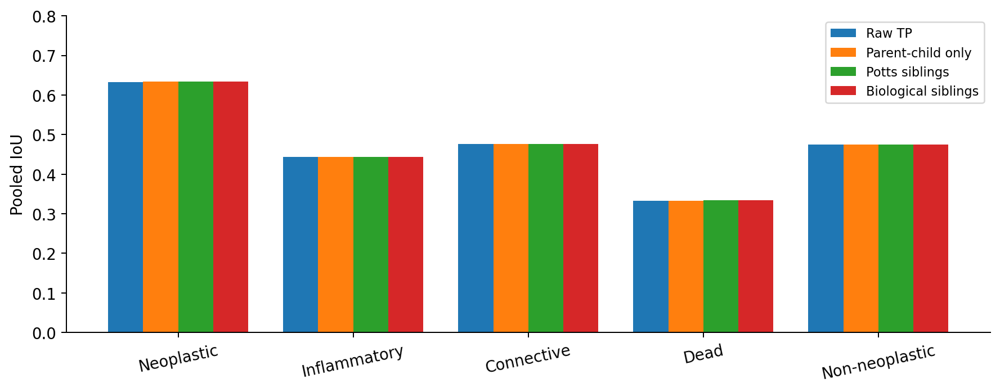
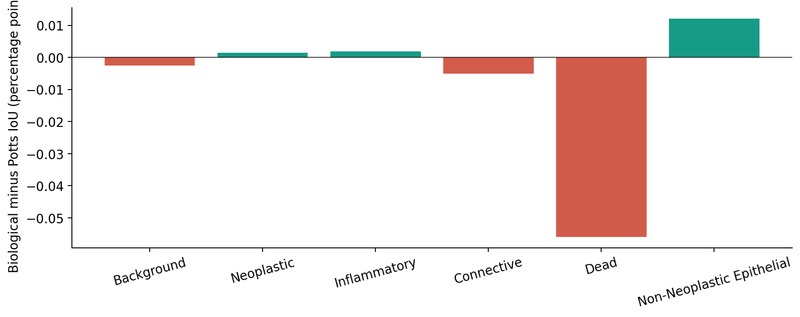
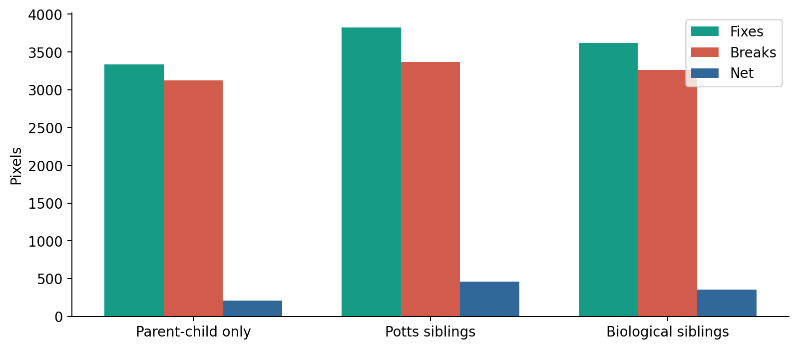
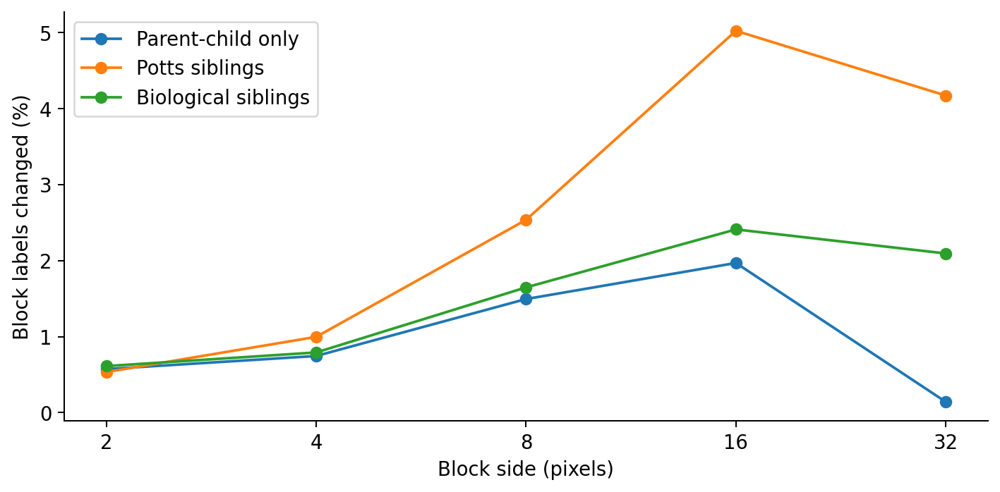
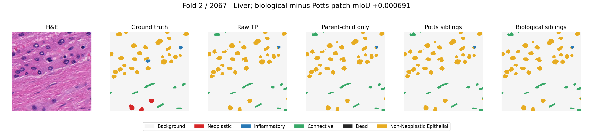
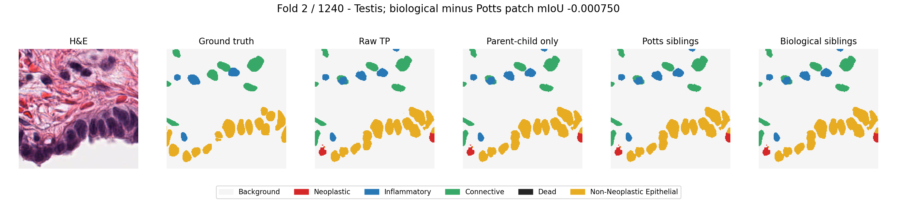
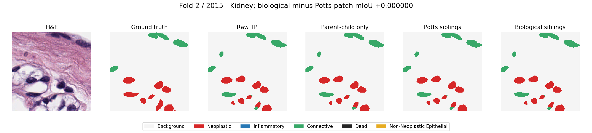

# PanNuke: cost scaling and biological sibling ablation

## Final comparison overview

| Method | Bio mIoU | Δ vs raw (pp) | W/L/T |
|---|---:|---:|---|
| Raw TP | 0.472126 | +0.0000 | - |
| V1: no block fidelity | 0.472389 | +0.0262 | 58/34/8 |
| V2: block fidelity | 0.472389 | +0.0263 | 58/34/8 |
| BCSS scaling: matched | 0.472407 | +0.0280 | 56/36/8 |
| BCSS scaling: dev-selected | 0.472228 | +0.0101 | 55/36/9 |
| Parent-child only | 0.472262 | +0.0136 | 57/35/8 |
| Generic Potts siblings | 0.472480 | +0.0354 | 58/34/8 |

- V1 is the exact biological-sibling reference in the later ablation.
- Seven distinct conditions; do not count the repeated V1 biological reference as an eighth independent model.

## Scope and protocol

- Original block-fidelity V1/V2 experiment is preserved unchanged.
- Scaling runs first; sibling ablation follows on original unscaled V1, with no block unaries. These are separate questions.
- Exact original 100 comparison patches, full 256x256 TP probabilities/GT, six levels, 12 development patches, five-class pooled mIoU and paired 5,000-patch bootstrap.
- Four comparison IDs (908, 2216, 2330, 2354) overlap upstream beta-development data discovered after the original run. Follow-up uses previously inspected data and is exploratory, not a fresh confirmation.
- Reflect padding approximates border context. Patient/slide independence and checkpoint training exposure remain unknown.

## 1. BCSS-style scaling

| Term | Original | Scaled |
|---|---|---|
| Block unary | gamma x -log(mean P) | original x block area |
| Sibling edge | sibling/4 x C_level | original x block side |
| Parent-child mismatch | parent x mismatch | original x child area |

- Six levels, scale-specific tables and four-connected graph stay fixed. This borrows cost scaling, not the complete BCSS pipeline.
- Matched run: sibling=.3, parent=.1, gamma=.3, exactly as old V2; only scale factors change.
- Calibrated run: parent chosen on original 12 development patches from .01/.03/.1/.3/.5; sibling=.3 and gamma=.3 fixed. Selected parent=.01 before comparison.

| Method | Bio mIoU | Delta vs raw (pp) | W/L/T |
|---|---:|---:|---|
| Unscaled V2 | 0.472389 | +0.0263 | 58/34/8 |
| Scaled, matched weights | 0.472407 | +0.0280 | 56/36/8 |
| Scaled, dev-selected parent | 0.472228 | +0.0101 | 55/36/9 |



- Matched scaling minus unscaled V2: +0.0017 pp; 95% CI [-0.0054, +0.0087] pp.
- Calibrated scaling minus unscaled V2: -0.0162 pp; 95% CI [-0.0315, -0.0017] pp.
- Scaling does not establish a benefit on PanNuke: matched difference includes zero; the development-selected variant is worse than unscaled V2 on this comparison set.

## 2. Sibling ablation

- All B/C/D conditions use original V1: parent=.1, sibling=.3, gamma=0, same initialization, solver, stopping and unaries.
- B: all same-level costs zero. C: Potts (0 same / 1 different). D: exact original 80% learned / 20% biological scale-specific tables.
- Potts and biological tables have the same mean off-diagonal cost (1). No per-condition tuning.
- D reproduces original V1 pixel labels exactly on all 100 patches.

| Method | Bio mIoU | Delta vs raw (pp) | Six-class mIoU | Accuracy | Fixes | Breaks | Net | W/L/T |
|---|---:|---:|---:|---:|---:|---:|---:|---|
| Raw TP | 0.472126 | - | 0.551215 | 0.930564 | - | - | - | - |
| Parent-child only | 0.472262 | +0.0136 | 0.551331 | 0.930596 | 3334 | 3125 | 209 | 57/35/8 |
| Potts siblings | 0.472480 | +0.0354 | 0.551515 | 0.930634 | 3827 | 3369 | 458 | 58/34/8 |
| Biological siblings | 0.472389 | +0.0262 | 0.551435 | 0.930618 | 3617 | 3263 | 354 | 58/34/8 |



| Comparison | Delta mIoU | 95% paired CI |
|---|---:|---|
| parent_only minus raw | +0.00013602 | [-0.00004186, +0.00029934] |
| potts minus parent_only | +0.00021781 | [+0.00001996, +0.00036743] |
| biological minus parent_only | +0.00012648 | [-0.00004387, +0.00029811] |
| biological minus potts | -0.00009134 | [-0.00016362, +0.00002173] |

## Per-class IoU

| Class | Raw | Parent-child | Potts | Biological | Bio minus Potts (pp) |
|---|---:|---:|---:|---:|---:|
| Background | 0.946658 | 0.946673 | 0.946692 | 0.946666 | -0.0026 |
| Neoplastic | 0.633264 | 0.633470 | 0.633621 | 0.633635 | +0.0015 |
| Inflammatory | 0.443356 | 0.443398 | 0.443310 | 0.443329 | +0.0018 |
| Connective | 0.475914 | 0.475920 | 0.476023 | 0.475973 | -0.0050 |
| Dead | 0.333224 | 0.333503 | 0.334329 | 0.333770 | -0.0560 |
| Non-Neoplastic Epithelial | 0.474873 | 0.475021 | 0.475117 | 0.475238 | +0.0120 |







## Interpretation

- Parent-child alone has a small positive point estimate, but its paired interval includes zero: hierarchy-alone improvement is not established.
- Potts improves over parent-child alone with a positive paired interval. Generic smoothing contributes in this sample.
- Biological siblings do not outperform Potts: their point estimate is lower, and the direct paired interval includes zero. Do not claim the biological table is useful beyond generic smoothing.
- Biological minus Potts is slightly positive for Neo, Inflammatory and Non-Neoplastic, but negative for Connective and especially Dead. These are descriptive class effects without class-specific uncertainty tests.
- None of the tested models guarantees non-degradation on every patch. Do not choose per-patch baseline fallbacks using evaluation GT.
- This is not proof that biology is useless: it tests the current table, weights, representation and local solver only.

## Boundary, confidence and hierarchy diagnostics

- Near boundary = within two dilation steps of a GT label transition; interior = remaining pixels. Confidence = model top-two probability margin, not calibrated correctness.
- Exact aggregate diagnostics and all level transition matrices are in summary.json; per-patch details are in each condition results.json.
### Parent-child only

- Boundary fixes / breaks: 1850 / 1855. Interior fixes / breaks: 1484 / 1270.
- Mean model margin, fixed / broken / unchanged correct: 0.0234 / 0.0231 / 0.9778.

| Level | Changed labels (%) | Parent disagreement before / after |
|---|---:|---|
| 1 | 0.1159 | 80181 / 72475 |
| 2 | 0.5721 | 38539 / 29122 |
| 3 | 0.7446 | 18201 / 15174 |
| 4 | 1.4941 | 7774 / 6219 |
| 5 | 1.9688 | 2632 / 2119 |
| 6 | 0.1406 | 0 / 0 |

- Full class-transition matrices by level are saved in summary.json.

### Potts siblings

- Boundary fixes / breaks: 2015 / 2055. Interior fixes / breaks: 1812 / 1314.
- Mean model margin, fixed / broken / unchanged correct: 0.0316 / 0.0296 / 0.9778.

| Level | Changed labels (%) | Parent disagreement before / after |
|---|---:|---|
| 1 | 0.1299 | 80181 / 72876 |
| 2 | 0.5328 | 38539 / 31073 |
| 3 | 0.9963 | 18201 / 15684 |
| 4 | 2.5361 | 7774 / 6198 |
| 5 | 5.0234 | 2632 / 1502 |
| 6 | 4.1719 | 0 / 0 |

- Full class-transition matrices by level are saved in summary.json.

### Biological siblings

- Boundary fixes / breaks: 1939 / 1966. Interior fixes / breaks: 1678 / 1297.
- Mean model margin, fixed / broken / unchanged correct: 0.0285 / 0.0273 / 0.9778.

| Level | Changed labels (%) | Parent disagreement before / after |
|---|---:|---|
| 1 | 0.1250 | 80181 / 72615 |
| 2 | 0.6117 | 38539 / 28951 |
| 3 | 0.7913 | 18201 / 15193 |
| 4 | 1.6475 | 7774 / 6220 |
| 5 | 2.4102 | 2632 / 2019 |
| 6 | 2.0938 | 0 / 0 |

- Full class-transition matrices by level are saved in summary.json.




## Paired image examples

### bio helps



### bio hurts



### representative



## Runtime

- Same-level sibling conditions include optimization and independent audits; input inference was reused, not rerun.
- Parent-child only: 6.689 seconds total across 100 patches.
- Potts siblings: 7.034 seconds total across 100 patches.
- Biological siblings: 6.867 seconds total across 100 patches.
## Limits and future questions

- Same sibling multiplier across scales; distinct learned tables share the fixed biological reference prior, which may not mean the same thing at each scale.
- Dead fitting data: two patches; no dominant Dead 32x32 fitting blocks. Sparse coarse-scale relations are smoothed rather than empirically established.
- Simple mismatch parent-child cost; blocks mix nuclei with abundant Background; coarse labels are soft dominant states.
- Local minima do not establish global optima or biological validity. Higher-level label changes alone do not establish causal contribution.
- Next: check whether background-dominant block summaries or class-specific parent-child costs protect rare nuclei; validate any chosen redesign on genuinely new patches. Do not tune on these outcomes.

## Reproduction

```bash
python -m unittest discover -s experiments/pannuke_wcsp/scaling_siblings_20261109 -p "test_*.py" -v
python experiments/pannuke_wcsp/scaling_siblings_20261109/run.py
python experiments/pannuke_wcsp/scaling_siblings_20261109/report.py
```

- Existing outputs refuse overwrite. Inputs reference the preserved hierarchy_20261109/cache. protocol.json and scaling_frozen.json record selection before comparison.
- Tables, per-patch labels, level labels, confusion arrays, CSV/JSON, paired intervals and logs are retained.
- Final Deliverable 6 now summarizes all three experiment groups; detailed history remains in the internal review guide.
