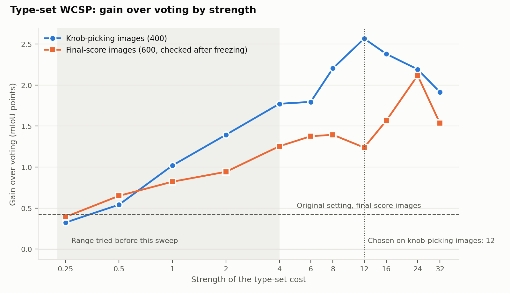

# Type-set WCSP: wider knob sweep on fresh PanNuke images

**Question:** The BCSS group swept more settings of their class-presence rule. PanNuke's version of that rule is the type-set WCSP. Does sweeping its settings more widely beat the original frozen setting?

**Answer:**
- **The best swept setting improves on HoVer-Net voting by +1.24 mIoU points [+0.21, +2.33], Holm p = 0.034.** That's about three times the original setting's gain (+0.43).
- **But we can't yet claim it beats the original setting.** The difference is +0.81 points [−0.16, +1.78], Holm p = 0.10.
- **Nearly all of the gain is in Breast and Colon.** On the 16 other organs, the new setting does no better than voting, while the original setting still helps a little.



## What the type-set cost does, in plain words

1. **Counting, done once.** For each labeled image, note which cell kinds appear in it, such as {cancer, immune, connective}. Count how often each list of kinds appears. Common lists are cheap and rare lists are expensive.
2. **Fixing an image.** HoVer-Net finds the nuclei and says how confident it is about each kind. WCSP tries every possible list of kinds for the whole image, finds the best labeling that uses only that list, and adds the list's cost. It keeps the cheapest option.

This catches a single odd nucleus that doesn't fit the rest of the image. HoVer-Net can't, because it never looks at the whole image at once.

## The knobs swept (1,584 combinations)

| Knob | What it means | Values tried | Original | Chosen |
|---|---|---|---|---|
| Strength | How much the counts outweigh HoVer-Net | 0.25 to 32 (11 values) | 1 | **12** |
| Per-nucleus cost | How HoVer-Net's pixel confidences become one cost per nucleus | vote, mean, log-mean | vote | **mean** |
| Evidence penalty | Also penalize a kind that no nucleus is confident about | off, on | on | **on** |
| Busy/sparse groups | Count separately for images with few vs. many nuclei | none; 4 groups; 8 finer groups | 4 groups | **8 finer groups** |
| Smoothing | How much rare lists are pulled toward the average, so unseen lists aren't impossible | 1, 4, 16, 64 | 16 | **4** |
| Per organ | Count separately for each organ, falling back on the all-organ counts | no, yes | no | **yes** |

## Results on the 600 final-score images (scored once)

| Method | mIoU | Gain over voting [95% range] |
|---|---:|---|
| HoVer-Net raw pixels | 0.4337 | |
| Voting (one label per nucleus) | 0.4326 | |
| Original setting, original counts (200 images) | 0.4369 | +0.43 [+0.20, +0.72] |
| Original setting, recounted on 4,089 images | 0.4371 | +0.45 |
| **Swept winner** | **0.4450** | **+1.24 [+0.21, +2.33]** |

### What each change contributed

- **More counting data alone did nothing.** Original setting with 4,089 images instead of 200: +0.03 points [−0.11, +0.16].
- **The new knobs added +0.79 points** over the recounted original [−0.22, +1.80]. That's suggestive but not established.

### By organ (final-score images)

| Images | Count | Swept winner vs. voting | Original vs. voting |
|---|---:|---|---|
| Breast | 189 | **+1.25 [+0.18, +2.26]** | +0.22 [−0.01, +0.46] |
| Colon | 104 | +2.83 [−0.44, +7.84] | +0.74 [−0.88, +3.11] |
| 16 other organs | 307 | −0.09 [−1.90, +1.65] | **+0.33 [+0.11, +0.65]** |

Per-organ counting pays off where there are many images to count from (Breast and Colon, 1,293 and 797 counting images). For the other organs (65 to 241 counting images each), it adds noise. This matches the per-organ runs from 22 November: Breast tuning worked, Colon and Adrenal didn't.

### By cell kind (swept winner minus voting)

Normal lining (epithelial) +0.029, Dead +0.023, Cancer +0.007, Connective +0.002, Immune +0.001. Without Dead: +0.97 points [+0.14, +1.75].

## Things to know before presenting

- **Knob-picking overestimated the gain.** It showed +2.57 points, and the final score showed +1.24. That's normal when choosing among 1,584 settings, and it's why the final images were kept separate.
- **The strength curve on the final images is bumpy** (see figure). Anything from 4 to 32 beats the original range; past 4, the exact value matters less than the picture suggests. These extra points were checked only after freezing and were not used to choose anything.
- **On most images nothing changes.** 321 of 600 are ties; 151 improve and 128 get worse.
- **PanNuke has no patient or slide IDs**, so counting and final-score images may come from the same slide. That could flatter per-organ counting in particular.
- **It's unknown whether HoVer-Net was trained on folds 1 and 3.** Gains are measured on the same HoVer-Net output, so the comparison stays fair even if raw scores are inflated.

## Files

| File | Contents |
|---|---|
| `protocol.json` | Knobs, selection rule and the two primary comparisons, written before any scoring |
| `split.json` | 4,089 counting / 400 knob-picking / 600 final-score images |
| `development.json` | Knob-picking score of all 1,584 settings |
| `frozen.json` | The chosen setting, written before the final score |
| `evaluation.json` | All final-score comparisons, by organ, by cell kind, strength curve |
| `confusions.npz`, `per_patch.csv` | Per-image results |
| `inference_scored.json` | HoVer-Net checkpoint and code hashes |
| `strength_curve.png` | The figure above |
| `DECISIONS.md` | Every choice and why |

## Reproduce

```bash
.venv/bin/python experiments/pannuke_wcsp/type_set_sweep_20261123/sweep.py prepare
.venv/bin/python experiments/pannuke_wcsp/type_set_sweep_20261123/sweep.py infer   # about 55 min on CPU
.venv/bin/python experiments/pannuke_wcsp/type_set_sweep_20261123/sweep.py dev     # about 15 s
.venv/bin/python experiments/pannuke_wcsp/type_set_sweep_20261123/sweep.py test
.venv/bin/python experiments/pannuke_wcsp/type_set_sweep_20261123/make_figure.py
```

Needs `fold_1.zip`, `fold_2.zip` and `fold_3.zip` in `benchmarks/pannuke/data/` and the HoVer-Net weights in `benchmarks/pannuke/data/cache/models/`. `dev` refuses to rerun once `frozen.json` exists; `test` refuses once `evaluation.json` exists.
